<h1 align="center">Flowmate</h1>

<p align="center">
  <strong>基于 Pi SDK 的本地优先 Agent 桌面工作台</strong>
</p>

<p align="center">
  <code>TypeScript 5.8</code> · <code>Bun 1.4.4</code> · <code>Electron 44</code> · <code>Pi SDK 1.4.0</code>
</p>

<p align="center">
  <a href="#highlights">研究与工程亮点</a> ·
  <a href="#personal-agent">Personal Agent</a> ·
  <a href="#deep-research">Deep Research</a> ·
  <a href="#runtime">工具 Runtime</a> ·
  <a href="#architecture">架构与职责</a> ·
  <a href="#quick-start">快速开始</a> ·
  <a href="#development">测试与评测</a> ·
  <a href="#capabilities">当前能力</a>
</p>

**Personal Agent** 持续整理一组发票；**Deep Research** 从本地资料建立可复核的证据链。桌面同时提供资料问答与单票复核。

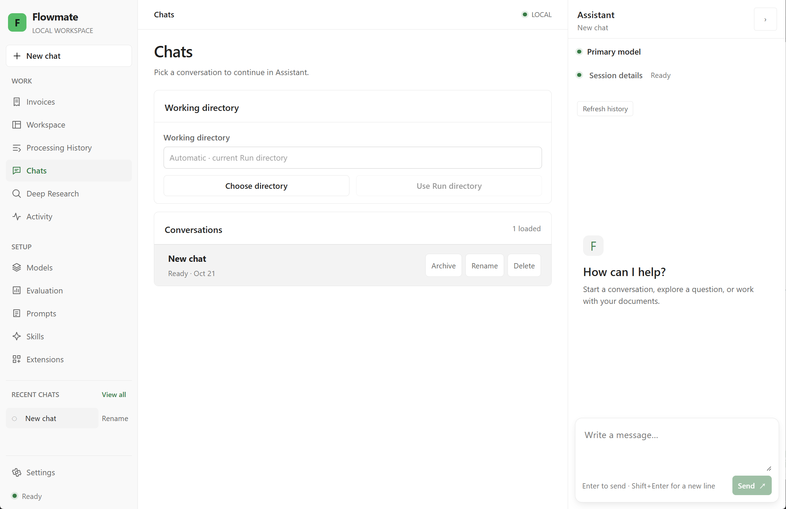

<a id="highlights"></a>

## ✨ 研究与工程亮点

| 能力 | Flowmate 的自定义实现与作用 |
|---|---|
| **Personal Agent 持续事项助手** | 基于 Pi Durable 保存固定票组、逐票 Todo、候选与处置，按原配置、授权和预算继续执行。 |
| **结构化 Deep Research** | 将确认计划拆为可追踪步骤，用工具回执与来源快照记录进度，继续时复用成功证据。 |
| **Skill Hub 技能管理** | 检查技能依赖，显式启用并固定运行版本；模型先读索引，再按需读取正文。 |
| **Master + Subagent 协作** | 两套 Runtime 分别接入受限委派，管理并行准入、共享预算、独立历史与停止确认，分别记录结果保存、回送和是否进入父模型请求。 |
| **预算感知的工具 Runtime** | 让模型看到剩余调用数、时间和可用工具时限，并由执行器落实约束。 |
| **可核验的工具执行** | 执行前核对参数和权限，执行后核验输出、停止及写入回执；符合条件的工具采用有上限的 P95 时限。 |
| **Context / Memory 分层** | 分离请求上下文、原生历史和任务进度；支持可插拔式长期记忆，OpenViking 后端可按需启用。 |
| **独立 Agent 评测闭环** | 从运行证据建立数据集、评分、实验对照和回归；Personal Agent 另有独立的受控场景验证。 |

<a id="personal-agent"></a>

## 🤖 Personal Agent：基于 Pi Durable 的持续事项助手

固定一组已解析发票和原配置，逐票保存 Todo、补料、候选与处置。某票等待材料或复核时，其他符合条件的票可继续；每张票明确接受、拒绝或排除，且执行与写入均收口后，事项才完成。


### 持续事项流程

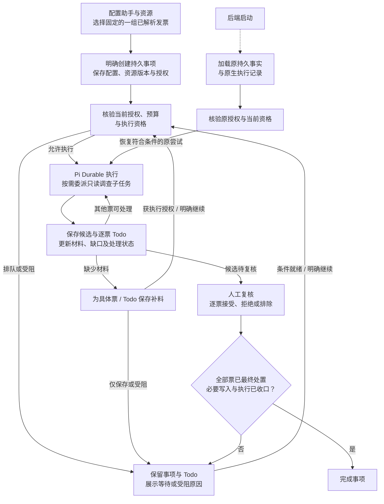

用户停止或执行失败后，补料先保存，由用户明确继续。后端启动仅恢复符合原授权与预算的执行；查看历史、重连和查询原回执均保持只读。停止当前执行和取消事项分别处理。

### 核心设计与使用边界

- **观测与协作。** 在 **Tasks / Timeline** 沿事项、发票和执行阶段追溯工具回执、模型观测与候选反馈，本地观测只保存有限的耗时和状态摘要。Master 委派只读取证，子结果保存、回送与父请求接收分别可查；最多同时保有四个子执行，共享预算，停止未确认仍占名额，禁止嵌套。独立复核由用户确认共享字段和证据后启动，建议绑定原候选版本。
- **审批与操作。** 选材和选窗限定范围；网页读取、桌面点击或输入逐次批准，发票处置单独确认。符合条件的阶段可保留原 Task 等待决定，其他合格发票可按序推进。WebBridge 仅在用户绑定的同源标签页读取，返回地址去掉查询参数和片段，正文作为不可信工具数据；KimiCU 在同一 Windows 用户桌面串行观察和输入，派发前复核控件，遇可识别的凭证字段即拦截。两种模式在同一新事项中互斥，结果未知时先查原回执。
- **连续性与云端执行。** 按票保存原生会话，Durable 压缩沿用原阶段的授权、模型和预算，原历史与回执保持可查。云端由受限 SSH Bridge 转发，Authority 核验权限、保存业务事实，Runtime 执行持久任务；设备操作仍在本机。云服务运行且原授权与预算有效时，合格事项可在桌面断线后继续，重连读取原事项与保存的回执。云端实时进度与本地持久模型观测分别呈现。

<a id="deep-research"></a>

## 🔬 Deep Research：从研究问题到可追溯的证据链

用授权的本地文本、Markdown 或已登记解析资料回答研究问题，保留来源、结论与缺口。


### 研究流程

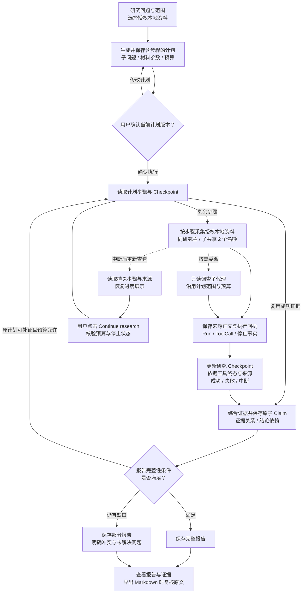

1. **确认计划。** 保存子问题、带材料参数的步骤和预算，确认具体版本后执行。原范围内修改需重新确认；更换授权资料需新建研究任务。
2. **受控采集。** 复用现有读取工具，主 Agent 与可选只读调查子代理共享 **2** 路采集及根预算，排队可取消。成功由工具成功终态、停止确认和来源快照共同支撑。中断后查看进度，再用 **Continue research** 复用成功来源、处理剩余步骤；停止未确认时继续受阻。
3. **证据交付。** Claim 关联子问题、依赖结论及支持或反驳它的原文。问题均有覆盖、结论获证据支持且无未解决项时保存完整报告，否则以部分报告保留冲突和缺口。导出 Markdown 时复核来源与原文片段；语义质量由独立评测判断。

旧计划仍可读取，重新确认含步骤的计划后使用新工作流。当前研究不联网搜索或抓取网页。

<a id="runtime"></a>

## ⚙️ Agent Harness 与工具 Runtime

Pi 提供 Agent Loop 和工具协议；Flowmate 负责授权、预算、执行记录与业务回执。

### 预算感知：让模型看到实际剩余资源

每次模型请求获得剩余调用数、时间、工具时限与近期诊断。执行器据当前预算拦截越界调用。

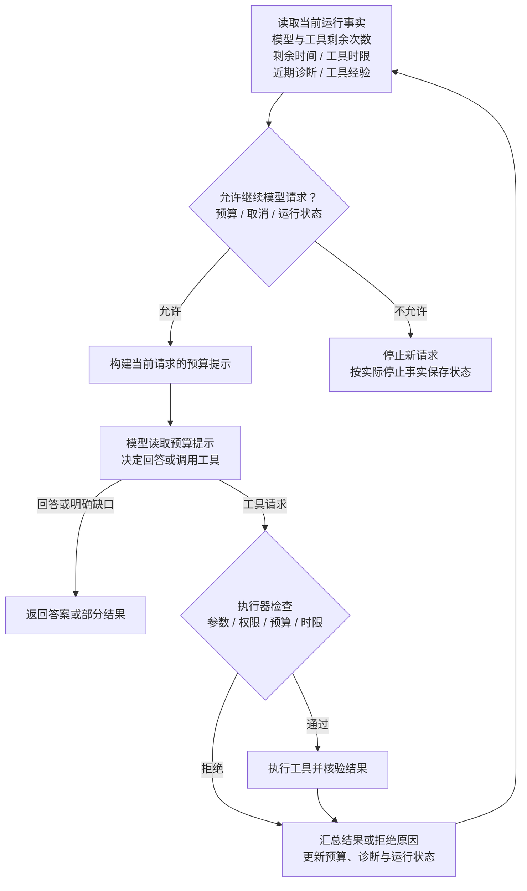

### 执行检查与自定义 P95 超时策略

AgentSession 受理输入时记录资料范围，调用前核对参数、工具权限与预算，调用后核验输出、停止及写入回执。研究执行须确认计划版本，发票结果由用户明确接受。

仅对符合条件的自定义 `PURE` / `READ` 工具，以成功、停止已确认且计时完整的样本计算 P95。配置与 Run 剩余时间仍限制时限；样本不足、近期异常或读取失败时回退到配置值。

### 诊断反馈与停止确认

参数错误与执行缺口反馈给 Agent。停止或写入结果未确认时保留阻断，恢复后先核对原回执。AgentSession 支持 Pi 自动压缩及空闲根会话手动压缩，保留原历史；从历史位置继续或分支后，明确提交新输入才开始执行。

### Skill Hub：依赖可见与按需读取

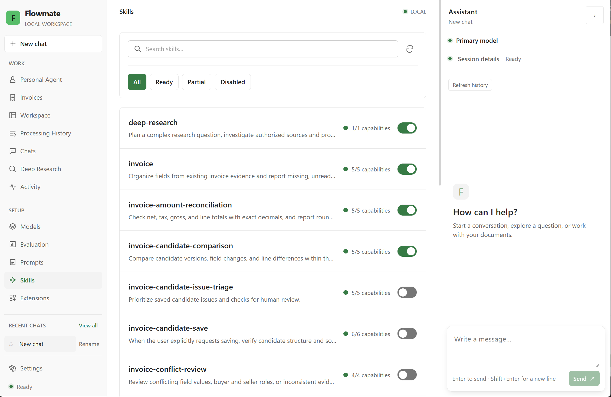

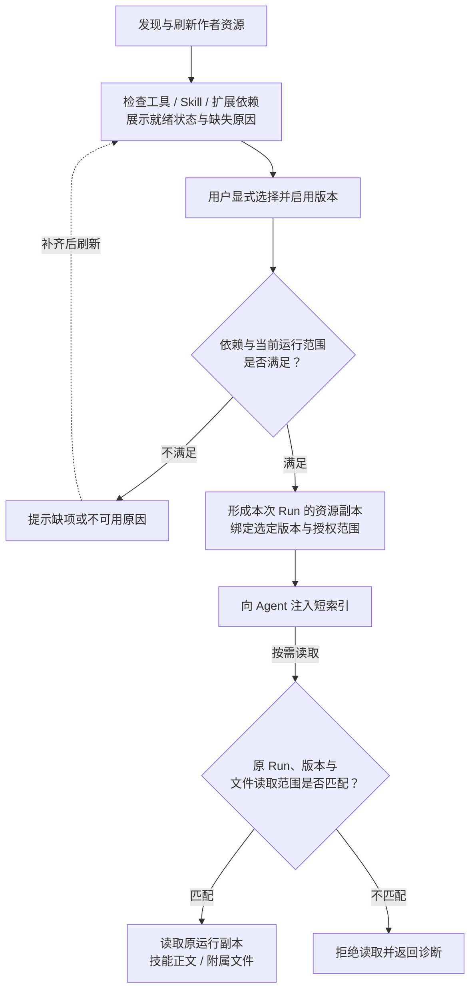

Flowmate 检查工具、Skill 和扩展依赖，展示缺项与启用状态。每次 Run 保留选定资源版本和授权依据，先提供短索引，再按需读取正文；后续更新只用于新运行。

### Master + Subagent：受控任务委派

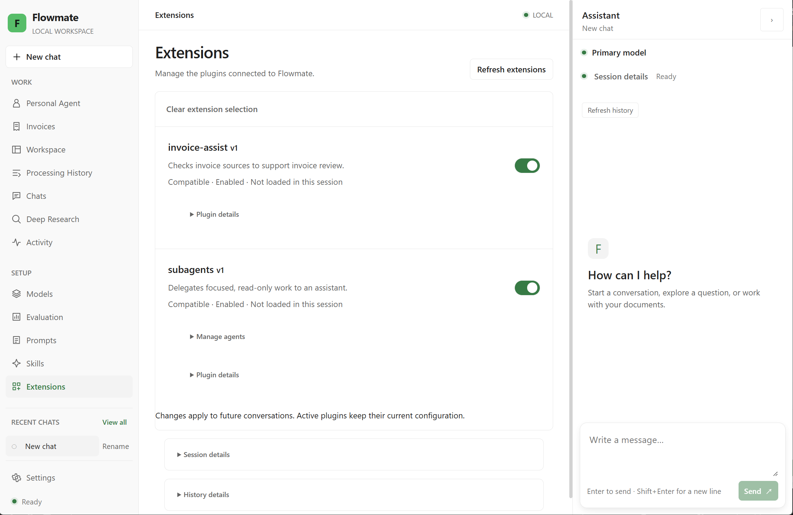

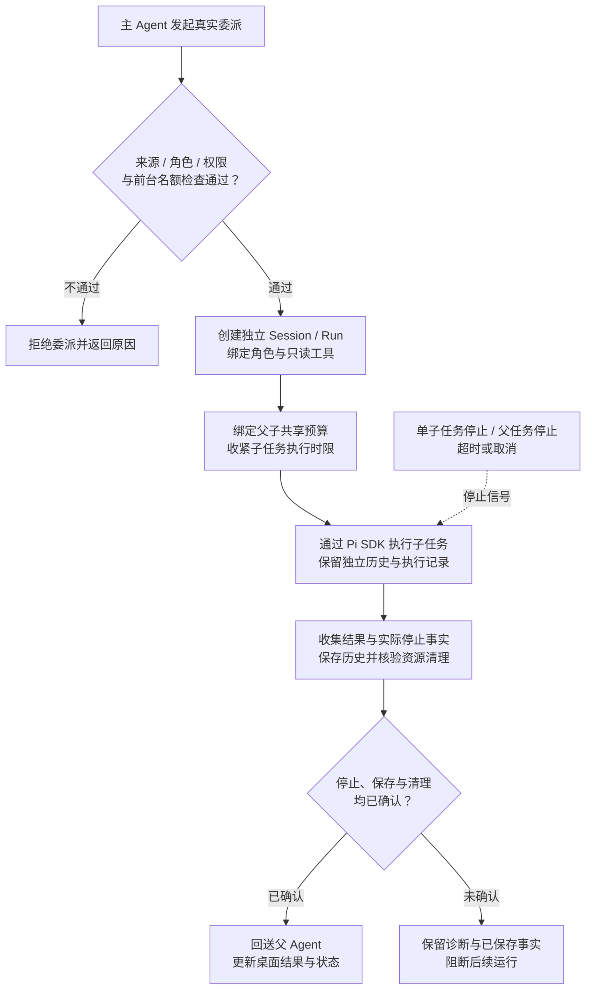

图示为 AgentSession：在 **Extensions → subagents → Manage agents** 启用并管理角色。Flowmate 核验父调用与角色，创建独立子会话和 Run，限定只读工具及共享预算。最多四个前台子执行，限单层委派；可单独停止，也随父任务停止。Deep Research 的调查角色沿用确认计划的资料范围。

Durable 委派使用独立适配，两条路径均可查看子结果、保存历史、停止事实，以及结果是否进入父模型请求。查看记录不重放原执行。

<a id="architecture"></a>

## 🧠 架构与职责边界

### 技术栈与调用方向

| 层级 | 技术与职责 |
|---|---|
| 语言与契约 | TypeScript strict、Zod |
| 桌面界面 | Electron、React、Vite |
| 应用与存储 | Bun 1.4.4、SQLite |
| 会话执行 | Pi SDK 1.4.0、`runtime-pi`：Chats / Invoices / Deep Research |
| 持久执行 | Pi Durable 1.4.0、`runtime-durable`：Personal Agent |
| 子代理驱动 | Flowmate 管理角色、子执行与共享预算 |
| 验证与评测 | Bun Test、Playwright、独立 Judge、Langfuse |

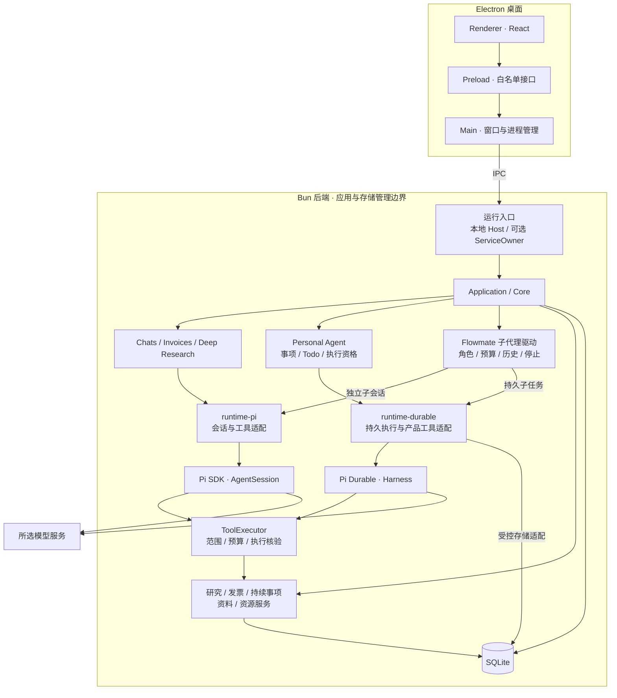

图示为本地后端。默认由 Host 管理数据根，显式服务模式由 ServiceOwner 承载；关闭桌面后持续执行、服务重启及开机恢复仍待 Windows 系统验收。选择工作目录只确定执行位置，不提供沙箱。

### Context / Memory：分层状态与研究恢复

| 层次 | 职责与生命周期 |
|---|---|
| **Workspace Context** | 接收输入时保存焦点、选区与授权资料快照；切页不改变已受理任务。 |
| **Conversation** | 保存原生消息、工具结果与历史摘要。 |
| **Runtime Session** | 进程内管理 Agent、取消及并发，重启后依据保存事实重建。 |
| **Research Preferences** | 用户显式保存，研究 Run 捕获当次版本。 |
| **Task Checkpoint** | 从确认计划、工具终态与来源快照恢复研究进度。 |

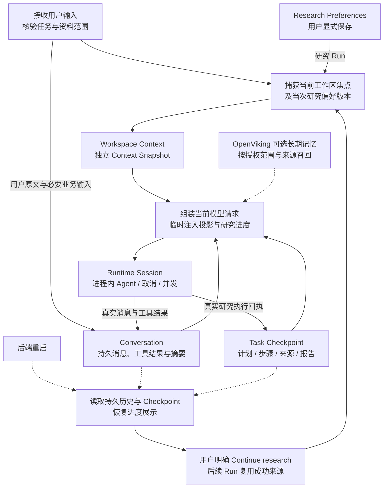

页面投影仅用于当前模型请求，原生历史与压缩输入保持独立；用户提交的业务输入仍保存。Personal Agent 使用独立的 Durable 阶段上下文。

**OpenViking 是可选长期记忆，默认使用 Native。** 在 **Settings → Connections → Long-term memory** 配置新会话或事项的后端，已有记录沿用原绑定。本机和云端的服务、身份及数据分开；有授权和可验证来源的语义召回只作为当次请求的参考。

记忆可显式保存、搜索和遗忘，结果未知时查询原回执；遗忘阻止后续召回，已保存历史照常保留。AgentSession 的合格聊天可另行启用自动采集，识别到凭证标记时跳过相应自动外发；发票事项使用显式保存。

### 原生能力、适配与自定义产品实现

| 模块 | 底层基础能力 | Flowmate 的适配与产品实现 |
|---|---|---|
| **运行与取消** | AgentSession 循环与事件；Durable 持久任务 | 准入、预算、终态与停止确认 |
| **Personal Agent** | Durable 任务图、原生记录与恢复 | 固定票组、逐票推进、授权与结项 |
| **工具** | Pi 工具协议与执行机制 | 范围、时限、输出及副作用核验 |
| **会话与历史** | 两类原生记录 | 关联运行、事项与执行阶段，按保存事实恢复 |
| **上下文** | Pi 消息与压缩、Durable 阶段上下文 | 请求投影、偏好、记忆授权和研究 Checkpoint |
| **Skill Hub** | Pi 资源与加载机制 | 依赖检查、版本保存和按需读取 |
| **Subagent 驱动** | AgentSession 子会话、Durable 子任务 | 角色、预算、独立历史及回执核验 |
| **研究与业务交付** | 通用模型和工具 | 持久研究步骤、证据报告、发票复核及导出 |

<a id="quick-start"></a>

## 🚀 快速开始

### 1. 准备环境

使用 **Windows x64、Bun 1.4.4、Node.js 24**，并准备可访问的模型服务与 API Key。

### 2. 安装并启动

在仓库根目录执行：

```powershell
bun install --frozen-lockfile
bun run dev
```

Renderer 支持热更新，Main / Preload 改动后重建。开发结束时按 **Ctrl+C**，等待关闭完成。

### 3. 配置模型并发起第一次对话

1. 在 **Models** 或 **Settings → LLM** 选择模型并保存 API Key。**Custom model** 还需 Base URL、Pi API 类型及模型能力。
2. 点击 **Test connection**，再用 **New chat → Send** 对话；需要时用 **Stop**，从 **Chats** 重开历史。

桌面凭据由系统加密保存。测试连接、对话、规划及获准的事项执行可能请求模型并产生费用。

### 4. 体验 Personal Agent

1. 在 **Personal Agent** 选择 **Local workspace** 并配置已保存模型，或连接已部署的云工作区：填写工作区 UUID、SSH 主机、受限用户、私钥与已验证的 known_hosts。进入云工作区时尝试重连并启动或复用已配置的本机桥。
2. 在 **New invoice work** 固定票组与目标并提交；在逐票 Todo 补料或明确继续，沿复核入口处理候选，用 **Attach confirmed acceptance** 关联接受回执。

**可选：由本地 Personal Agent 填写发票表单。** 为新事项启用 `personal_observe_invoice_form` 与 `personal_fill_invoice_form`，在原票 **Results → Prepare form for Personal Agent** 准备表单，回事项补充要求并继续。核对草稿后由用户接受；连接或目标变化后重新准备，此入口不依赖 KimiCU。

**可选：读取网页。** 安装本机 WebBridge 与 Chrome 扩展，为新事项启用 **Browser page reading**。在对应发票用 **Open dedicated tab** 绑定页面，再按提示批准单次读取。

**可选：操作外部 Windows 窗口。** 独立安装 KimiCU，确保 PATH 中 Node.js ≥ 24.15.0。通过 `%APPDATA%\Flowmate\data\kimi-cu.json` 指定本机绝对路径：

```json
{"version":1,"pluginRoot":"D:\\KimiCU\\plugin","runtimeExecutable":"D:\\KimiCU\\runtime\\kimi-cu.exe"}
```

也可同时设置下列变量，优先于配置文件：

```powershell
$env:FLOWMATE_KIMICU_PLUGIN_ROOT = 'D:\KimiCU\plugin'
$env:KIMI_CU_WINDOWS_EXE = 'D:\KimiCU\runtime\kimi-cu.exe'
bun run dev
```

桌面工具默认关闭。为新事项启用 `desktop_list_windows`、`desktop_observe_window`、`desktop_propose_action`、`desktop_execute_approved`；在对应发票点击 **Find desktop windows**，选窗后逐次批准动作。云端桌面操作要求 Authority、Runtime 和 SSH Bridge 配套版本。

当前支持文本可读控件；真实输入可能激活窗口、覆盖剪贴板，观察内容可能进入历史或模型请求。涉及资金、账户和发布的操作应由用户完成。插件与运行时单独安装，厂商支持及各外部应用兼容性需分别核验。

### 5. 体验 Deep Research

在 **Deep Research** 选本地资料并创建任务，使用 Assistant 生成并确认计划。在 **Research steps** 看进度，**Continue research** 手动继续，在 **Evidence / Report** 复核并另存 Markdown。可在 **Settings → General → Research preferences** 保存偏好；调查子代理需启用 subagents 扩展。

### 6. 体验单票复核

将原件与外部解析材料登记到 **Invoices**（开发导入目录：`data/invoices/agent-input/`）。查看 **Original / Parsed / Results**，用 **Process this invoice → Send** 生成候选。

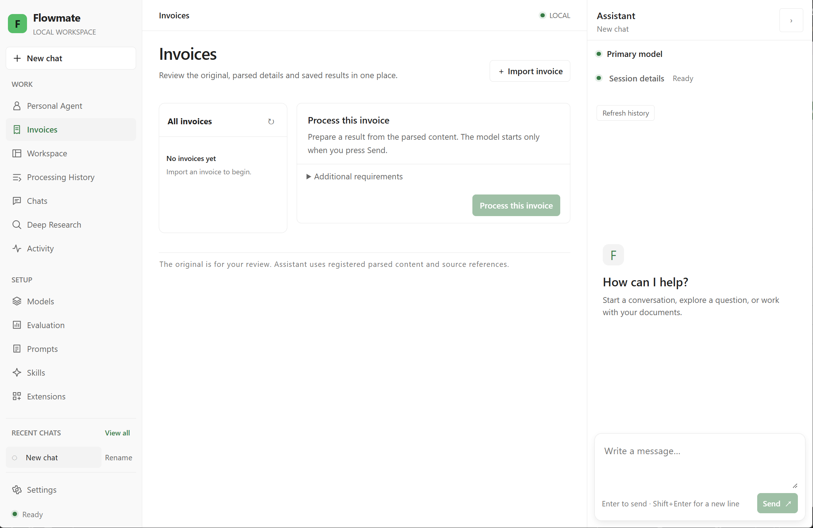

选择 **Fill with Agent** 或 **Edit**，保存后明确 **Accept result**，再导出 JSON、CSV 或 Markdown。撤回资料权限后，受影响会话不能继续请求模型；未保存的编辑仅在当前窗口保留。

<a id="development"></a>

## 🧪 开发、测试与 Agent 评测

### 常用命令

| 用途 | 在仓库根目录执行 |
|---|---|
| 桌面开发 | `bun run dev` |
| 类型检查 | `bun --no-env-file run typecheck` |
| 单元测试 | `bun --no-env-file run test:unit` |
| 集成测试 | `bun --no-env-file run test:integration` |
| Electron E2E | `bun --no-env-file run test:e2e` |
| 完整工程验证 | `bun --no-env-file run test` |
| 桌面构建 | `bun --no-env-file run build:desktop` |
| Windows x64 目录包 | `bun --no-env-file run package:dir` |
| Windows x64 NSIS 安装包 | `bun --no-env-file run package:win` |

工程测试使用受控 Provider；打包需要 Windows x64 与 Bun 1.4.4，实际安装、升级与恢复单独验证。

### 项目结构

```text
apps/       桌面、Host 与云端入口
packages/   契约、业务、存储及两套 Runtime
resources/  Skills、Prompts、模板、角色与扩展
agent-eval/ 隔离执行、评分、回归与报告
tests/      工程测试与合成夹具
scripts/    开发、测试与打包
```

### 独立 Agent 评测闭环

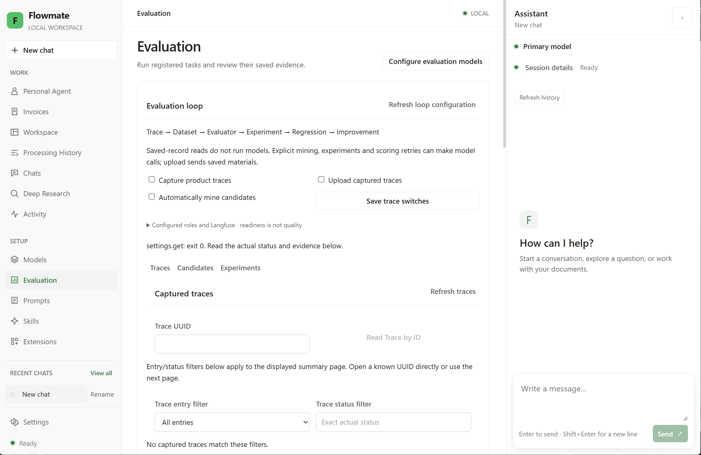

**Trace → Dataset → Evaluator → Experiment → Regression → Improvement。**

试验隔离保存执行、业务交付与评分。从轨迹和回执整理候选，经校验、必要重放及人工批准进入版本化数据集。确定性检查与语义 Judge 使用独立 Gold 评分，覆盖 Skill 正反例和 Deep Research 证据链；Gold 仅供评分。补评分只调用适用的 Judge，保留原执行与原分数。Baseline / Gate 衡量可比实验的相对回归，绝对质量结合任务结果与证据判断。

**Smoke / Full 主基准。** 在 `agent-eval/configs/.env` 配置 Agent、Judge 与 Langfuse 后先预检。基准调用真实模型并上传、回读评测材料，可能产生费用。桌面产品轨迹采集、上传与自动挖掘默认关闭，分别启用。

```powershell
bun --no-env-file run eval -- doctor --backend local
bun --no-env-file run eval:smoke
bun --no-env-file run eval:full
```

**Personal Agent 场景评测。** `bun --no-env-file run eval:personal` 使用隔离数据与模拟 Provider，报告保存在本地；加 `--suite full` 覆盖审批、恢复、子任务及业务回执。真实模型质量单独评估。

<a id="capabilities"></a>

## 📍 当前能力与使用边界

| 方面 | 当前能力与边界 |
|---|---|
| **Personal Agent** | 基于 Pi Durable 持续整理固定票组，保留逐票 Todo、补料、候选、原配置与人工最终处置；按已保存授权恢复合格原尝试。 |
| **研究** | 支持本地资料规划与确认、受控并行采集、持久步骤及手动继续，复用成功证据并保存 Claim 与完整或部分报告；可选只读子任务。尚未接入联网搜索和网页抓取。 |
| **日常任务** | Chats、Invoices、Deep Research 使用 AgentSession，支持资料问答、持久会话和当前平台可用的 Pi 原生工具；工作目录选择不构成沙箱。 |
| **发票** | 支持已有解析材料上的候选、字段核算、人工复核、接受与导出；不在 Host 中执行原票解析。 |
| **验证** | 已有工程测试，以及轨迹、候选、数据集、评分、实验和回归入口。机制覆盖、真实模型质量、相对 Gate 与平台回读分别判断，不由功能存在推导质量达标。 |
| **发行** | 当前主要目标为 Windows x64；完整安装、升级、恢复验收及其他操作系统兼容性仍需实际验证。 |
| **数据** | 本地模式默认数据根为 `%APPDATA%\Flowmate`，SQLite 位于 `data\app.sqlite`；云端事项使用明确提交的资料与资源。外部模型和可选 OpenViking 按各自授权接收内容。 |
