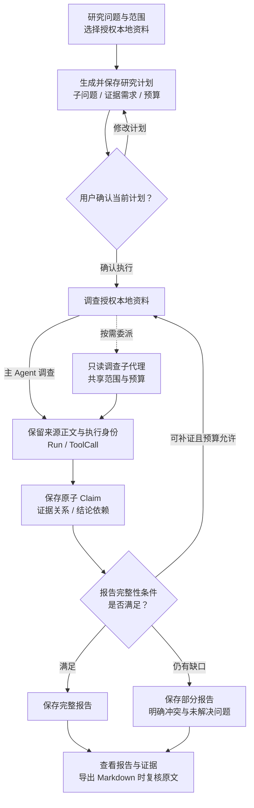
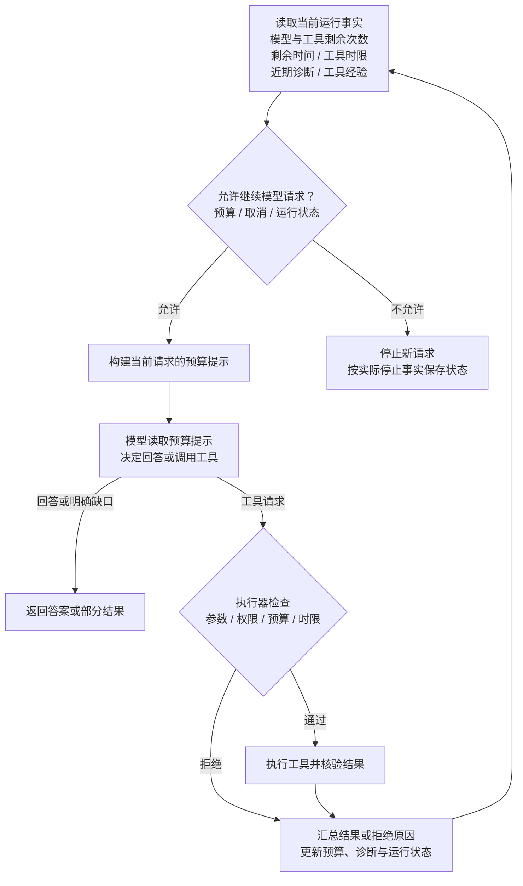
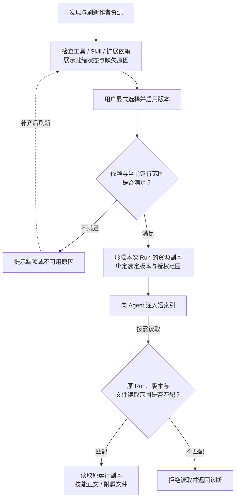
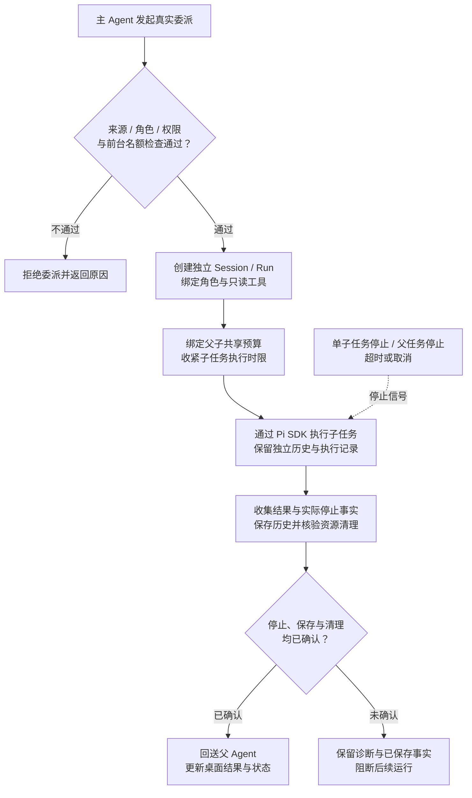
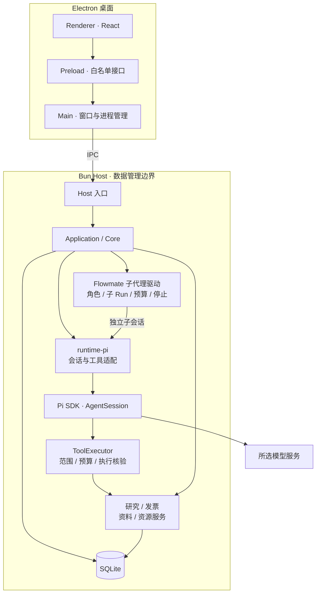

<h1 align="center">Flowmate</h1>

<p align="center">
  <strong>基于 Pi SDK 的本地优先 Agent 桌面工作台</strong>
</p>

<p align="center">
  从研究计划到可追溯的结论与证据链，以预算感知的工具 Runtime 和独立评测支撑 Agent 工作流程。
</p>

<p align="center">
  <code>TypeScript 5.8</code> · <code>Bun 1.4</code> · <code>Electron 44</code> · <code>Pi SDK 0.85.1</code>
</p>

<p align="center">
  <a href="#highlights">研究与工程亮点</a> ·
  <a href="#deep-research">Deep Research</a> ·
  <a href="#runtime">工具 Runtime</a> ·
  <a href="#architecture">架构与职责</a> ·
  <a href="#quick-start">快速开始</a> ·
  <a href="#development">测试与评测</a> ·
  <a href="#capabilities">当前能力</a>
</p>

Flowmate 面向需要处理本地资料、保留工作过程并复核交付结果的任务。**Deep Research** 将问题组织为研究计划、子问题、Claim 与证据链；**资料问答**支持连续对话和工具使用；**发票处理**提供候选生成、人工复核、接受与导出。三条路径可独立使用。


*桌面工作台：左侧切换任务与资源，中央管理会话和工作目录，右侧使用 Assistant。*

<a id="highlights"></a>

## ✨ 研究与工程亮点

围绕本地研究与实际交付，Flowmate 在 Pi 提供的 Agent 基础上实现运行约束、证据模型与产品流程。以下重点展示适配层和产品层的自定义能力。

| 能力 | Flowmate 的自定义实现与作用 |
|---|---|
| **结构化 Deep Research** | 将研究拆为维度与子问题，用原子结论及依赖组织答案；保存来源正文与证据位置，逐项呈现覆盖、冲突和缺口。 |
| **Skill Hub 技能管理** | 串联技能发现、依赖检查、显式启用、版本化运行副本和按需读取，让用户与 Agent 明确技能是否可用、缺少什么，以及本次执行使用的资源。 |
| **Subagent 自定义子代理驱动** | 将真实委派接入产品 Runtime，为子任务创建独立 Session / Run，按角色收紧工具范围，统一管理父子共享预算、并行准入、停止确认、结果保存与回送。 |
| **预算感知的工具 Runtime** | 每次模型请求提供剩余调用数、时间、工具时限和近期诊断；执行器同时落实预算与范围限制，让模型决策与实际约束保持一致。 |
| **可核验的工具执行** | 执行前检查参数、权限与预算，执行后核验输出、停止及写入回执；以合格历史样本形成有上限的 P95 超时策略。 |
| **持久会话与上下文** | 将 Pi 历史接入本地产品存储，保存每次运行的实际上下文，支持会话恢复与历史查询，避免用当前选择解释过去的执行。 |
| **独立 Agent 评测** | 隔离执行真实产品链路，以确定性检查、语义 Judge 和人工校准检验任务结果；保留逐次试验、证据、评分与回归关联。 |

<a id="deep-research"></a>

## 🔬 Deep Research：从研究问题到可追溯的证据链

研究任务需要回答多个相关问题，并解释结论如何得到。Flowmate 用结构化计划和 Claim 承载研究过程，让用户能检查资料、补充缺口，并查看支持最终答案的中间结论。


*Deep Research：从研究入口新建任务，按“问题与资料 → 确认计划 → 研究报告”推进。*

### 研究流程



1. **提出问题与范围。** 选择本地文本、Markdown 或已登记解析资料，明确允许使用的材料。
2. **生成并确认计划。** Agent 保存研究维度、子问题、证据需求、预算和停止条件；用户可修改计划，确认后才进入调查。
3. **读取与调查。** 工具读取授权材料并保存正文快照。需要独立调查时，主 Agent 可委派 `research-investigator`，子任务只读并共享父预算。
4. **组织结论与证据。** 将发现保存为原子 Claim，关联支持或反驳证据，以及推理依赖的其他 Claim；证据保留原执行与工具调用身份。
5. **检查覆盖与缺口。** 根据计划逐项说明覆盖、冲突和未解决问题；证据不足时允许提交明确标记的部分报告。
6. **保存与交付。** 报告保存后可在产品中重新查看，导出 Markdown 时再次核验结论、来源身份及原文片段。

### 证据与完整性的约束

| 对象 | 产品实际检查什么 |
|---|---|
| **来源** | 资料必须属于当前任务允许的范围；读取后保存正文及来源信息，关联实际 Run / ToolCall。 |
| **证据定位** | 研究任务、确认的计划、来源执行身份必须匹配；证据片段须与保存正文的对应位置一致。 |
| **结论** | 记录所回答的子问题、依赖结论、证据关系，以及 Agent 给出的支持、反驳或不足判断。 |
| **完整报告** | 所有计划问题均有覆盖，关联的结论及依赖满足支持条件，且没有未解决问题；部分报告显式保留缺口。 |

**证据校验确认原文片段及其执行身份；语义支持仍由 Agent 判断，并通过独立评测检验。** Run 完成与报告完整分别记录，避免把执行结束直接解释为研究充分。

当前 Deep Research 使用授权的本地资料，联网搜索与网页抓取尚未接入；无需 Tavily Key。多 Agent 调查在启用 subagents 扩展后可用，并非每次研究都必须委派子任务。

<a id="runtime"></a>

## ⚙️ Agent Harness 与工具 Runtime

Pi SDK 提供 Agent Loop、工具调用协议和原生调度；Flowmate 的 `runtime-pi` 适配工具与事件，产品层执行器再接入授权范围、预算、调用记录和业务交付校验。一次业务工具调用经过：

**模型请求 → 参数与范围检查 → 预算和时限检查 → 实际执行 → 输出与副作用核验 → 保存调用记录 → 向模型回送结果与诊断。**

### 预算感知：让模型看到实际剩余资源

Flowmate 在每次模型请求中附加剩余模型调用数、工具次数、运行时间、可用工具时限，以及近期诊断和有界工具经验。这些提示只作用于当前请求，执行器独立落实硬约束。

提示指导 Agent 在证据缺失时缩小查询、选择允许的较低成本读取，或明确说明缺口并停止。



### 执行检查与自定义 P95 超时策略

Flowmate 对一次调用执行前置、执行中和后置检查，并根据合格的历史计时形成时限策略：

| 执行位置 | Flowmate 的工程实现 | 作用 |
|---|---|---|
| **调用前** | 校验参数和真实工具上下文，检查允许的工具、材料范围、会话权限、取消状态和剩余预算。 | 不让模型给出的参数直接变成未经检查的执行。 |
| **执行时** | 工具时限结合配置上限、可用统计策略和 Run 剩余时间；并行调用共用计数与反馈预算。 | 约束单次调用及整次运行的资源使用。 |
| **调用后** | 检查输出结构和领域结果，核验实际停止、候选保存或表单应用回执，并保存终态。 | 区分工具返回成功、实际完成写入及可确认的业务交付。 |
| **历史校准** | 仅对符合条件的自定义 `PURE` / `READ` 工具，用成功、停止已确认且计时完整的样本计算 P95；排除被 Run 截断等无效样本。 | 形成受配置上限约束的时限；样本不足、近期风险或读取失败时回退到配置策略。 |

P95 统计只调整符合条件工具的执行时限，配置上限和整次运行预算继续生效。

### 诊断反馈与停止确认

Flowmate 把可操作的参数错误、失败位置、输出检查结果和缺少的执行证据反馈给 Agent，辅助后续调整。

用户点击 Stop 后，产品继续核验执行是否真正停止以及必要记录是否保存。停止或写入结果未知时保留阻断状态，避免启动后续任务或自动重放可能已经产生副作用的调用。恢复历史时也沿用原保存事实，不用当前配置补造过去的执行依据。

### Skill Hub：依赖可见与按需读取

Skill Hub 将技能从作者资源接入到具体运行，形成统一流程：


*Skill Hub：集中搜索与筛选技能，查看能力就绪情况，并显式启用或停用。*

**发现资源 → 检查依赖 → 用户启用 → 形成运行副本 → 注入短索引 → 按需读取正文。**



Pi 提供基础 Skill 资源机制；Flowmate 负责资源发现与刷新、显式启停，以及工具、其他 Skill 和扩展依赖的检查。界面展示启用状态、依赖就绪情况和具体缺失原因，执行时再按实际工具与权限范围确定可用技能。

每次 Run 保留选定版本的资源副本和授权依据。Agent 先获取短索引，再按需要读取正文与附属文件，读取请求绑定原 Run、选定版本和允许范围。刷新或更新作者资源不会用当前文件替换历史执行依据。

### Subagent：由产品 Runtime 驱动的任务委派

Flowmate 自定义子代理驱动将任务委派纳入同一套产品运行管理：


*Subagent 启用入口：在 Extensions 中启用 subagents，并从 Manage agents 进入角色管理。*

**主 Agent 发起委派 → 核验来源与角色 → 创建独立子会话和子 Run → 执行受限工具 → 保存结果与停止事实 → 回送父 Agent 并更新桌面状态。**



驱动核验真实委派调用、父 Run 和角色身份，为子任务创建独立 Session / Run 与历史，并按角色注册允许的 `PURE` / `READ` 工具。底层模型循环复用 Pi SDK；角色装配、子任务准入、执行绑定和生命周期管理由 Flowmate 完成。

父子任务共享调用预算，子任务时限受父任务剩余时间与委派时限约束。当前最多四个前台子执行，不支持后台或嵌套委派；桌面可查看真实执行状态和结果，支持停止单个子任务，也支持父任务停止时联动停止子任务。

驱动分别记录取消请求、实际停止和结果保存。停止未确认时阻断后续运行；已经保存的结果与历史保持可查，不因恢复或重复委派而自动重放原执行。

Deep Research 通过只读调查角色使用这套驱动：子代理返回发现、证据、冲突与缺口，主任务负责综合并保存 Claim 和报告，调查范围与预算沿用用户确认的研究计划。

<a id="architecture"></a>

## 🧠 架构与职责边界

### 技术栈与调用方向

| 层级 | 技术与职责 |
|---|---|
| 语言与契约 | TypeScript strict、Zod：跨层输入、结果和错误契约 |
| 桌面界面 | Electron、React、Vite：页面、Preload 接口与窗口生命周期 |
| 应用与存储 | Bun、SQLite：应用组装、领域服务、会话与业务事实保存 |
| Agent 接入 | Pi SDK 0.85.1：Provider、AgentSession、模型与工具循环 |
| 子代理驱动 | Flowmate 自定义驱动：角色定义、独立子会话、共享预算与执行状态管理，底层复用 Pi AgentSession |
| 验证与评测 | Bun Test、Playwright、本地评测 Runner、独立 Judge 与可选 Langfuse |



Bun Host 承载 Pi 与本地数据访问，是该数据根的唯一数据库控制者；Renderer 通过公开接口访问产品能力。主会话与子会话在同一 Host 中运行，各自维护独立历史。

### 原生能力、适配与自定义产品实现

| 模块 | 底层基础能力 | Flowmate 的适配与产品实现 |
|---|---|---|
| **运行与取消** | Pi 的模型调用、Agent Loop、事件和中止接口。 | `runtime-pi` 转换运行事件并接合取消；产品 Runtime 管理预算、桌面状态、终态保存和实际停止确认。 |
| **工具** | Pi 工具协议、原生工具与调度机制。 | 将自定义工具定义适配到 Pi；执行器增加参数、范围、时限、输出、调用记录和副作用核验。 |
| **会话与历史** | Pi 原生消息、会话语义和历史结构。 | 将原生历史与产品 Session / Run 关联保存，接入本地恢复和桌面查询；历史不完整时保留只读状态。 |
| **上下文** | Pi 消息构建与原生压缩机制。 | 组织授权资料、工作目录和资源，保存本次运行实际使用的依据，并接合压缩状态与历史恢复。 |
| **Skill Hub** | Pi 的 Skill 资源与加载机制。 | 管理资源发现、依赖就绪、显式启停、选定版本和运行副本，以短索引与按需读取接入具体 Run。 |
| **Subagent 驱动** | Pi AgentSession 的会话、事件与工具执行能力。 | 自定义驱动负责真实委派核验、角色装配、独立 Session / Run、只读工具注册、共享预算、并行准入、停止确认与结果回送。 |
| **研究与业务交付** | 通用模型、工具与扩展能力。 | 实现研究计划、来源、Claim 和报告模型；实现发票候选、字段规则、人工复核、接受与导出流程。 |

普通聊天可使用当前平台支持的 Pi 原生文件与命令工具。工作目录用于确定执行位置，**目录选择本身不提供沙箱隔离**。Skill 与 Extension 的依赖、启用状态及工具可用性可在对应资源页面和 Diagnostics 查看。

<a id="quick-start"></a>

## 🚀 快速开始

### 1. 准备环境

- **Windows x64**：当前主要开发与打包目标。
- **Bun 1.4.0、Node.js 24**：Bun 用于依赖、Host 和测试，Node.js 用于开发入口及 Electron 测试。
- 可访问的模型服务与 API Key，首次使用时在桌面配置。

### 2. 安装并启动

在仓库根目录执行：

```powershell
bun install --frozen-lockfile
bun run dev
```

Renderer 支持热更新；Main / Preload 改动触发停止、关闭与重建。结束开发时按 **Ctrl+C**，等待关闭完成。

### 3. 配置模型并发起第一次对话

1. 打开 **Models** 或 **Settings → LLM**，选择 Pi 内置供应商与模型。
2. 填写并保存 API Key；使用 **Custom model** 时同时填写 Base URL、Pi API 类型及实际模型能力。
3. 点击 **Test connection** 检查连接。
4. 进入 **Chats**，新建会话，在 Assistant 输入问题并点击 **Send**，需要时使用 **Stop**。

桌面凭据通过系统加密存储保存，评测使用独立配置。会话、候选与报告保存在本地；调用外部模型时，请求内容会发送至所选服务。Test connection、Optimize、Send、Fill with Agent 及研究规划或执行会请求模型，可能产生费用；启动应用、浏览页面和保存设置不会自动请求模型。

### 4. 体验 Deep Research

1. 进入 **Deep Research**，导入或选择本地 `.txt` / `.md` 资料，也可选择已登记解析资料；填写问题和范围并创建研究。
2. 在 Assistant 点击 **Send** 生成研究计划。查看子问题、证据需求和预算，按需修改并确认执行。
3. 调查结束后，在 **Evidence / Report** 查看来源、结论、覆盖和缺口，使用 **Save report** 另存 Markdown。

要使用调查子任务，先在 Extensions 启用已登记的 **subagents** 扩展。研究无需先创建发票任务。

### 5. 体验发票复核

准备同一张发票的原件与外部已生成的解析材料，开发环境正式导入来源为 `data/invoices/agent-input/`。在 **Invoices** 导入并查看 **Original / Parsed / Results**，点击 **Process this invoice**，再在 Assistant 点击 **Send**。


*发票处理入口：在 Invoices 导入并发起处理，通过右侧 Assistant 继续交互。*

选择候选后，可用 **Fill with Agent** 实际填表，或用 **Edit** 人工编辑；核对并保存后，通过 **Accept result** 明确接受，再导出 JSON、CSV 或 Markdown。业务取证读取已登记解析材料，原票用于人工对照，Host 不运行发票解析器。

默认桌面数据根为 `%APPDATA%\Flowmate`，数据库位于 `data\app.sqlite`。候选生成、编辑保存和接受分别记录；未保存编辑只存在于当前窗口，离开时按提示保存或放弃。撤回材料使用权限后，受影响会话不能继续请求模型。

<a id="development"></a>

## 🧪 开发、测试与 Agent 评测

### 常用命令

以下命令均在仓库根目录执行：

| 用途 | 命令 |
|---|---|
| 桌面开发 | `bun run dev` |
| 类型检查 | `bun --no-env-file run typecheck` |
| 单元测试 | `bun --no-env-file run test:unit` |
| 集成测试 | `bun --no-env-file run test:integration` |
| Electron E2E | `bun --no-env-file run test:e2e` |
| 完整工程验证 | `bun --no-env-file run test` |
| 桌面构建 | `bun --no-env-file run build:desktop` |
| Windows x64 目录包 | `bun --no-env-file run package:dir` |
| Windows x64 NSIS 安装包 | `bun --no-env-file run package:win` |

打包脚本要求 Windows x64 与 Bun 1.4.0。产物生成、实际安装、升级和恢复分别验证。

### 项目结构

```text
apps/
  desktop/           Electron Main、Preload 与 React Renderer
  host/              Bun Host 入口
  composition.ts     公共应用组装
packages/
  contracts/         输入、状态、事件与跨层接口
  core/              Runtime、Session、Context、工具与研究服务
  runtime-pi/        Pi 会话、Provider、原生与自定义工具适配
  data/              解析材料登记与读取
  employee-invoice/  发票规则、业务工具与表单能力
  logging/           运行日志与 Prompt Trace
  shared/            路径、凭据与共享能力
resources/           Skills、Prompts、模板、子任务角色与扩展声明
agent-eval/          隔离执行、评分、校准、回归与本地报告
tests/               工程测试与合成夹具
scripts/             开发、测试与打包入口
```

### 工程测试验证机制，Agent 评测验证任务表现

标准 `test` 入口依次运行类型检查、Unit、Integration、桌面构建与 Electron E2E。临时数据目录和受控 Provider 用于检查配置、消息、工具、取消、恢复与桌面接合，不请求付费模型。

Agent 评测使用专用 Agent 与 Judge 配置，通过独立本地 Host 调用同一产品核心，采集真实产品状态与工具记录。本地保存 Execution、Trial、Trace、交付产物和评分，桌面 **Evaluation** 提供配置、执行与查看入口；Langfuse 用于可选的平台查看与显式导出。


*评测工作台：选择数据集、重复次数与 Judge 模式，预览评测配置，并查看已保存的执行。*

### 独立评测的执行与评分

| 能力 | Flowmate 的实现与判断依据 |
|---|---|
| **隔离试验** | 分离 Task / Trial / Trace / Outcome；隔离每次试验，分别核验执行终态、业务交付与质量。有效重复试验支持 pass@k、pass^k 和波动统计。 |
| **Skill 行为检查** | 设置 Skill 正例、反例和正确不使用 Skill 的场景，从实际工具与资源读取记录检验行为。 |
| **质量评分** | 明确成功与失败标准，拆分确定性检查和语义评分，使用独立参考答案、Rubric 与校准；区分不适用、未运行和评分故障。 |
| **反馈与回归** | 将离线评测、人工反馈与回归流程衔接；保留失败来源、目标指标和后续运行关联，反馈经核验后才能成为正式样例。 |

执行器与评分器在本地实现。适用的语义判据在单次 Trial 中合并为一次 Judge 生成，确定性判据由本地检查执行，并保留独立参考答案、校准与人工核验流程。

**Deep Research 质量评测**从实际保存的计划、Claim、报告、来源正文与 Run / ToolCall 取得证据，检查事实准确性与遗漏、来源支撑、有效证据覆盖和多跳证据链。产品中的覆盖记录属于被测结果，独立参考答案仅用于评分；控制器读到材料，也不能直接证明模型实际接收或使用了该材料。

### 执行独立评测

创建 `agent-eval/configs/.env`，填写专用 Agent、Judge 及可选平台配置，先检查就绪条件：

```powershell
bun --no-env-file run eval -- doctor --backend local
```

doctor 必要时只读模型元数据，就绪失败返回非零状态。以下命令实际调用 Agent 和适用的 Judge，会产生模型费用：

```powershell
bun --no-env-file run eval:smoke
bun --no-env-file run eval:full
```

工程测试、受控评测与真实模型质量分别表述。质量结论以对应 Execution 的模型、资料、执行完整性、评分及人工核验为准；模拟模型、未完成试验或评分故障不计作真实质量通过。

<a id="capabilities"></a>

## 📍 当前能力与使用边界

| 方面 | 当前能力与边界 |
|---|---|
| **研究** | 支持本地资料规划、确认、调查、Claim、证据与完整或部分报告；可选只读子任务。尚未接入联网搜索和网页抓取。 |
| **日常任务** | 支持资料问答、持久会话和当前平台可用的 Pi 原生工具；工作目录选择不构成沙箱。 |
| **发票** | 支持已有解析材料上的候选、字段核算、人工复核、接受与导出；不在 Host 中执行原票解析。 |
| **验证** | 已有工程测试和独立评测入口。机制覆盖与真实模型效果分别判断，不由功能存在推导质量达标。 |
| **发行** | 当前主要目标为 Windows x64；完整安装、升级、恢复验收及其他操作系统兼容性仍需实际验证。 |
| **数据** | 产品数据在本地保存；外部模型调用会发送相应请求内容，凭据、模型选择与费用由使用者配置。 |
