<h1 align="center">Flowmate</h1>

<p align="center">
  <strong>基于 Pi SDK 的本地优先 Agent 桌面工作台</strong>
</p>

<p align="center">
  从持续事项的逐票推进，到研究问题的证据链，以双运行时、预算感知工具和独立评测支撑 Agent 工作流程。
</p>

<p align="center">
  <code>TypeScript 5.8</code> · <code>Bun 1.4.4</code> · <code>Electron 44</code> · <code>Pi SDK 1.4.0</code>
</p>

<p align="center">
  <a href="#highlights">研究与工程亮点</a> ·
  <a href="#personal-agent">Personal Agent</a> ·
  <a href="#deep-research">Deep Research</a> ·
  <a href="#runtime">工具 Runtime</a> ·
  <a href="#architecture">架构与职责</a> ·
  <a href="#quick-start">快速开始</a> ·
  <a href="#development">测试与评测</a> ·
  <a href="#capabilities">当前能力</a>
</p>

Flowmate 面向需要处理本地资料、保留工作过程并复核交付结果的任务。**Personal Agent** 基于 Pi Durable 持续整理固定的一组发票，跟踪逐票 Todo、补料与最终处置；**Deep Research** 将问题组织为研究计划、子问题、Claim 与证据链；**资料问答**支持连续对话和工具使用；**单票复核**提供候选生成、人工编辑、接受与导出。

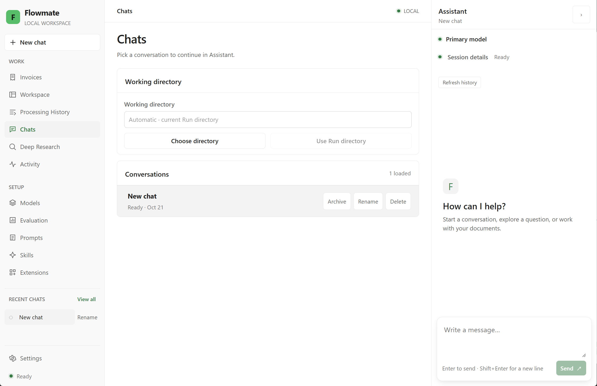

*桌面工作台：左侧切换任务与资源，中央管理会话和工作目录，右侧使用 Assistant。*

<a id="highlights"></a>

## ✨ 研究与工程亮点

围绕持续事项、本地研究与实际交付，Flowmate 在 Pi AgentSession 与 Pi Durable 提供的执行基础上，实现运行约束、业务状态、证据模型与产品流程。以下重点展示适配层和产品层的自定义能力。

| 能力 | Flowmate 的自定义实现与作用 |
|---|---|
| **Personal Agent 持续事项助手** | 基于 Pi Durable，将固定票组组织为持久事项，逐票跟踪 Todo、补料、候选与最终处置；保留原配置、资源和执行依据，通过授权、预算与停止事实控制后续执行。 |
| **结构化 Deep Research** | 将确认的计划拆为可追踪步骤，以真实工具回执和来源快照推进 Checkpoint；主任务与子代理共享采集名额，手动继续复用成功证据，再以 Claim 与依赖组织覆盖、冲突和报告。 |
| **Skill Hub 技能管理** | 串联技能发现、依赖检查、显式启用、版本化运行副本和按需读取，让用户与 Agent 明确技能是否可用、缺少什么，以及本次执行使用的资源。 |
| **Subagent 自定义子代理驱动** | 分别接入 AgentSession 子会话与 Durable 子任务，按角色收紧工具范围，统一管理父子共享预算、并行准入、独立历史、停止确认、结果保存与回送。 |
| **预算感知的工具 Runtime** | 每次模型请求提供剩余调用数、时间、工具时限和近期诊断；执行器同时落实预算与范围限制，让模型决策与实际约束保持一致。 |
| **可核验的工具执行** | 执行前检查参数、权限与预算，执行后核验输出、停止及写入回执；以合格历史样本形成有上限的 P95 超时策略。 |
| **Context / Memory 分层** | 分开管理工作区快照、会话历史、进程内运行态、显式研究偏好与任务 Checkpoint；当前页面投影仅注入本次模型请求，研究进度依据真实执行记录恢复，隔离当前焦点并复用成功证据。 |
| **独立 Agent 评测闭环** | 从真实轨迹、候选审核和版本化数据集，连接独立评分、配置比较、Baseline / Gate 与反馈回归；保留原执行、证据及评分修订。 |

<a id="personal-agent"></a>

## 🤖 Personal Agent：基于 Pi Durable 的持续事项助手

整理一组发票往往需要多次补料、逐票复核和明确处置。Personal Agent 将这项工作保存为持续事项：Agent 准备候选、定位缺口并推进可处理的票，用户沿 Todo 补充材料、复核结果，直到每张票都有明确结论。


*Personal Agent：独立配置模型、思考级别、偏好和工具，从 New invoice work 创建持续发票事项；已保存事项沿用原配置与资源版本。*

### 持续事项流程

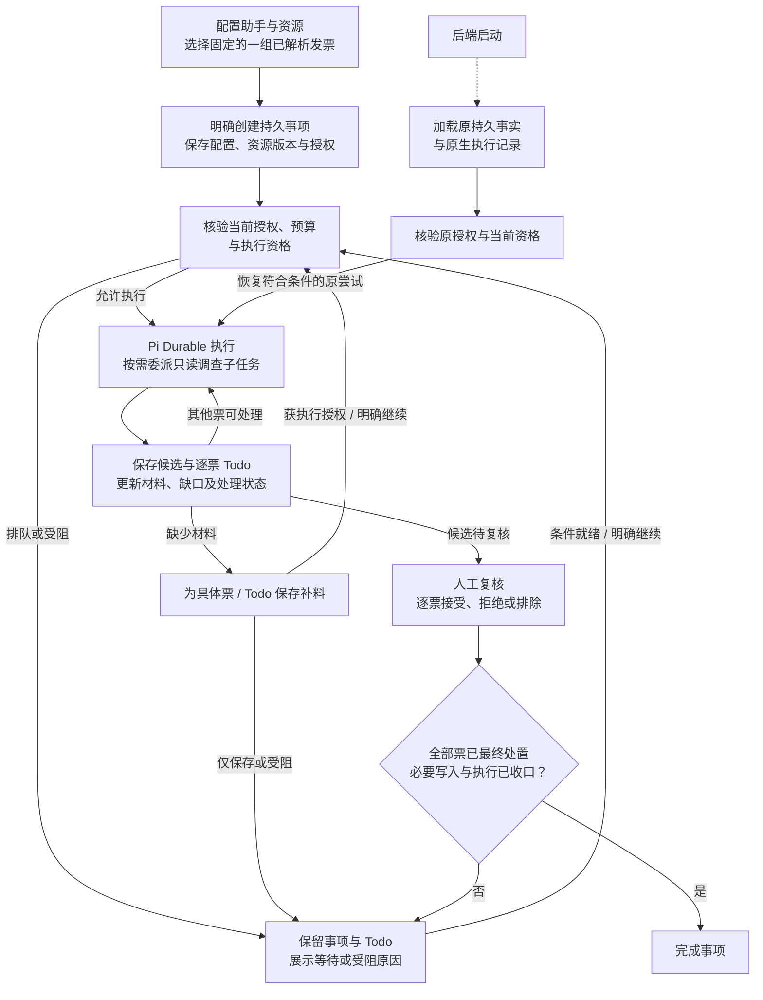

### 核心设计与使用边界

- **固定票组与原配置。** 创建时明确票据集合、目标及助手配置。后续配置更新用于新事项，已有事项保留原模型、资源版本和执行依据；新增票据另建事项。
- **逐票推进与人工复核。** 每张票分别保留材料、候选、Todo 和处置状态。一张票等待补料或复核时，可继续其他符合条件的票；复核动作回到 Invoices，并保留原事项与对话。
- **补料、执行与恢复分别记录。** 原尝试正常结束且事项仍 open 时，有效补料可受理符合条件的后续执行；用户停止或执行失败后的补料先保存，须明确继续。后端启动按原授权恢复合格原尝试，页面查看、历史读取与桌面重连均保持只读。
- **协作受预算与停止事实约束。** Master 按需委派只读 `invoice-evidence-checker`，父子共享根预算，最多四个同时拥有的子执行且禁止嵌套。停止未确认仍占用容量，Master 负责综合证据与候选，用户负责明确接受。
- **以业务处置判断完成。** 每张票最终处置为 `accepted`、`rejected` 或 `excluded`，且必要业务写入与执行均已收口，事项才能完成。普通 **Reject** 只拒绝候选；**Stop** 停止当前执行，取消整个事项是另一项业务动作。

| 基础能力 | Flowmate 的自定义实现 |
|---|---|
| Pi Durable 的 Harness、持久任务图、原生执行记录与恢复能力 | 持续发票事项、逐票 Todo、配置与资源绑定、补料受理、业务准入、共享预算、停止确认及结项条件 |

Personal Agent 使用自身已适配的工具、Prompt 与 Skill，不自动沿用 AgentSession 的 Extension 选择。当前工程实现覆盖应用运行期间的持续事项能力；关闭桌面后持续执行、服务重启及开机恢复的真实 Windows 系统验收仍待完成。

<a id="deep-research"></a>

## 🔬 Deep Research：从研究问题到可追溯的证据链

研究任务需要回答多个相关问题，并解释结论如何得到。Flowmate 将结构化计划拆为可执行采集步骤，以真实工具记录与来源快照保存进度，再用 Claim 组织结论和证据链。用户能检查资料、补充缺口，并在中断后明确继续，复用已经确认成功的证据。


*Deep Research：填写研究问题与范围，导入或选择本地资料；创建任务后在 Assistant 生成并确认研究计划。*

### 研究流程

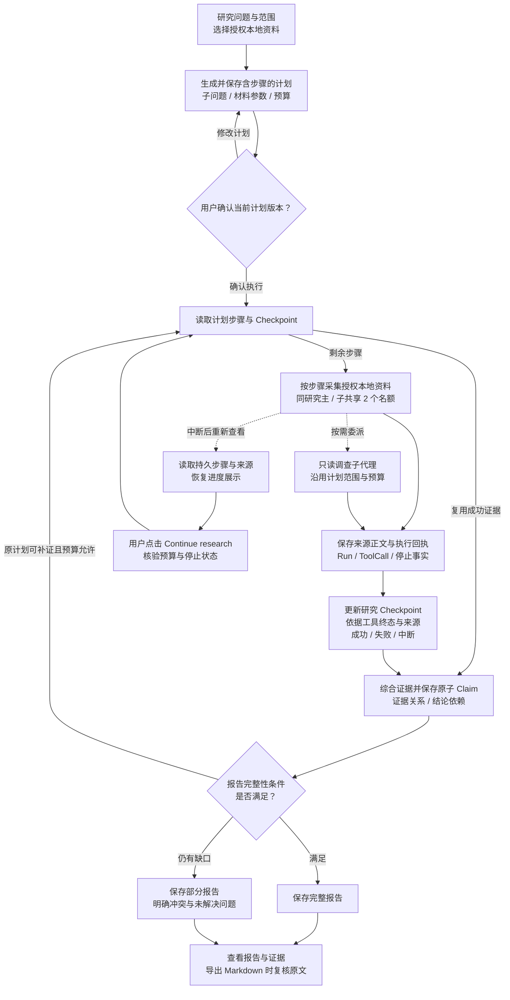

1. **提出问题与范围。** 选择本地文本、Markdown 或已登记解析资料，明确允许使用的材料。
2. **生成并确认计划。** Agent 保存研究维度、子问题、证据需求、预算和停止条件，以及包含稳定步骤 ID、关联子问题与材料参数的采集步骤。用户确认具体计划版本后才进入调查；原授权范围内可修改并重新确认计划，改变授权材料选择需要新建研究任务。
3. **按步骤读取与调查。** 复用现有读取工具与 SDK 并行执行，调用绑定步骤及材料参数；同一研究的实际采集最多并发 **2** 个，主 Agent 与只读 `research-investigator` 共享名额、资料范围和根预算，排队期间也响应取消。
4. **保存真实进度。** 来源正文及 Run / ToolCall 身份与计划步骤关联，Checkpoint 依据实际执行记录更新；下一次模型请求提供成功来源、失败原因、剩余步骤和预算，正文按需读取。
5. **组织结论并检查缺口。** 将发现保存为原子 Claim，关联支持或反驳证据、依赖结论及所回答的子问题；逐项检查覆盖与冲突，采集失败或预算不足时可提交明确标记的部分报告。
6. **保存与交付。** 报告保存后可在产品中重新查看，导出 Markdown 时再次核验结论、来源身份及原文片段。

步骤展示为 `pending`、`running`、`succeeded`、`failed` 或 `interrupted`。成功需要工具成功终态、停止已确认及对应来源快照共同支撑；模型声明完成或已经出现来源文件，都不能单独把步骤判为成功。

重启后重新查看任务只恢复进度，不请求模型。用户点击 **Continue research** 后，在新的研究 Run 中复用已确认成功的来源，处理待执行、失败和中断步骤；每次继续使用明确的运行预算，停止未确认时仍受阻，不在后台自动重试。旧计划保持可读及原有继续能力，重新生成并确认含步骤的计划后使用新工作流。

### 证据与完整性的约束

| 对象 | 产品实际检查什么 |
|---|---|
| **来源** | 资料必须属于当前任务允许的范围；读取后保存正文及来源信息，关联实际 Run / ToolCall。 |
| **证据定位** | 研究任务、确认的计划、来源执行身份必须匹配；证据片段须与保存正文的对应位置一致。 |
| **结论** | 记录所回答的子问题、依赖结论、证据关系，以及 Agent 给出的支持、反驳或不足判断。 |
| **完整报告** | 所有计划问题均有覆盖，关联的结论及依赖满足支持条件，且没有未解决问题；部分报告显式保留缺口。 |

**证据校验确认原文片段及其执行身份；语义支持仍由 Agent 判断，并通过独立评测检验。** Run 完成与报告完整分别记录，避免把执行结束直接解释为研究充分。

当前 Deep Research 使用授权的本地资料，联网搜索与网页抓取尚未接入；无需 Tavily Key。多 Agent 调查在启用 subagents 扩展后可用，并非每次研究都必须委派子任务。

<a id="runtime"></a>

## ⚙️ Agent Harness 与工具 Runtime

Pi SDK 为 AgentSession 提供 Agent Loop、工具协议和原生调度，Pi Durable 为 Personal Agent 提供持久执行基础。Flowmate 通过 `runtime-pi` 与 `runtime-durable` 分别接入会话和持久执行，产品层执行器落实授权范围、预算、调用记录和业务交付校验。一次业务工具调用经过：

**模型请求 → 参数与范围检查 → 预算和时限检查 → 实际执行 → 输出与副作用核验 → 保存调用记录 → 向模型回送结果与诊断。**

### 预算感知：让模型看到实际剩余资源

Flowmate 在每次模型请求中附加剩余模型调用数、工具次数、运行时间、可用工具时限，以及近期诊断和有界工具经验。这些提示只作用于当前请求，执行器独立落实硬约束。

提示指导 Agent 在证据缺失时缩小查询、选择允许的较低成本读取，或明确说明缺口并停止。

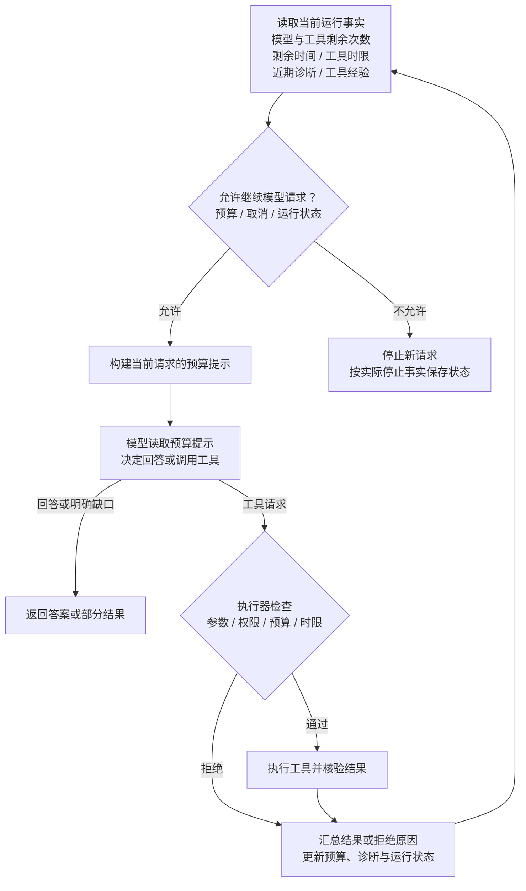

### 执行检查与自定义 P95 超时策略

Flowmate 对一次调用执行前置、执行中和后置检查，并根据合格的历史计时形成时限策略：

| 执行位置 | Flowmate 的工程实现 | 作用 |
|---|---|---|
| **调用前** | 校验参数和真实工具上下文，检查允许的工具、材料范围、会话权限、取消状态和剩余预算。 | 不让模型给出的参数直接变成未经检查的执行。 |
| **执行时** | 工具时限结合配置上限、可用统计策略和 Run 剩余时间；并行调用共用计数与反馈预算。 | 约束单次调用及整次运行的资源使用。 |
| **调用后** | 检查输出结构和领域结果，核验实际停止、候选保存或表单应用回执，并保存终态。 | 区分工具返回成功、实际完成写入及可确认的业务交付。 |
| **历史校准** | 仅对符合条件的自定义 `PURE` / `READ` 工具，用成功、停止已确认且计时完整的样本计算 P95；排除被 Run 截断等无效样本。 | 形成受配置上限约束的时限；样本不足、近期风险或读取失败时回退到配置策略。 |

P95 统计只调整符合条件工具的执行时限，配置上限和整次运行预算继续生效。

### 诊断反馈与停止确认

Flowmate 把可操作的参数错误、失败位置、输出检查结果和缺少的执行证据反馈给 Agent，辅助后续调整。

用户点击 Stop 后，产品继续核验执行是否真正停止以及必要记录是否保存。停止或写入结果未知时保留阻断状态，避免启动后续任务或自动重放可能已经产生副作用的调用。恢复历史时也沿用原保存事实，不用当前配置补造过去的执行依据。

### Skill Hub：依赖可见与按需读取

Skill Hub 将技能从作者资源接入到具体运行，形成统一流程：

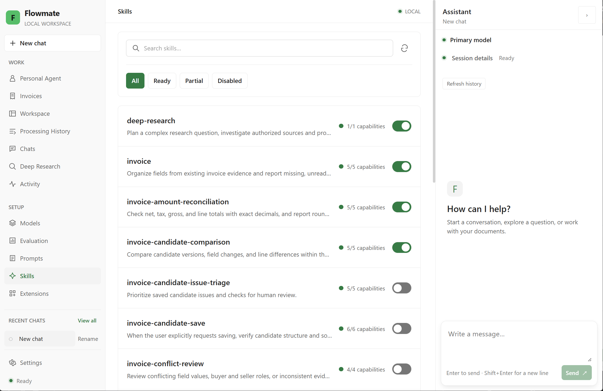

*Skill Hub：集中搜索与筛选技能，查看能力就绪情况，并显式启用或停用。*

**发现资源 → 检查依赖 → 用户启用 → 形成运行副本 → 注入短索引 → 按需读取正文。**

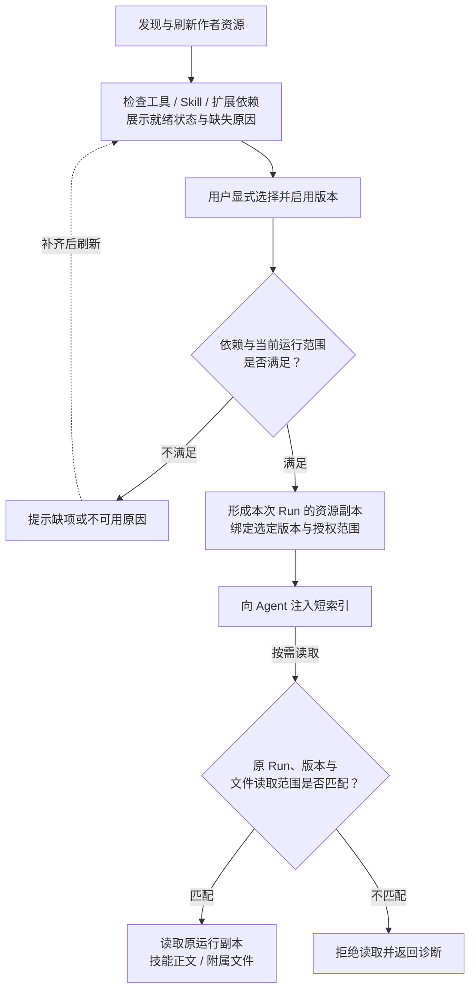

Pi 提供基础 Skill 资源机制；Flowmate 负责资源发现与刷新、显式启停，以及工具、其他 Skill 和扩展依赖的检查。界面展示启用状态、依赖就绪情况和具体缺失原因，执行时再按实际工具与权限范围确定可用技能。

每次 Run 保留选定版本的资源副本和授权依据。Agent 先获取短索引，再按需要读取正文与附属文件，读取请求绑定原 Run、选定版本和允许范围。刷新或更新作者资源不会用当前文件替换历史执行依据。

Personal Agent 按已保存事项配置装配受支持的 Prompt、Skill 与工具，后续尝试仍使用原资源版本；资源选择必须满足 Durable 路径的适配与授权条件。

### Subagent：由产品 Runtime 驱动的任务委派

Flowmate 自定义子代理驱动分别接入 AgentSession 子会话与 Durable 子任务，将委派纳入产品运行管理。以下展示 AgentSession 路径：

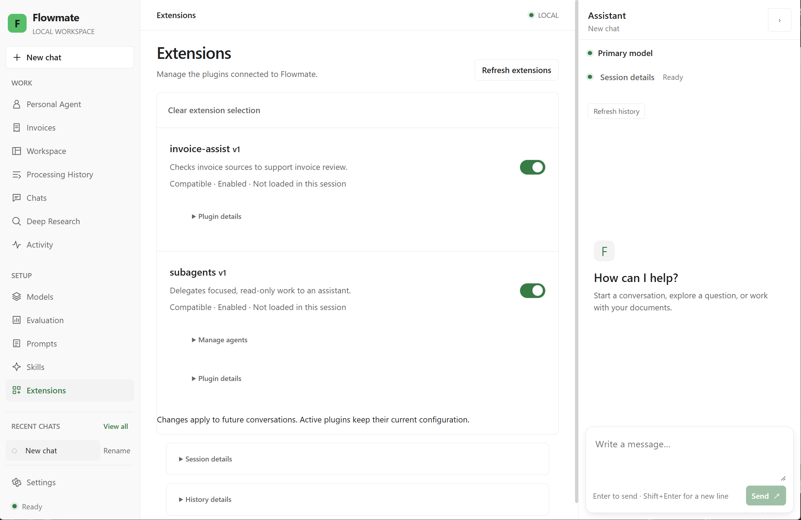

*AgentSession 子代理入口：在 Extensions 中启用 subagents，并从 Manage agents 进入角色管理。*

**主 Agent 发起委派 → 核验来源与角色 → 创建独立子会话和子 Run → 执行受限工具 → 保存结果与停止事实 → 回送父 Agent 并更新桌面状态。**

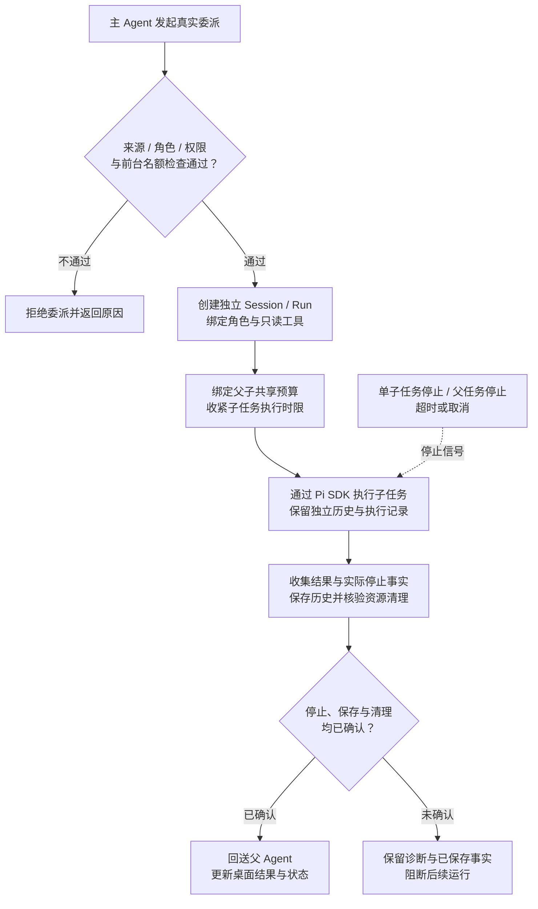

驱动核验真实委派调用、父 Run 和角色身份，为子任务创建独立 Session / Run 与历史，并按角色注册允许的 `PURE` / `READ` 工具。底层模型循环复用 Pi SDK；角色装配、子任务准入、执行绑定和生命周期管理由 Flowmate 完成。

父子任务共享调用预算，子任务时限受父任务剩余时间与委派时限约束。AgentSession 路径当前最多四个前台子执行，不支持后台或嵌套委派；桌面可查看真实执行状态和结果，支持停止单个子任务，也支持父任务停止时联动停止子任务。

驱动分别记录取消请求、实际停止和结果保存。停止未确认时阻断后续运行；已经保存的结果与历史保持可查，不因恢复或重复委派而自动重放原执行。

Deep Research 通过只读调查角色使用这套驱动：子代理返回发现、证据、冲突与缺口，主任务负责综合并保存 Claim 和报告，调查范围与预算沿用用户确认的研究计划。

Personal Agent 的委派通过 `runtime-durable` 接入 Pi Durable 任务图，使用只读 `invoice-evidence-checker` 核查限定来源问题。Flowmate 负责子任务准入、上下文、独立历史、共享预算、停止确认与结果关联；这一入口使用自身的 Durable 适配，不依赖启用上述会话扩展。子任务完成与结果返回分别保存，Master 继续核对证据、综合候选并推进逐票 Todo。

<a id="architecture"></a>

## 🧠 架构与职责边界

### 技术栈与调用方向

| 层级 | 技术与职责 |
|---|---|
| 语言与契约 | TypeScript strict、Zod：跨层输入、结果和错误契约 |
| 桌面界面 | Electron、React、Vite：页面、Preload 接口与窗口生命周期 |
| 应用与存储 | Bun 1.4.4、SQLite：应用组装、领域服务、原生运行记录与业务事实保存 |
| 会话执行 | Pi SDK 1.4.0、`runtime-pi`：Provider、AgentSession、模型与工具循环，承载 Chats / Invoices / Deep Research |
| 持久执行 | Pi Durable 1.4.0、`runtime-durable`：Harness、持久任务图、模型与工具适配，承载 Personal Agent |
| 子代理驱动 | Flowmate 自定义驱动：分别接合子会话与持久子任务，管理角色、共享预算、独立历史和执行状态 |
| 验证与评测 | Bun Test、Playwright、本地评测 Runner、独立 Judge 与 Langfuse 观察和回读 |

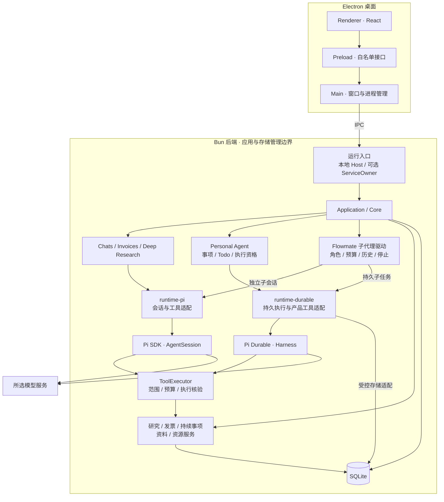

Chats、Invoices、Deep Research 保持 AgentSession 流程，Personal Agent 使用 Pi Durable。所选 Bun 后端统一管理该数据根的数据库与运行记录，Renderer 通过公开接口访问产品能力；两类主子执行分别保留对应的原生历史。

默认由本地 Host 承载后端，显式启用服务模式时由 ServiceOwner 承载；服务接入已有工程实现，真实 Windows 服务生命周期仍待系统验收。

### Context / Memory：分层状态与研究恢复

Flowmate 将当前输入依据、持久历史、进程内对象、显式偏好和任务进度分开管理。Pi 提供原生消息、历史与压缩能力，Flowmate 负责当前请求的投影、授权绑定，以及根据业务执行事实恢复研究进度。

| 层次 | 职责与生命周期 |
|---|---|
| **Workspace Context** | 接收输入时捕获页面焦点、材料与选区，形成独立 Context Snapshot。运行中切页不改变已接收任务，页面焦点不扩大资料访问范围。 |
| **Conversation** | 持久保存用户输入、助手回复、真实工具结果与历史摘要，沿用 Pi 的消息、会话历史及压缩能力。 |
| **Runtime Session** | 持有活跃 Agent、取消信号、并发执行和进程内对象；退出后根据持久事实重新建立运行对象。 |
| **Research Preferences** | 显式保存研究关注点、证据与报告偏好，默认空文本；研究 Run 捕获当次文本与版本，设置修改用于后续 Run。 |
| **Task Checkpoint** | 从确认的计划、步骤执行、工具终态与来源快照投影进度，关联成功证据、失败或中断及报告，不另存一份会话副本。 |

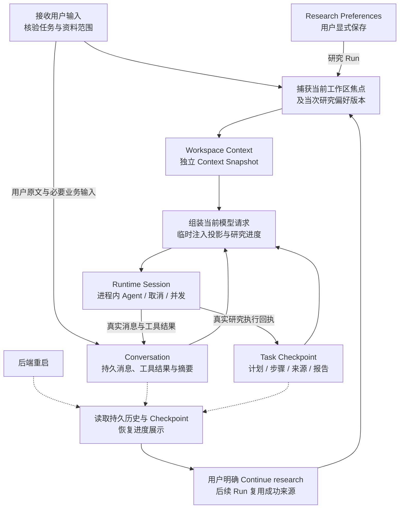

新增自动页面投影只用于当前模型请求，不拼入新的原生用户消息，也不直接进入历史压缩输入；用户显式提交的材料、确认操作、真实工具结果和 Fill Form 必需的业务输入继续保留。历史中已经保存的页面内容保持原样，不追溯重写。

研究偏好通过 **Settings → General → Research preferences** 显式保存，不自动从对话提炼，也不构成资料访问权限。当前 Run 沿用已捕获版本，下次研究 Run 才接收新的偏好。

图示覆盖 AgentSession 会话与 Deep Research：恢复展示和明确继续分别处理，查看页面不发起执行。Personal Agent 沿用独立的 Durable 阶段上下文，继续按事项原配置、授权与实际停止事实核验恢复条件。

### 原生能力、适配与自定义产品实现

| 模块 | 底层基础能力 | Flowmate 的适配与产品实现 |
|---|---|---|
| **运行与取消** | AgentSession 的循环、事件与中止接口；Pi Durable 的 Harness 与持久任务执行。 | 两类适配层接合运行与取消；产品 Runtime 管理准入、预算、桌面状态、终态保存和实际停止确认。 |
| **Personal Agent** | Pi Durable 的持久任务图、原生记录与恢复能力。 | 建模固定票组、逐票 Todo 与最终处置，绑定原配置和资源，核验补料、继续、恢复及结项条件。 |
| **工具** | Pi 工具协议、原生工具和 Durable 工具执行机制。 | 分别适配会话工具与持久产品工具；执行器增加参数、范围、时限、输出、调用记录和副作用核验。 |
| **会话与历史** | AgentSession 原生历史与 Pi Durable 原生持久记录。 | 关联产品 Session / Run 及事项、尝试和阶段，接入本地查询与受控恢复；查看历史不触发重新执行。 |
| **上下文** | Pi 的原生消息、历史与压缩能力，以及 Durable 的阶段上下文。 | 分层管理会话历史、当次工作区投影、显式研究偏好与任务 Checkpoint，保存请求依据；Personal Agent 保留独立的事项上下文与恢复条件。 |
| **Skill Hub** | Pi 的 Skill 资源与加载机制。 | 管理资源发现、依赖就绪、显式启停、选定版本和运行副本，以短索引与按需读取接入具体 Run。 |
| **Subagent 驱动** | AgentSession 的子会话执行能力与 Pi Durable 的持久子任务能力。 | 自定义驱动负责真实委派核验、角色与上下文装配、独立历史、只读工具注册、共享预算、并行准入、停止确认与结果回送。 |
| **研究与业务交付** | 通用模型、工具与扩展能力。 | 将确认的计划步骤关联真实工具回执和来源，管理并行采集、进度投影与手动继续，再组织 Claim 和报告；接合发票候选、人工复核、接受与导出。 |

普通聊天可使用当前平台支持的 Pi 原生文件与命令工具。工作目录用于确定执行位置，**目录选择本身不提供沙箱隔离**。Skill 与 Extension 的依赖、启用状态及工具可用性可在对应资源页面和 Diagnostics 查看。

<a id="quick-start"></a>

## 🚀 快速开始

### 1. 准备环境

- **Windows x64**：当前主要开发与打包目标。
- **Bun 1.4.4、Node.js 24**：Bun 用于依赖、后端和测试，Node.js 用于开发入口及 Electron 测试；当前 Pi SDK 与 Pi Durable 均为 1.4.0。
- 可访问的模型服务与 API Key，首次使用时在桌面配置。

### 2. 安装并启动

在仓库根目录执行：

```powershell
bun install --frozen-lockfile
bun run dev
```

Renderer 支持热更新；Main / Preload 改动触发停止、关闭与重建。结束开发时按 **Ctrl+C**，等待关闭完成。

### 3. 配置模型并发起第一次对话

1. 打开 **Models** 或 **Settings → LLM**，选择 Pi 内置供应商与模型。
2. 填写并保存 API Key；使用 **Custom model** 时同时填写 Base URL、Pi API 类型及实际模型能力。
3. 点击 **Test connection** 检查连接。
4. 点击左侧 **New chat**，在对话主区输入问题并点击 **Send**，需要时使用 **Stop**；从 **Chats** 可重新打开已有会话。业务页面保留右侧 Assistant 入口。

桌面凭据通过系统加密存储保存，评测使用独立配置。会话、事项、候选与报告保存在本地；调用外部模型时，请求内容会发送至所选服务。Test connection、Optimize、Send、Fill with Agent、研究规划或执行，以及 Personal Agent 事项创建、继续或获执行授权的补料，可能请求模型并产生费用。页面和历史查看保持只读；评测调用与轨迹上传按各自配置和显式操作执行。

### 4. 体验 Personal Agent

1. 从左侧进入 **Personal Agent**，在 **Assistant configuration** 选择已保存模型，确认思考级别、偏好、工具与 Prompt / Skill，保存配置。
2. 点击 **New invoice work**，选择固定的一组已有解析发票，填写目标并明确提交，创建持久事项。
3. 查看事项概览、逐票 Todo、候选与来源，为具体票 / Todo 补料；阅读回执，区分已保存、获执行授权、排队和受阻。用户停止或执行失败后，须明确继续。
4. 沿复核动作回到 **Invoices**，对照原票与解析材料，明确接受结果或对该票作最终拒绝、排除；全部票最终处置且必要执行收口后，事项完成。

Personal Agent 使用独立的 Pi Durable 入口；已有 Chats、Invoices、Deep Research 继续使用 AgentSession。新增票据另建事项，查看页面或重连不会自动发起执行。

### 5. 体验 Deep Research

1. 按需在 **Settings → General → Research preferences** 填写并保存研究偏好，后续研究 Run 使用新版本。
2. 进入 **Deep Research**，导入或选择本地 `.txt` / `.md` 资料，也可选择已登记解析资料；填写问题和范围并创建研究。
3. 在 Assistant 点击 **Send** 生成含采集步骤的计划，查看子问题、材料、证据需求和预算，按需修改并确认该版本。
4. 在 **Research steps** 查看逐步状态、来源身份和失败原因；在 **Evidence / Report** 查看结论、覆盖与缺口，使用 **Save report** 另存 Markdown。
5. 中断后重新打开任务查看已保存进度，点击 **Continue research** 明确继续，复用成功来源并处理剩余步骤。旧计划需重新生成并确认含步骤的计划，才能使用新步骤工作流。

要使用调查子任务，先在 Extensions 启用已登记的 **subagents** 扩展。研究无需先创建发票任务。

### 6. 体验单票复核

准备同一张发票的原件与外部已生成的解析材料，开发环境正式导入来源为 `data/invoices/agent-input/`。在 **Invoices** 导入并查看 **Original / Parsed / Results**，点击 **Process this invoice**，再在 Assistant 点击 **Send**。

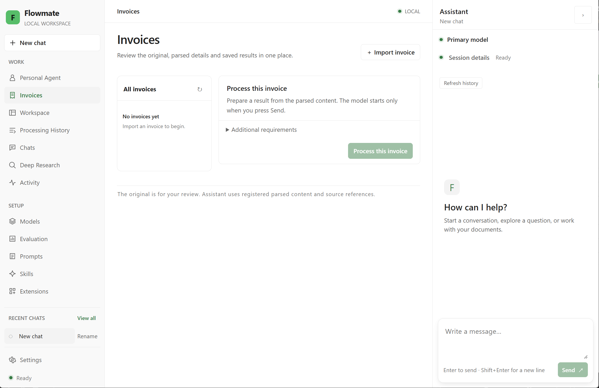

*发票处理入口：在 Invoices 导入并发起处理，通过右侧 Assistant 继续交互。*

选择候选后，可用 **Fill with Agent** 实际填表，或用 **Edit** 人工编辑；核对并保存后，通过 **Accept result** 明确接受，再导出 JSON、CSV 或 Markdown。业务取证读取已登记解析材料，原票用于人工对照，Host 不运行发票解析器。

默认桌面数据根为 `%APPDATA%\Flowmate`，数据库位于 `data\app.sqlite`。候选生成、编辑保存和接受分别记录；未保存编辑只存在于当前窗口，离开时按提示保存或放弃。撤回材料使用权限后，受影响会话不能继续请求模型。

<a id="development"></a>

## 🧪 开发、测试与 Agent 评测

### 常用命令

以下命令均在仓库根目录执行：

| 用途 | 命令 |
|---|---|
| 桌面开发 | `bun run dev` |
| 类型检查 | `bun --no-env-file run typecheck` |
| 单元测试 | `bun --no-env-file run test:unit` |
| 集成测试 | `bun --no-env-file run test:integration` |
| Electron E2E | `bun --no-env-file run test:e2e` |
| 完整工程验证 | `bun --no-env-file run test` |
| 桌面构建 | `bun --no-env-file run build:desktop` |
| Windows x64 目录包 | `bun --no-env-file run package:dir` |
| Windows x64 NSIS 安装包 | `bun --no-env-file run package:win` |

打包脚本要求 Windows x64 与 Bun 1.4.4。产物生成、实际安装、升级和恢复分别验证。

### 项目结构

```text
apps/
  desktop/           Electron Main、Preload 与 React Renderer
  host/              Bun Host 入口
  composition.ts     公共应用组装
packages/
  contracts/         输入、状态、事件与跨层接口
  core/              Runtime、Session、Context、工具与研究服务
  runtime-pi/        Pi 会话、Provider、原生与自定义工具适配
  runtime-durable/   Pi Durable、持久任务与产品工具适配
  data/              解析材料登记与读取
  employee-invoice/  发票规则、业务工具与表单能力
  logging/           运行日志与 Prompt Trace
  shared/            路径、凭据与共享能力
resources/           Skills、Prompts、模板、子任务角色与扩展声明
agent-eval/          隔离执行、评分、校准、回归与本地报告
tests/               工程测试与合成夹具
scripts/             开发、测试与打包入口
```

### 工程测试验证机制，Agent 评测验证任务表现

标准 `test` 入口依次运行类型检查、Unit、Integration、桌面构建与 Electron E2E。临时数据目录和受控 Provider 用于检查配置、消息、工具、取消、恢复与桌面接合，不请求付费模型。

Agent 评测使用专用 Agent 与 Judge 配置，通过独立本地 Host 调用同一产品核心，采集真实产品状态与工具记录。本地按 Run 保存 Trial、Trace、交付产物、评分与比较，桌面 **Evaluation** 提供轨迹、候选、实验和评测模型入口；Langfuse 展示上传后的模型、工具、子 Agent 观察与评分。

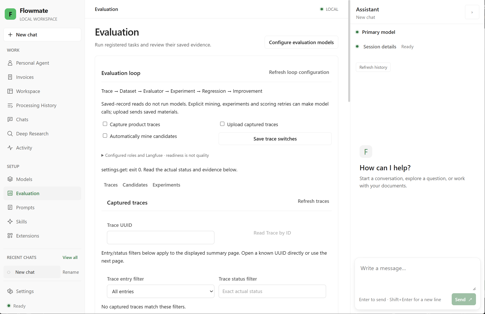

*评测工作台：独立控制轨迹采集、上传与自动挖掘，在 Traces、Candidates、Experiments 间查看证据、审核候选和组织实验。*

### 从真实轨迹到回归改进

**Trace → Dataset → Evaluator → Experiment → Regression → Improvement。**

产品轨迹连接实际请求、工具调用和业务回执，候选挖掘从中整理 Gold、Bad 与 Regression 样例。候选经过校验、必要重放及当前版本的人工批准后，才发布为明确版本的数据集；独立参考答案仅供评分，不进入被测 Agent 上下文。

实验比较明确声明的模型、Prompt、Skill、策略或代码配置，保留每次执行的实际条件与结果，再以指定 Baseline 和回归 Gate 判断变化。人工反馈与后续修订保留原始来源和关联，不覆盖原执行或原评分。

### 独立评测的执行与评分

| 能力 | Flowmate 的实现与判断依据 |
|---|---|
| **隔离试验** | 分离 Task / Trial / Trace / Outcome；隔离每次试验，分别核验执行终态、业务交付与质量。多次有效重复可统计 pass@k、pass^k 和波动，单次观察不证明稳定性。 |
| **轨迹与候选** | 采集实际模型、工具和业务事实；候选经过编辑、校验、必要重放与人工批准，发布为可追溯的数据集版本。 |
| **Skill 行为检查** | 设置 Skill 正例、反例和正确不使用 Skill 的场景，从实际工具与资源读取记录检验行为。 |
| **质量评分** | 明确成功与失败标准，拆分确定性检查和语义评分，使用独立 Gold、各评判项的 Rubric 与校准；区分不适用、未运行和评分故障。 |
| **比较与回归** | Baseline 绑定明确 Run、配置、选集和可比条件，Gate 判断相对退化；缺失结果、评分错误或条件不符时保留 blocked。 |
| **评分故障恢复** | 显式补评分只调用适用的 Judge，不重跑 Agent；新增评分修订并保留原分数，比较与 Gate 明确选择所用修订。 |
| **反馈与改进** | 将离线评测、人工反馈与回归流程衔接；保留失败来源、目标指标和后续运行关联，反馈经核验后才能成为正式样例。 |

执行器与评分器在本地实现。适用的语义判据在单次 Trial 中合并为一次 Judge 生成，确定性判据由本地检查执行，并保留独立参考答案、校准与人工核验流程。

流程完成、绝对质量、相对回归及平台回读分别呈现。质量 FAIL 是有效测量结果；Gate 通过表示相对所选 Baseline 未退化，不能单独推导任务质量达标。Langfuse 提供观察与分数，本地保存的证据承载比较、Baseline 和 Gate。

**Deep Research 质量评测**从实际保存的计划、Claim、报告、来源正文与 Run / ToolCall 取得证据，检查事实准确性与遗漏、来源支撑、有效证据覆盖和多跳证据链。产品中的覆盖记录属于被测结果，独立参考答案仅用于评分；控制器读到材料，也不能直接证明模型实际接收或使用了该材料。

### 执行独立评测

创建 `agent-eval/configs/.env`，填写专用 Agent、Judge 及 Smoke / Full 所需的 Langfuse 配置，先检查就绪条件：

```powershell
bun --no-env-file run eval -- doctor --backend local
```

doctor 必要时只读模型元数据，就绪失败返回非零状态。产品轨迹采集、上传和自动挖掘三个开关独立且默认关闭，填写凭据不会自动开启。以下 Smoke / Full 命令则明确包含被测模型与适用 Judge 调用、Langfuse 上传和回读，可能产生模型费用并发送该次评测材料：

```powershell
bun --no-env-file run eval:smoke
bun --no-env-file run eval:full
```

两个入口完成预检、执行、确定性检查与适用语义评分、本地采证、平台上传回读、诊断、配置比较及对应选集的 Baseline / Gate。读取保存记录不请求模型；显式候选挖掘、模型重放或补评分按操作调用相应模型。

工程测试、受控评测与真实模型质量分别表述。质量结论以对应 Execution 的模型、资料、执行完整性、评分及人工核验为准；模拟模型、未完成试验或评分故障不计作真实质量通过。

<a id="capabilities"></a>

## 📍 当前能力与使用边界

| 方面 | 当前能力与边界 |
|---|---|
| **Personal Agent** | 基于 Pi Durable 持续整理固定票组，保留逐票 Todo、补料、候选、原配置与人工最终处置；按已保存授权恢复合格原尝试。关闭桌面后持续执行、服务重启和开机恢复的真实系统验收仍待完成。 |
| **研究** | 支持本地资料规划与确认、受控并行采集、持久步骤及手动继续，复用成功证据并保存 Claim 与完整或部分报告；可选只读子任务。尚未接入联网搜索和网页抓取。 |
| **日常任务** | Chats、Invoices、Deep Research 使用 AgentSession，支持资料问答、持久会话和当前平台可用的 Pi 原生工具；工作目录选择不构成沙箱。 |
| **发票** | 支持已有解析材料上的候选、字段核算、人工复核、接受与导出；不在 Host 中执行原票解析。 |
| **验证** | 已有工程测试，以及轨迹、候选、数据集、评分、实验和回归入口。机制覆盖、真实模型质量、相对 Gate 与平台回读分别判断，不由功能存在推导质量达标。 |
| **发行** | 当前主要目标为 Windows x64；完整安装、升级、恢复验收及其他操作系统兼容性仍需实际验证。 |
| **数据** | 产品数据在本地保存；外部模型调用会发送相应请求内容，凭据、模型选择与费用由使用者配置。 |
