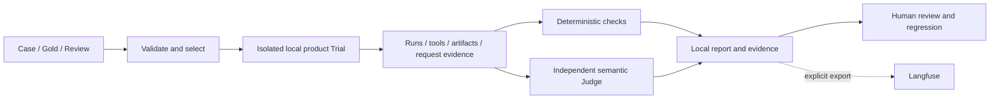

[English](EVALUATION.md) | [简体中文](EVALUATION.zh-CN.md) · [Documentation](README.md)

# Evaluation

## Engineering tests and model quality

Engineering tests use temporary stores, controlled providers and synthetic fixtures to check ownership, input delivery, tools, persistence, stopping and UI integration without paid model calls. They do not establish real invoice/research quality.

Agent evaluation executes a dataset through an isolated local Host using the same product core and a dedicated Agent model. It collects actual Run, tool and business artifacts, then applies deterministic checks and an independent Judge for applicable semantic scoring. Task, Trial, Trace, execution outcome, delivery and quality are separate facts.



## Datasets and evidence

Baseline declarations are [cases.ts](../../agent-eval/src/datasets/cases.ts), [gold.ts](../../agent-eval/src/datasets/gold.ts) and [review.ts](../../agent-eval/src/datasets/review.ts). Full has 62 cases (50 business, 12 research); Smoke has 14 (10 business, 4 research). Supplemental Badcase suites are separate and do not silently extend the baseline or `--dataset all`.

Cases define user inputs, resource selection and applicable checks. Gold/Review and future user turns are evaluator-side material, not answers injected into the Agent. Runtime source mounted for Trials excludes private scenarios and dataset answers.

Research scoring uses saved plans, Claims, reports, original source bodies and actual Run/ToolCall identities. The product's own coverage report is a measured output. Independent references test correctness, omissions, source support and multi-hop links. Controller acquisition, model-request inclusion and semantic use are different evidence levels.

<a id="configuration"></a>

## Configuration

Create the ignored `agent-eval/configs/.env`. The evaluator reads this dedicated file and same-name environment overrides; it does not inherit desktop credentials, root `.env` or generic model credentials. See the [module guide](../../agent-eval/README.md) for the complete current contract.

```dotenv
FLOWMATE_EVAL_AGENT_BASE_URL=
FLOWMATE_EVAL_AGENT_API_KEY=
FLOWMATE_EVAL_AGENT_MODEL=
FLOWMATE_EVAL_AGENT_API=openai-completions
FLOWMATE_JUDGE_API=openai-completions
FLOWMATE_JUDGE_BASE_URL=
FLOWMATE_JUDGE_MODEL=
FLOWMATE_JUDGE_API_KEY=
FLOWMATE_JUDGE_TIMEOUT_MS=180000
LANGFUSE_BASE_URL=
LANGFUSE_PUBLIC_KEY=
LANGFUSE_SECRET_KEY=
```

Keep Agent, Judge and platform keys separate. Match each protocol to its endpoint. Capability preparation uses Pi metadata; do not invent context/output capacities. Langfuse credentials are optional for local execution.

## Commands and costs

Run from the repository root:

```powershell
# Offline; no model generation or credentials required.
bun --no-env-file run eval -- dataset validate --dir agent-eval/src/datasets
# Readiness check; may read model metadata, but does not generate or score answers.
bun --no-env-file run eval -- doctor --backend local
```

These commands call real models and may incur charges:

```powershell
bun --no-env-file run eval:smoke
bun --no-env-file run eval:full
```

Business then research execute as separate groups with their own Execution IDs/reports. Ordinary failures can continue; cancellation or unconfirmed stopping blocks later Trials/groups. Exit 0 means necessary automatic scoring passed, 1 means failure/error/incomplete execution, and 2 means required scoring remains undecided. Human acceptance is independent.

## Scoring

Deterministic metrics inspect recorded behavior and legal field values. Applicable semantic metrics are combined into at most one Judge generation per Trial through an independently configured Pi model without business tools. A deterministic-only case needs no Judge credentials. `--judge required` requires applicable necessary semantic scoring; `--judge off` leaves those items unmeasured rather than passing them.

New Judge output is structured JSON keyed by metric ID with validated counts/failures; research ratios are calculated locally from evidence witnesses. Malformed, missing, duplicate or unassessable results remain errors/unknowns in their applicable scope. Distinguish Judge failures, absent evidence, provider billing rejection and NOT_RUN from a measured Agent quality result.

Calibration and human review check scoring against reference examples. Controlled fixtures do not constitute independent human endorsement. Preserve original Executions; changed implementations, models or conditions produce new ones.

<a id="reports"></a>

## Reports and evidence

```text
agent-eval/runs/
  business/<execution-id>/
  research/<execution-id>/
  mixed/<execution-id>/
  calibration/<id>/
  case-reviews/review.json
```

Execution directories contain `snapshot.json`, `report.json`, per-Trial `evidence/<trial-id>/` and derived `badcases.json`/`badcases.md`. `observation.json` holds detailed tool evidence; `events.jsonl` retains events and Run spans. `artifacts/`, `review.json` and `export.json` exist only when the corresponding artifact, feedback or export attempt happened. Calibration has its own `summary.json`.

Grouping follows the declared dataset scope, not just a Smoke/single-case selection. Readers support historical flat layouts but reject duplicate IDs instead of choosing a newer copy. Reports may contain user material; generated runs/records are ignored by Git.

```powershell
bun --no-env-file run eval -- status --execution-id <execution-id>
```

Progress, an existing directory or one saved Trial does not prove the batch passed. Inspect execution completeness and applicable PASS, FAIL, ERROR, UNJUDGEABLE or NOT_RUN results.

<a id="trials"></a>

## Repetitions and comparability

Use `--trials N` (default 1, range 1–20); old `--repeat` is rejected. Trial identity belongs to execution records, not Case definitions. This example explicitly runs paid repeated Trials:

```powershell
bun --no-env-file run eval -- run --dataset all --selection smoke --judge required --backend local --trials 3
```

Reports retain applicable per-case metrics and separate pass@k, pass^k and variability statistics. Repetitions do not change formulas or erase failures. Compare compatible model, dataset/reference, runtime, resources and execution conditions. Source changes can invalidate comparability without rewriting raw scores.

<a id="regressions"></a>

## Badcases and regression

A Badcase index is a derived review queue, not a runnable dataset or replacement score. Inspect original input, evidence, Gold, evaluator errors and feedback before classifying a defect. Add verified cases to a supplemental suite with origin/target-metric linkage, validate offline, calibrate relevant scoring, then explicitly run a single case, suite, repetitions and baseline as needed.

Actual saved regression Trials link to their origin batch. Controlled and real-model attempts are distinguished. Stability requires comparable repeated checks and necessary scores to pass; collecting a case or fixing an engineering test does not prove model improvement. The [module guide](../../agent-eval/README.md) provides current supplemental suite commands.

## Langfuse and desktop

Smoke/Full run locally; configuration alone does not upload. Explicit export resends an existing Execution without re-running Agent/Judge:

```powershell
bun --no-env-file run eval:upload -- --execution-id <execution-id>
```

Inspect export receipts, partial failures and the data being published. Desktop **Evaluation** provides dedicated configuration, execution and saved-result views; it does not turn desktop conversation credentials into evaluation credentials.

Implementation: [CLI](../../agent-eval/src/cli.ts), [dataset loader](../../agent-eval/src/dataset-loader), [execution](../../agent-eval/src/execution), [scoring](../../agent-eval/src/scoring), [reports](../../agent-eval/src/reports), [facility tests](../../agent-eval/tests/README.md). See [Subagents](subagents.md) for parent/child attribution.
