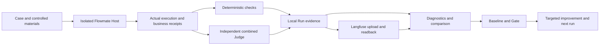

[English](EVALUATION.md) | [简体中文](EVALUATION.zh-CN.md)

# Flowmate evaluation

- What failed? —— Agent 哪些能力失败了？
- Why? —— 为什么失败？
- Where in the trajectory? —— 在执行轨迹中的哪个环节失败？
- Which change caused the regression? —— 哪次修改导致能力退化？
- Which configuration works better? —— 哪种模型、策略或 Skill 配置表现更好？

Evaluation connects real product execution to evidence, scoring and a repeatable comparison. It helps locate failures in local-material tasks, invoice review and research, then check a product, prompt, strategy, Skill or model change against an explicit baseline. A completed execution, a business receipt, a quality score and a regression decision answer different questions.

Read the [benchmark authoring guide](EVALUATION-BENCHMARK.md) for Case and Gold rules, the [module reference](../../agent-eval/README.md) for configuration, and the [Langfuse operation guide](../../agent-eval/Langfuse评测与问题定位操作指南.md) for real screenshots and measured examples.

## Architecture



The subject uses the product core in an isolated local Host. The scoring side receives independent Gold and recorded execution; Gold never enters the subject's context. Langfuse provides observations and scores, while local evidence retains the complete comparison and Gate decision. Candidate mining, replay and publication require explicit operations.

| Object | Meaning |
|---|---|
| Case | Task input, expected behavior, scope and identity |
| Gold / scenario | Independent reference evidence / controlled execution conditions |
| Dataset | Explicit version and Case selection |
| Trial | One Case executed once by one configuration |
| Run | One saved evaluation, including its configurations, Trials, scores and analysis |
| Trace / Session | Recorded execution tree / the product conversation that groups related execution |

## Tracing: locate the failure in the trajectory

Start from a failed Score, open its Trace, then find the Session. Read the actual model request and response, tool arguments and results, subagent work, and saved business receipts. Match the failure to a specific requirement and the evidence supporting that requirement. A controller reading a file, a model receiving its contents and a model using them correctly are separate observations.

Keep observed facts separate from explanations. A missing business receipt can establish that delivery was not recorded; it does not alone explain whether the cause was a prompt, a tool error or a model choice. Provider, infrastructure, runtime and Judge failures need their own diagnosis. Missing capture stays missing evidence.

Langfuse upload is followed by readback of the relevant observations, parent/child links, content and scores. An accepted request is not proof of a complete remote trace. If a write result is unknown, inspect the original operation before resending it. Benchmark observations stay in their Run and are not duplicated as product Trace files.

## Cases, datasets and independent Gold

The original Full set remains **62 Cases: 50 business and 12 research**. Smoke selects **7 Cases: 5 business and 2 research**:

`FM-001, FM-002, FM-027, FM-033, FM-046, FM-051, FM-055`.

A Case defines what to do; Gold establishes what counts as success from independent materials. The original model answer and its previous score are observations, not a source of truth. Keep private checks, Gold and future turns out of the subject's initial input. Preserve the original language, whitespace and turn order of real inputs.

Trace-derived Gold, Bad and Regression candidates remain outside runnable datasets until validation and current human approval support publication. A successful controlled replay and a successful real model replay establish different facts. Missing independent evidence leaves a candidate awaiting evidence. Publication creates an explicit benchmark version; it does not silently enlarge the original Full or Smoke selection.

## Evaluators: measure behavior before judging semantics

Deterministic checks verify recorded behavior and business values. All applicable semantic requirements in one Trial are combined into at most **one logical Judge submission**. A deterministic-only Trial needs no Judge. The Judge is configured independently and has no subject business tools.

**Scoring flow: independent Metric definition → versioned Rubric → Case selection → one merged Trial request → per-Metric Scores.** The formal catalog remains **39 metrics**: 28 semantic and 11 local/derived by default. Two additional semantic diagnostics stay outside that count. The active registry has **55 definitions: 25 deterministic/derived implementations and 30 independent semantic definitions**, organized in ten domain files. Definitions, formal metrics and model requests are different counts.

Each semantic Evaluator owns one Metric and its version, Rubric, applicability, evidence requirements, preparation and validation. It has no model client. Cases select Metric IDs in `scoring.judge`; applicability cannot enable an unselected metric. Existing local alternatives, such as a zero-tool control, remain local. Multiple Rubric criteria do not automatically create additional Metrics.

The orchestrator preserves known local results, then merges remaining applicable semantics in their declared order. Research claims, citations and chains share the original witness frame; ratios are computed locally. An invalid or omitted item fails that Metric; duplicate/unknown IDs or an invalid root invalidate the model batch. Known leakage and prohibited effects survive model disagreement. Errors never cause per-Metric fallback calls, silent evidence truncation or retries until success.

New results record `scoringVersion: 2`, `semantic-metric-batch` v1, `metric-json-independent/v1`, the original request and independent Evaluator versions. Metric versions describe formulas, units and direction; Evaluator versions describe grading rules. Historical group definitions, protocols and scores remain readable with their original validators. Reading never regrades with today's Rubric. Comparisons and Gates block incompatible scoring conditions.

Independent calibration shares definitions, batching, parsing and count calculation without executing the subject Agent or substituting local safety findings for Judge accuracy. Single-metric selection preserves original documents and labels; results join by Metric ID. Single-metric evidence does not certify combined grading. An Evaluator change invalidates its single scope and combinations containing it; shared protocol or Judge changes affect corresponding references. Results distinguish `not-provided`, `insufficient-coverage`, `version-mismatch` and `matched`, with reference, scope, versions and Judge task. A match only establishes scope/version compatibility; `acceptance` remains `not-assessed`.

These explicit commands perform real calibration; Benchmark execution and result queries never start them automatically:

```powershell
bun --no-env-file run eval -- judge calibrate --dir <independent-reference-directory> --execution-id <calibration-id> --metric tool-arguments
bun --no-env-file run eval -- judge calibrate --dir <independent-reference-directory> --execution-id <calibration-id>
```

The first selects one Metric; the second batches each reference's declared combination. Keep tune/validation partitions, source-group isolation and `agent-authored`/`human-reference` authority. Controlled engineering fixtures do not establish semantic acceptance or human approval.

Keep raw Judge output, metric identities, scores, witnesses and ratio numerators/denominators. Missing, duplicate, malformed or unjudgeable results remain errors or unjudgeable results. Unmeasured semantics cannot count as a quality pass. A logical submission does not reveal unreported internal retries or network request counts.

A valid metric with no actual opportunities may be N/A only when the complete evidence supports that interpretation. Diagnostics that are outside required and formal Gate metrics can be displayed separately; that never removes a required failure. Human feedback supplements original scores and does not overwrite them.

## Experiments: compare declared configurations

The two standard entry points run a fixed model comparison with **one repetition per Case per model**:

| Entry | Selection | Subject Trials |
|---|---|---|
| Smoke | 7 Cases × 2 models × 1 | 14 |
| Full | 62 Cases × 2 models × 1 | 124 |

Running both produces **138 subject Trials**, with no separate canary. Judge and mining calls are not subject Trials. One repetition can describe these observations, not stability or reliable improvement.

| Role | Configuration |
|---|---|
| Control | Existing local gateway, `gpt-6.1-sol / max` |
| Candidate | Existing local gateway, `gpt-6-luna` / `max` |
| Judge | Existing local gateway, `gpt-6.1-terra` / `max` |
| Mining | Native Codex CLI, `gpt-6-luna` / `max` |
| Candidate replay | Existing local gateway, `gpt-6-luna` / `max` |

Hold the Case versions, materials, Gold, scoring rules, environment and repetitions constant when comparing configurations. Declare model, prompt, strategy/Skill or code changes. Multiple changed axes support a conclusion about that combination; they do not identify one causal change. Compare the same Case's requests, receipts and scores before drawing an aggregate conclusion.

## Baselines and regression Gates

A baseline identifies an actual Run, configuration, selection and comparable conditions. Store baselines in `agent-eval/baselines.json`; select an explicit identity rather than an automatically changing latest result. A complete, measured Agent FAIL can be a known-failure baseline. Missing results, scoring errors or incompatible conditions cannot establish one.

| Gate condition | Requirement |
|---|---|
| Critical metrics | No decline in the metric's correct direction |
| Required assertions per Case | Passing repetition count must not decrease |
| Published regression assertions | Pass in every actual repetition |
| Actual leakage and prohibited side effects | Zero |
| Other normalized quality ratios | At most `0.02` absolute decline, with numerator and denominator shown |
| Missing, erroneous or incomparable evidence | `blocked` |

Critical aggregate metrics include task success, false completion, reference fields, line items, candidate idempotency, actual leakage, illegal-request blocking, DR01 and DR04. Metric direction matters: a lower failure rate is better.

Compute **Smoke7 and Full62 Gates separately**. A Smoke result covers those seven Cases only. Gate outputs are `pass`, `fail` or `blocked`, with reasons. A relative pass means the candidate did not regress against that baseline; both configurations may still fail the task. Absolute quality and relative regression must both be visible.

## Privacy and saved evidence

Product trace capture, upload and automatic mining are independent controls, off by default. Providing credentials does not enable them. Running the two evaluation commands explicitly includes uploading their evaluation observations. Review the materials permitted to leave the machine and avoid exposing credentials in reports, raw exports or screenshots.

Each Run is saved under `agent-eval/runs/Run-<Shanghai date_time>-smoke|full-compare-01/` with `README.md`, `run.json` and optional necessary binary `materials/`. The JSON contains original Trial I/O, actual model/tool/subagent observations, business receipts, Judge results, ratio counts, analyses and upload/readback state. Used Case, Gold, scenario and scoring snapshots are stored once and referenced by Trials. No per-model, per-Trial, experiment, comparison, Gate or export sidecar trees are required.

Independent product Traces use flat `Trace-<date>-<entry>-<purpose>-01.json` files with internal UUIDs. Four feedback targets—Case quality, saved Run, Trace and candidate review—share `agent-eval/feedback.json`, created only after real feedback. Candidate and published benchmark layouts are covered in the [authoring guide](EVALUATION-BENCHMARK.md).

## Configuration, UI and commands

Use the private `agent-eval/configs/.env`; same-name system environment variables take precedence. The [module reference](../../agent-eval/README.md) lists the exact role and Langfuse fields. The Judge uses the existing local HTTP gateway; native mining reuses the existing Codex login. Sol and Luna use separate roles on the same local gateway; external provider credentials are not forwarded to it.

Run from the repository root:

```powershell
bun --no-env-file run eval:smoke
bun --no-env-file run eval:full
```

Each command performs preflight, real execution, deterministic checks and applicable combined judging, local capture, Langfuse upload/readback, diagnostics, comparison, the matching baseline/Gate and a readable README. Quality failure remains a completed measurement when execution and evidence are complete. Pipeline completion, absolute quality, relative Gate and upload verification are reported separately.

Use Langfuse for Scores, Traces, Sessions and the User's related execution. Use local `README.md` and `run.json` for comparison and baseline/Gate details. These local decisions are not native Langfuse Gate pages. The [Chinese operation guide](../../agent-eval/Langfuse评测与问题定位操作指南.md) documents both navigation directions with actual screenshots when performed.

## Limits

Engineering tests and controlled fixtures verify implementation behavior, not real model quality. One repetition does not establish stability, a relative Gate pass does not certify absolute quality, and a Smoke pass does not establish Full quality. Keep observed facts, cause hypotheses and the conditions for the next validation explicit. Mining, replay and publication do not run automatically.

The topic order follows the [pinned Folio evaluation guide](https://github.com/helsome/folio/blob/f5822f0cb27b1f5843fe3ed5cc2f3f5baecc75de/docs/EVALUATION.md); the task domains, Langfuse integration and operating rules here describe Flowmate.
