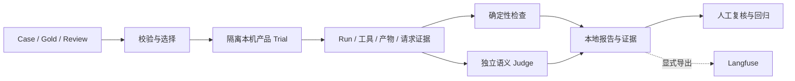

[English](EVALUATION.md) | [简体中文](EVALUATION.zh-CN.md) · [文档导航](README.zh-CN.md)

# 评测指南

## 工程测试与模型质量

工程测试使用临时存储、受控 Provider 与合成夹具，验证归属、输入交付、工具、保存、停止和界面接合，不请求付费模型，也不证明真实发票或研究质量。

Agent 评测通过隔离本机 Host 调用同一产品核心及专用 Agent 模型，采集实际 Run、工具、业务产物，再执行确定性检查和适用的独立语义 Judge。Task、Trial、Trace、执行终态、业务交付与质量分别记录。



## 数据集与证据

基线为 [cases.ts](../../agent-eval/src/datasets/cases.ts)、[gold.ts](../../agent-eval/src/datasets/gold.ts)、[review.ts](../../agent-eval/src/datasets/review.ts)。Full 62 题，业务 50、研究 12；Smoke 14 题，业务 10、研究 4。附加 Badcase 专项独立声明，不静默扩充基线或 `--dataset all`。

Case 定义用户输入、资源选择和适用检查。Gold/Review 及未来用户轮次是评分侧资料，不作为答案注入 Agent；Trial 挂载源码排除私有场景和数据集答案。

研究评分使用保存的计划、Claim、报告、来源正文及实际 Run/ToolCall 身份。产品自报覆盖是被测输出，独立参考检查正确性、遗漏、来源支持及多跳关系。控制器采集、模型请求包含与模型语义采用是不同证据层级。

<a id="configuration"></a>

## 配置

创建忽略提交的 `agent-eval/configs/.env`。评测读取该专用文件及同名环境覆盖，不继承桌面凭据、根 `.env` 或通用模型凭据，完整当前契约见[模块指南](../../agent-eval/README.md)。

```dotenv
FLOWMATE_EVAL_AGENT_BASE_URL=
FLOWMATE_EVAL_AGENT_API_KEY=
FLOWMATE_EVAL_AGENT_MODEL=
FLOWMATE_EVAL_AGENT_API=openai-completions
FLOWMATE_JUDGE_API=openai-completions
FLOWMATE_JUDGE_BASE_URL=
FLOWMATE_JUDGE_MODEL=
FLOWMATE_JUDGE_API_KEY=
FLOWMATE_JUDGE_TIMEOUT_MS=180000
LANGFUSE_BASE_URL=
LANGFUSE_PUBLIC_KEY=
LANGFUSE_SECRET_KEY=
```

Agent、Judge、平台密钥分开，协议匹配实际端点。模型能力准备复用 Pi 元数据，不编造上下文或输出容量。本地执行无需 Langfuse 凭据。

## 命令与费用

在仓库根目录执行：

```powershell
# 离线校验，不生成模型回答，无需凭据。
bun --no-env-file run eval -- dataset validate --dir agent-eval/src/datasets
# 就绪检查，可能读取模型元数据，不生成答案或评分。
bun --no-env-file run eval -- doctor --backend local
```

以下命令真实请求模型，可能收费：

```powershell
bun --no-env-file run eval:smoke
bun --no-env-file run eval:full
```

业务后研究分组执行，各有独立 Execution ID/报告。普通失败可继续，取消或停止未确认阻断后续 Trial/组。退出 0 表示必要自动评分通过，1 表示失败、错误或执行不完整，2 表示必要评分仍待判；人工接受独立。

## 评分

确定性指标检查已记录行为与合法字段值。适用语义指标在每个 Trial 合并为最多一次 Judge 生成，使用独立配置的 Pi 模型且无业务工具。纯确定性题无需 Judge 凭据。`--judge required` 要求适用必要语义评分，`--judge off` 将其保留为未测，不能判通过。

新 Judge 返回按指标 ID 组织的结构化 JSON，严格核验计数和失败，研究比例由证据见证在本地计算。格式错误、缺项、重复、不可判定在对应范围保留错误或未知。Judge 故障、缺证据、计费拒绝和 NOT_RUN 与已测 Agent 质量结论分开。

校准与人工审核通过参考样例检查评分，受控夹具不代表独立真人认可。保留原 Execution；实现、模型或条件改变后创建新 Execution。

<a id="reports"></a>

## 报告与证据

```text
agent-eval/runs/
  business/<execution-id>/
  research/<execution-id>/
  mixed/<execution-id>/
  calibration/<id>/
  case-reviews/review.json
```

Execution 目录包含 `snapshot.json`、`report.json`、逐 Trial `evidence/<trial-id>/` 与派生 `badcases.json`/`badcases.md`。`observation.json` 为详细工具证据，`events.jsonl` 为事件和 Run span。`artifacts/`、`review.json`、`export.json` 仅在对应产物、反馈或导出尝试发生时存在；校准单独保存 `summary.json`。

分组由数据集声明全集决定，不因 Smoke/单题选集改变。读取兼容旧平铺布局，重复 ID 报错，不选择较新副本。报告可能含用户资料，生成的 runs/records 被 Git 忽略。

```powershell
bun --no-env-file run eval -- status --execution-id <execution-id>
```

进度、已有目录、单个 Trial 保存不证明整批通过，需检查执行完整性与适用的 PASS、FAIL、ERROR、UNJUDGEABLE、NOT_RUN。

<a id="trials"></a>

## 重复试验与可比性

使用 `--trials N`，默认 1、范围 1–20，旧 `--repeat` 被拒绝。Trial 身份属于执行记录，不属于 Case 定义。以下会显式运行付费重复 Trial：

```powershell
bun --no-env-file run eval -- run --dataset all --selection smoke --judge required --backend local --trials 3
```

报告保留逐题适用指标，另报 pass@k、pass^k 与波动，不改变公式或抹去失败。比较需核对模型、数据与参考、Runtime、资源、执行条件；源码变化可能使可比性失效，但不改写原始分数。

<a id="regressions"></a>

## Badcase 与回归

Badcase 索引是派生复核队列，不是可运行数据集或替代分数。先检查原输入、证据、Gold、评分故障及反馈再归因。已核验题目按来源与目标指标关联进入专项，先离线校验、必要评分校准，再按需显式运行单题、专项、重复和基线。

实际保存的回归 Trial 关联原批次，受控和真实模型尝试分开。稳定性要求可比条件下的重复检查与必要分数通过；收录题目或修复工程测试不证明模型改善。专项命令见[模块指南](../../agent-eval/README.md)。

## Langfuse 与桌面

Smoke/Full 本地执行，配置不自动上传。显式导出已有 Execution，不重跑 Agent/Judge：

```powershell
bun --no-env-file run eval:upload -- --execution-id <execution-id>
```

检查导出回执、部分失败与发布内容。桌面 **Evaluation** 提供专用配置、执行和保存结果入口，不将桌面对话凭据转为评测凭据。

实现：[CLI](../../agent-eval/src/cli.ts)、[数据加载](../../agent-eval/src/dataset-loader)、[执行](../../agent-eval/src/execution)、[评分](../../agent-eval/src/scoring)、[报告](../../agent-eval/src/reports)、[设施测试](../../agent-eval/tests/README.md)。父子归属见 [Subagent](subagents.zh-CN.md)。
