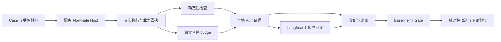

[English](EVALUATION.md) | [简体中文](EVALUATION.zh-CN.md)

# Flowmate 评测

- What failed? —— Agent 哪些能力失败了？
- Why? —— 为什么失败？
- Where in the trajectory? —— 在执行轨迹中的哪个环节失败？
- Which change caused the regression? —— 哪次修改导致能力退化？
- Which configuration works better? —— 哪种模型、策略或 Skill 配置表现更好？

评测将真实产品执行与证据、评分、可重复的比较连接起来。它帮助定位本地资料任务、发票复核和研究中的失败，再用明确 Baseline 检查产品、Prompt、策略、Skill 或模型变更。执行完成、业务回执、质量得分和回归判断回答不同问题。

Case 与 Gold 规则见[基准制作指南](EVALUATION-BENCHMARK.zh-CN.md)，配置见[模块说明](../../agent-eval/README.md)，真实截图与测量示例见 [Langfuse 操作指南](../../agent-eval/Langfuse评测与问题定位操作指南.md)。

## 架构



被测 Agent 在隔离本机 Host 中调用产品核心。评分侧接收独立 Gold 和执行事实，Gold 不进入被测 Agent 上下文。Langfuse 提供观察记录和分数，本地证据保留完整比较与 Gate。候选挖掘、重放和发布需要明确操作。

| 对象 | 含义 |
|---|---|
| Case | 任务输入、期望行为、范围与身份 |
| Gold / scenario | 独立参考证据 / 受控执行条件 |
| Dataset | 明确版本与 Case 选集 |
| Trial | 一个配置对一道 Case 执行一次 |
| Run | 一次保存的评测，含配置、各 Trial、评分与分析 |
| Trace / Session | 记录的执行树 / 组织相关执行的产品会话 |

## 轨迹：失败发生在哪个环节

从失败 Score 进入 Trace，再找到 Session。读取实际模型请求响应、工具参数与结果、子 Agent 工作和已保存业务回执，将失败对应到具体要求及其证明。控制器读到文件、模型收到文件正文、模型正确采用正文，是不同观察层次。

将事实与解释分开。缺少业务回执可以证明未记录交付，单凭这一点不能确定是 Prompt、工具报错还是模型选择导致。Provider、基础设施、Runtime 和 Judge 故障需要各自诊断；未采到的证据保留缺口。

Langfuse 上传后回读相关观察、父子关系、内容及分数。请求被接受不等于远端轨迹完整。写入结果未知时先查原操作，不能盲目重发。Benchmark 观察保留在 Run 中，不再复制为产品 Trace 文件。

## Case、Dataset 与独立 Gold

原始 Full 保留 **62 题：业务 50、研究 12**。Smoke 选择 **7 题：业务 5、研究 2**：

`FM-001、FM-002、FM-027、FM-033、FM-046、FM-051、FM-055`。

Case 定义要完成什么，Gold 用独立材料证明成功标准。原模型回答和旧评分是观察值，不能当作正确答案来源。私有检查、Gold 和后续用户轮次不提前进入被测 Agent 首轮上下文。真实输入保留原始语言、空白与轮次顺序。

由 Trace 挖掘的 Gold、Bad、Regression 候选，在校验与当前真人批准支持发布前，不属于可运行 Dataset。受控回放成功与真实模型重放成功是不同证据。缺少独立证明时保留待补证据。发布产生明确基准版本，不静默扩大原始 Full 或 Smoke。

## Evaluator：先核对行为，再判断语义

确定性检查核验实际行为和业务值。一个 Trial 的全部适用语义要求合并为**至多一次逻辑 Judge 提交**；纯确定性 Trial 无需 Judge。Judge 独立配置，不装配被测业务工具。

**评分链：Metric 独立定义 → Rubric 评分规范 → Case 选择 → Trial 合并请求 → 按 Metric 返回 Scores。** 正式指标保持 **39 项**：默认 28 项语义、11 项本地或派生；另有 2 项语义诊断。实现目录为 **55 个活动定义＝25 个确定性／派生实现＋30 个独立语义定义**，按 10 个领域文件组织。实现数量不是指标数量，也不是模型请求次数。

每个语义 Evaluator 只负责一个 Metric，独立维护版本、Rubric、适用性、证据要求、准备与校验；定义本身不持有模型客户端。Case 的 `scoring.judge` 仍使用 Metric ID；未被选择的项不会因适用性为 true 自动加入。工具预算为零等现有本地替代路径保持不变。Rubric 的多条判据不会自动成为额外指标。

调度层先处理本地确定事实，再将剩余适用语义项按原顺序合并。研究事实、引用和链条共用原始见证框架，比例继续本地计算。单项坏计数、缺项或坏证据只使该 Metric ERROR；重复／未知 Metric ID 或根级坏 JSON 使整个模型批次出现契约错误。已确认的泄露和禁止副作用不被 Judge 覆盖。错误不触发拆分、额外请求或静默截断。

新流程记录 `scoringVersion: 2`、`semantic-metric-batch` v1、`metric-json-independent/v1`、实际请求和各 Evaluator 版本。Metric 版本继续表示公式、方向和单位；Evaluator 版本表示该项评分规则。旧组定义、旧协议和原成绩只读保留，读取不使用当前 Rubric 重评。新旧评分条件不同，比较和 Gate 明确阻断。

独立校准复用同一套定义、合并请求、解析和计数，不启动被测 Agent，不把本地安全兜底计作模型判断正确。单项选择只筛选执行目标，保留原始参考与标签；结果按 Metric ID 匹配。单项校准不能证明组合表现。修改一个 Evaluator 会使其单项及包含它的组合引用不匹配；公共协议或 Judge 配置改变影响相应引用。界面区分 `not-provided`、`insufficient-coverage`、`version-mismatch` 和 `matched`，展示参考、目标组合、Judge 任务及版本；`matched` 只表示范围和版本匹配，`acceptance` 仍为 `not-assessed`。

以下是需要明确启动的真实校准入口，不随 Benchmark 或结果查询自动执行：

```powershell
bun --no-env-file run eval -- judge calibrate --dir <独立参考目录> --execution-id <校准身份> --metric tool-arguments
bun --no-env-file run eval -- judge calibrate --dir <独立参考目录> --execution-id <校准身份>
```

第一条检查单项，第二条按参考中声明的组合合并评分。参考必须保留 tune／validation、来源组和 `agent-authored`／`human-reference` 身份。工程样例和模拟传输通过不代表真实语义校准或人工批准。

保留 Judge 原始输出、指标身份、分数、见证与比例分子/分母。缺项、重复、格式错误和不可判断分别保留；未测语义不能计为质量通过。一次逻辑提交不证明底层网络请求次数或未报告的内部重试。

只有完整证据支持确无实际机会时，对应有效指标才可显示 N/A。必要和正式 Gate 指标之外的诊断可以单列，但不能据此移除必要失败。人工反馈补充原始评分，不覆盖它。

## Experiment：比较明确声明的配置

两个标准入口均执行固定双模型比较，**每题每模型重复一次**：

| 入口 | 选集与计算 | 被测 Trial 数 |
|---|---|---|
| Smoke | 7 题 × 2 模型 × 1 | 14 |
| Full | 62 题 × 2 模型 × 1 | 124 |

两个入口合计 **138 个被测 Trial**，不另加 canary。Judge 和挖掘调用不计入 Trial。一次重复只能说明本轮观察，不能证明稳定性或可靠提升。

| 职责 | 配置 |
|---|---|
| 对照组 | 现有本地网关，`gpt-6.1-sol / max` |
| 候选组 | 现有本机网关，`gpt-6-luna` / `max` |
| Judge | 现有本地网关，`gpt-6.1-terra` / `max` |
| 挖掘 | 原生 Codex CLI，`gpt-6-luna` / `max` |
| 候选重放 | 现有本机网关，`gpt-6-luna` / `max` |

比较时固定 Case 版本、材料、Gold、评分规则、环境和重复条件，明确声明模型、Prompt、策略/Skill 或代码变化。多轴同时变化，只能判断该组合，不能据此确定单一因果。汇总前先比较同 Case 的请求、回执和分数。

## Baseline 与回归 Gate

Baseline 绑定实际 Run、配置、选集与可比条件，统一存入 `agent-eval/baselines.json`。使用明确身份，不按最新结果自动替换。完整、可比且已测量的 Agent FAIL 可以成为已知失败基线；缺失结果、评分错误或条件不符不能。

| Gate 条件 | 要求 |
|---|---|
| 关键指标 | 按正确优劣方向零退步 |
| 每题必要断言 | 通过的重复次数不能下降 |
| 已发布回归断言 | 每次实际重复均通过 |
| 实际泄漏与禁止副作用 | 零 |
| 其他归一化质量比例 | 最多绝对下降 `0.02`，同时显示分子/分母 |
| 缺失、错误、不可比证据 | `blocked` |

关键聚合指标包括 task-success、false-completion、reference-fields、line-items、candidate-idempotency、actual-leakage、illegal-request-blocking、DR01、DR04；按各自方向判断，失败率越低越好。

**Smoke7 与 Full62 分开计算 Gate**。Smoke 结论只覆盖七题。Gate 输出 `pass/fail/blocked` 及原因。相对通过表示候选相对该 Baseline 未退化，两组仍可能都未完成任务；必须同时呈现绝对质量和相对回归。

## 隐私与证据保存

产品轨迹 capture、upload、自动 mining 独立控制，默认关闭；填写凭据不自动开启。运行两个评测命令则明确包含该次评测观察的上传。核对允许离开本机的材料，避免在报告、原始导出与截图中暴露凭据。

每次 Run 保存到 `agent-eval/runs/Run-<Shanghai date_time>-smoke|full-compare-01/`，包含 `README.md`、`run.json` 及必要二进制 `materials/`。JSON 保存各 Trial 原始输入输出、实际模型/工具/子 Agent 观察、业务回执、Judge、比例计数、分析及上传回读状态。所用 Case、Gold、scenario、评分快照各保存一次，Trial 通过身份引用。不再拆模型、Trial、experiment、comparison、gate、export 旁文件目录。

独立产品 Trace 采用平铺的 `Trace-<date>-<entry>-<purpose>-01.json`，内部使用 UUID。Case 质量、保存 Run、Trace、候选审核四类反馈共用 `agent-eval/feedback.json`，只在真实反馈后创建。候选与正式基准布局见[制作指南](EVALUATION-BENCHMARK.zh-CN.md)。

## 配置、UI 与命令

私有配置使用 `agent-eval/configs/.env`，同名系统环境变量优先。[模块说明](../../agent-eval/README.md)列出角色和 Langfuse 字段。Judge 使用现有本地 HTTP 网关；原生挖掘复用现有 Codex 登录；Sol 和 Luna 使用同一本地网关的独立角色，不转发外部服务凭据。

在仓库根目录执行：

```powershell
bun --no-env-file run eval:smoke
bun --no-env-file run eval:full
```

每个命令完成预检、真实执行、确定性和适用语义合并评分、本地采证、Langfuse 上传回读、诊断、比较、对应 Baseline/Gate 与可读 README。执行与采证完整时，质量失败仍是完成的测量。流程完整、绝对质量、相对 Gate 和上传验证分别报告。

Langfuse 用于查看 Score、Trace、Session 及 User 关联执行；本地 `README.md` 与 `run.json` 提供比较及 Baseline/Gate 细节。这些本地结论不是 Langfuse 原生 Gate 页面。[中文操作指南](../../agent-eval/Langfuse评测与问题定位操作指南.md)用真实 Langfuse 截图记录本次 Smoke、Full 中断与续跑，分别演示失败定位和模型比较。


## 执行预算与评分故障恢复

预算是 Run 的执行条件，不改变 Case、Gold 或评分标准。业务默认 Trial 600 秒、单 Run 180 秒、模型调用 16 次；研究默认分别为 900 秒、300 秒、24 次。准备和停止后的采证各 60 秒，停止确认沿用 5 秒。环境变量 `FLOWMATE_EVAL_BUSINESS_*`／`FLOWMATE_EVAL_RESEARCH_*` 可覆盖 `TRIAL_TIMEOUT_MS`、`RUN_TIMEOUT_MS`、`MAX_MODEL_CALLS`，同一实验两模型共用解析值。显式旧 `timeoutMs` 仍约束整题的业务执行，指定 `trialTimeoutMs` 后才分开；已确认研究 Plan 的预算继续生效，不被控制器改写。

Judge 默认输出预算为 32768 token，受模型和传输上限约束。发送前核对输入估算、输出预留和安全余量；过大时只使用既有 shared-text 无损共享编码。仍放不下则记录 `judge_context_capacity`，不提交模型、不截断关键证据、不拆分多次评分。

执行及停止事实先保存，再提交 Judge。显示分别区分执行结束、评分处理结束、必要评分充分、评分错误／证据不足和平台核对。完整证据证明没有机会时保留空比例及原计数；ERROR、未知采证和一侧零机会不能被当成通过。历史统计摘要按其原规则校验并保留，新记录使用 `statisticsPolicyVersion: 2`；旧统计不证明当前 Gate 可比。

评分设施错误需要明确补评分。只有 `score retry` 调用 Judge，**不会重跑 Agent**；`score list/show` 只读，`score upload` 只上传已保存的分数。保留并复用操作 UUID，查询未知结果时不另建操作：

```powershell
bun --no-env-file run eval -- score retry --run-id <RunId> --failed-only --operation-id <UUID>
bun --no-env-file run eval -- score list --run-id <RunId>
bun --no-env-file run eval -- score show --run-id <RunId> --revision-id <RevisionId> --execution-id <ExecutionId>
bun --no-env-file run eval -- score upload --run-id <RunId> --revision-id <RevisionId>
```

可用 `--trial <TrialId>` 限定补评分。新结果保存在同一 `run.json.scoringRevisions`，原执行、分数与 Judge 不覆盖；默认查看 Original，不自动选最新或最高分。比较、Baseline 和 Gate 使用修订时明确传 `--scoring-revision <RevisionId>`。条件不兼容仍 blocked。

修订上传只向已核对的原 Trace 添加带修订身份的 Score，不重传观察树。写入状态未知时回读原身份，不盲重发。接口不执行自动 Agent 断点续跑、额外校准或案例发布。

## 限制

工程测试和受控夹具证明实现行为，不能替代真实模型质量。一次重复不证明稳定性，相对 Gate 通过不代表绝对质量合格，Smoke 通过不代表 Full 通过。明确区分已见事实、原因假设与下次验证条件。挖掘、重放和发布不会自动执行。

专题顺序参考[固定版本 Folio 评测文档](https://github.com/helsome/folio/blob/f5822f0cb27b1f5843fe3ed5cc2f3f5baecc75de/docs/EVALUATION.md)；这里的任务领域、Langfuse 集成和操作规则依据 Flowmate。
