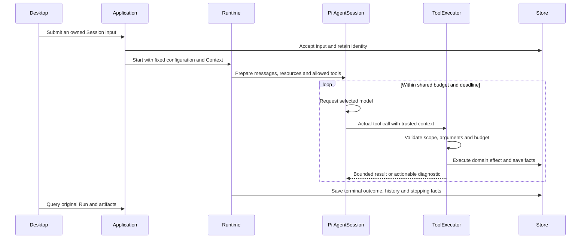

[English](agent-runtime.md) | [简体中文](agent-runtime.zh-CN.md) · [Documentation](README.md)

# Agent runtime

## The objects behind a conversation

Chats, Invoices and Deep Research keep AgentSession. [Personal Agent](personal-agent.md) uses Durable from the same Pi SDK 1.4.0 release and shares product services, tools, Workspace and Context. Each adapter owns its native history and recovery protocol.

| Object | Meaning |
|---|---|
| Session | Persistent product conversation with an explicit runtime owner |
| Session input | A particular accepted user input and its dispatch/consumption facts |
| Run | One bounded product execution with fixed configuration, scope and recorded outcome; existing states are `created`, `running`, `completed`, `failed`, `cancelled` |
| Native history / Task | AgentSession `SessionEntry`/history belongs to runtime-pi; Durable SDK-native Tasks/checkpoints belong to runtime-durable |
| InvoiceWork | A fixed invoice set and its continuing goal: `open`, `completed`, `cancelled` |
| InvoiceWorkItem | One invoice's explicit disposition: `unresolved`, `accepted`, `rejected`, `excluded` |
| Context snapshot/request | The saved basis for selected materials, workspace and the actual model request |
| ToolCall | One actual tool request, its arguments, execution, result, delivery and cleanup facts |
| Business artifact | A research source/Claim/report, invoice candidate or export with its own identity |

A Session can contain several Runs. A model's tool request is not itself a business commit. A ToolCall can have committed a candidate even if its response was lost or the Run subsequently failed. Query the original identities before deciding whether to retry.

Rejecting a candidate does not dispose of its invoice, and a failed or stopped execution does not cancel its Work. Stopped `open` Work requires explicit `continueWork`; `completed` or `cancelled` Work does not automatically revive. InvoiceWork coordinates committed business facts rather than introducing a general task system or an outer model goal loop.

## Input and execution flow

The sequence below describes AgentSession entry points. Personal Agent routes accepted Work commands to Durable submissions and native Tasks while reusing product tool admission and domain checks.

Live events help the UI refresh. Saved state and tool evidence answer whether an operation was accepted, executed, committed or delivered. A reconnect or history query does not replay input.

## Context and resource boundaries

Flowmate separates the current working basis from saved conversation and research facts. These responsibilities have different lifetimes:

| Layer | Contents and lifetime |
|---|---|
| Workspace Context | Page focus, when supplied, and selected business references and authorized materials are captured with an accepted input. Changing the page does not rewrite that input's snapshot. |
| Conversation | User inputs, assistant messages, actual tool results and Pi history/compaction entries are persisted with the Session. |
| Runtime Session | The active Agent, cancellation, budgets and in-process execution exist while their owner runs; recovery uses saved facts, not a saved copy of the live process. |
| Research preferences | Text explicitly saved in **Settings → General → Research preferences** is captured with its settings revision for each research Run. A change affects a later Run, not one already running. |
| Research checkpoint | The confirmed plan, step executions, source identities and report facts are read from the ResearchTask and actual records; the checkpoint is a projection of those facts. |

For new AgentSession prompt, steer and follow-up inputs, the product saves the applicable focus and selected material basis in a Context Snapshot. Before a model request, the Pi adapter adds a request-local system section using that input's snapshot, the Run's captured preferences and, when applicable, the current saved research checkpoint. Automatically captured page state is not appended to the native user message or accumulated as conversation text. An explicit user message or expanded template remains part of the input. The saved snapshot and request binding allow the basis to be inspected in **Session details → Context**.

Historical records are not rewritten to remove earlier page content. Pi continues to own AgentSession history and compaction; request-local projection does not replace saved conversation history. Fill Form retains its frozen Workspace input path, and Personal Agent retains its separate Durable phase context. Research preference text and material content are untrusted data: they do not grant permissions or expand a task's authorized source scope. A model request may send this context to the selected provider.

Merely reading a material on the controller side is weaker evidence than showing it in the actual model request; neither proves semantic use by the model. Without an external memory connection, Flowmate does not extract long-term preferences from conversations.

### Long AgentSession conversations

In **Session details**, check the saved input and its Context before resuming an interrupted conversation. A saved input and its consumption by the runtime are distinct. If the reply or receipt is missing, inspect the original input and Run before sending again. Revoked material access or unusable native history can block continuation while saved facts remain readable. Refreshing resources affects future selections.

Pi's automatic compaction follows the policy captured for an eligible Run. When an eligible root Session is idle, **Context compaction** lets you select a **Compaction model** and choose **Compact context**. **Refresh compaction** shows whether the summary was generated and saved. The summary reduces future model context and preserves the original history. Capacity estimates and displayed summaries do not replace saved history. Child Sessions cannot be manually compacted through the root Session operation.

Use **Continue from this reply** in the conversation, or **Continue here** or **Fork chat** on an eligible saved history entry. Continuing selects a history point in the existing Session. A fork creates a separate chat from the selected point. A later explicit input starts execution. Personal Agent's separate [Durable history and compaction](personal-agent.md#personal-long-sessions) follow Work phases and native Tasks.

### Authorization and privacy in AgentSession

Select the Workspace and materials you intend to share before sending. The accepted input records the authorized scope, and tool admission checks that scope independently of the model's instructions. **Confirm plan version** authorizes a saved research plan. In **Invoices**, review the original and parsed evidence before **Accept result**. A generated candidate or a form fill remains separate from acceptance. See [Workflows](workflows.md).

Confirm the text and scope before saving a memory. Turning on automatic capture requires a separate confirmation. For credential handling and unknown memory writes, see [OpenViking memory](#openviking-memory). Per-invoice waiting and desktop or browser approvals are documented in [Personal Agent](personal-agent.md#personal-approvals).

## Configure OpenViking memory

OpenViking is optional and the default backend is Native. Existing Sessions and Works retain their original bindings when the default changes. Previously saved history is not automatically uploaded. Local and cloud memory use separate services, accounts, credentials and data, without automatic synchronization or reuse of WeKnora's instance. AgentSession chats and Personal Agent Works also have separate recall scopes within each location. Authorized entries with verifiable sources are untrusted references for the current request. Saved conversation history, compaction summaries and Work facts retain their own roles. When OpenViking is unavailable, memory can be unavailable while authorized business execution continues.

1. Open **Settings → Connections → Long-term memory** and select **This device** or **Connected cloud workspace**. On this device, use **Connect OpenViking from file** with a loopback endpoint, account, user, peer and ordinary user key. Flowmate copies the key to Windows secure storage and leaves the selected file on disk. Ordinary operations reject administrator and Root keys. Background service mode uses its own secure credential store. For the connected cloud workspace, Authority needs its own configured memory service and credential. See the [cloud service instructions](../../deploy/cloud/README.zh-CN.md).
2. Use **Backend for new conversations** to select OpenViking, and save the desired recall and capture policies. **Recall authorized memories** controls automatic recall. **Completed chats** requires separate consent and captures only successful ordinary chat turns after activation. Work has [its own explicit saving flow](personal-agent.md#personal-memory).
3. Use **Save a memory** to confirm the text, original completed chat input or Work phase, and the authorized scope. **Search authorized memories** runs against the selected original input or phase without enabling automatic recall. **Saved memories** shows entries and their sources and grants. Entries lacking a verifiable origin are excluded from automatic recall.
4. **Forget memory** blocks future recall of the entry and requests removal from the original service. Under **Memory operations**, use **Check original request** for a save or **Check original forget request** for a removal if its outcome is unknown, including after a restart. For local automatic capture, **Check original synchronization** checks an unknown sync result. Check the saved receipt before retrying a write. Disabling recall or forgetting a memory leaves existing conversation history and committed business records under their own retention rules.

AgentSession skips automatic recall when the input contains a recognizable credential marker, such as a labeled password or private key header. If an input or the final answer contains a marker, it skips automatic capture for that turn. Explicit saving and manual search use the source and scope you select. Continuing from history or forking uses a new remote memory Session. A fork inherits the original chat's currently valid chat-scoped memory authorization.

Search, saving and extraction depend on the selected OpenViking service and its model services. Local memory work requires the local service and its host to be running, including WSL2 when the service runs there.

### OpenViking management

The **OpenViking management** panel on the same page uses a separate identity file. For a local connection, provide a loopback `endpoint`, `apiKey` and `role`. P also requires `accountId`, `userId` and `peerId`. A requires `accountId` and `userId`. S uses a system administrator key.

For cloud management, provide `kind: "cloud"`, `workspaceId`, `role` and a `target` with `host`, `port`, `username`, `privateKeyPath` and `knownHostsPath`. Use the dedicated SSH identity for that role. Authority checks the workspace, role and OpenViking identity and holds the service credential. See the [cloud service instructions](../../deploy/cloud/README.zh-CN.md) for role setup.

Select an operation and enter the listed parameters as JSON. Uploads, downloads, private Options and exported user keys use native file dialogs. Cloud files use 256 KiB chunks with a 256 MiB limit per file. To resume an upload, retry the original operation within the same desktop management connection, using the original file selection and the offset confirmed by Authority. **Check original target or resume file** resumes a download from local staging after reconnecting or reopening. Writes require native confirmation and an encrypted receipt for the management identity. Reconcile unknown results or async tasks using the original operation. Abandoning reconciliation closes the local receipt while the remote result may remain unknown.

## Budgets and tool execution

Defaults are centralized in [runtime-config.ts](../../packages/contracts/src/runtime-config.ts). New Runs may use validated settings overrides; inspect the saved configuration for the actual values.

| Default | Value |
|---|---|
| Model requests, workspace / pure chat | 16 / 12 |
| Tool calls | 24 |
| Single-tool configured timeout | 10,000 ms |
| Run timeout, ordinary / save-candidate | 60,000 / 120,000 ms |
| Stop confirmation wait | 5,000 ms |
| Cumulative tool feedback capacity | 8 MiB in UTF-8 |
| Provider automatic retries | 0 |

These are product call/time/byte constraints, not invented model token capacities. Actual model context/output capabilities come from prepared model metadata. Before each model request, budget awareness can describe remaining calls/time, diagnostics and bounded tool experience; executor guards enforce the limits independently of prompt wording.

Tool admission validates trusted Run/Session context, allowed tools, material scope, cancellation and input schema. Post-execution checks validate result structure, domain effects, persistence and delivery. Eligible custom PURE/READ tool timing can use a bounded P95 strategy, with configured fallback when samples are insufficient or unsuitable. The configured limits and remaining Run time still constrain execution.

AgentSession children use separate Sessions/Runs; Durable children retain native Task ownership with product Run provenance. Both share their owner's model-call, tool-call and feedback budgets. AgentSession child admission reserves one root continuation request; Durable checks the remaining Work model budget without promising that reservation. At most four owned children are admitted, with no nesting; Personal Agent permits only the read-only `invoice-evidence-checker` role. Both paths' child-specific rules live in [Subagents](subagents.md).

## Stopping and recovery

Stop closes admission and requests cancellation, then waits for actual stopping, history and necessary persistence. Cancellation acceptance, a terminal status, `cleanup.stopped` and a confirmed stop timestamp are distinct facts. Unconfirmed execution is not a free concurrency slot.

When required stopping or saving cannot be confirmed, the selected runtime may become unusable until restart/recheck. Recovery checks original accepted work, retained evidence, permissions and budgets. AgentSession does not replay interrupted model/tool requests; Durable recovers only eligible native Tasks with original operation and receipt identities. An unknown write response should be resolved by querying its original operation/ToolCall rather than submitting a new identity.

Use Session Details/Context, Activity and Processing History to inspect the relevant Run. Confirmed stopping, local SDK execution and saved output do not prove semantic correctness; [Evaluation](EVALUATION.md) measures quality separately. Data backup and restore verification are covered in [Packaging and recovery](packaging-and-recovery.md).

## Source and tests

- [RuntimeService](../../packages/core/src/runtime/service.ts), [Session service](../../packages/core/src/sessions), [Context](../../packages/core/src/context)
- [Tool executor](../../packages/core/src/tools/executor.ts), [Pi Session adapter](../../packages/runtime-pi/src/session.ts), [Durable adapter](../../packages/runtime-durable/src/index.ts), [Personal Agent services](../../packages/core/src/personal-agent)
- [Lifecycle tests](../../tests/core/runtime), [cold-start recovery](../../tests/core/application/cold-start-recovery.integration.test.ts), [Context integration](../../tests/runtime-pi/context.integration.test.ts), [request-layer tests](../../tests/core/research/layered-context.integration.test.ts)
