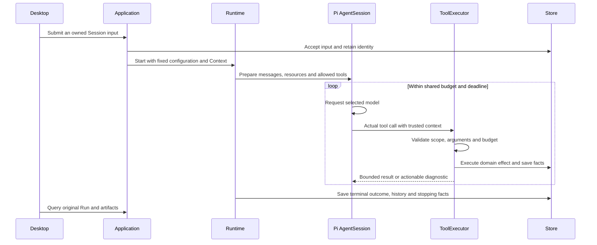

[English](agent-runtime.md) | [简体中文](agent-runtime.zh-CN.md) · [Documentation](README.md)

# Agent runtime

## The objects behind a conversation

Chats, Invoices and Deep Research keep AgentSession. [Personal Agent](personal-agent.md) uses Durable from the same Pi SDK 1.4.0 release and shares product services, tools, Workspace and Context. Each adapter owns its native history and recovery protocol.

| Object | Meaning |
|---|---|
| Session | Persistent product conversation with an explicit runtime owner |
| Session input | A particular accepted user input and its dispatch/consumption facts |
| Run | One bounded product execution with fixed configuration, scope and recorded outcome; existing states are `created`, `running`, `completed`, `failed`, `cancelled` |
| Native history / Task | AgentSession `SessionEntry`/history belongs to runtime-pi; Durable SDK-native Tasks/checkpoints belong to runtime-durable |
| InvoiceWork | A fixed invoice set and its continuing goal: `open`, `completed`, `cancelled` |
| InvoiceWorkItem | One invoice's explicit disposition: `unresolved`, `accepted`, `rejected`, `excluded` |
| Context snapshot/request | The saved basis for selected materials, workspace and the actual model request |
| ToolCall | One actual tool request, its arguments, execution, result, delivery and cleanup facts |
| Business artifact | A research source/Claim/report, invoice candidate or export with its own identity |

A Session can contain several Runs. A model's tool request is not itself a business commit. A ToolCall can have committed a candidate even if its response was lost or the Run subsequently failed. Query the original identities before deciding whether to retry.

Rejecting a candidate does not dispose of its invoice, and a failed or stopped execution does not cancel its Work. Stopped `open` Work requires explicit `continueWork`; `completed` or `cancelled` Work does not automatically revive. InvoiceWork coordinates committed business facts rather than introducing a general task system or an outer model goal loop.

## Input and execution flow

The sequence below describes AgentSession entry points. Personal Agent routes accepted Work commands to Durable submissions and native Tasks while reusing product tool admission and domain checks.

Live events help the UI refresh. Saved state and tool evidence answer whether an operation was accepted, executed, committed or delivered. A reconnect or history query does not replay input.

## Context and resource boundaries

The product saves the selected materials and workspace basis with the input/Run. The adapter connects this basis to native messages and model request evidence. Merely reading a material on the controller side is weaker evidence than showing it in the actual model request; neither proves semantic use by the model.

Resource refresh affects future selections, not historical run copies. Revoked material access or unusable native history can block continued model use while leaving saved facts inspectable. Automatic/native compaction and explicit Session compaction use the Pi history path; a displayed summary is not a replacement for missing committed history. Child Sessions cannot be manually compacted through the root Session operation.

These Session history/compaction operations remain AgentSession-owned. Durable keeps its own native Task, entry and checkpoint records; inspecting or recovering AgentSession history does not turn `SessionEntry` into a Durable checkpoint.

## Budgets and tool execution

Defaults are centralized in [runtime-config.ts](../../packages/contracts/src/runtime-config.ts). New Runs may use validated settings overrides; inspect the saved configuration for the actual values.

| Default | Value |
|---|---|
| Model requests, workspace / pure chat | 16 / 12 |
| Tool calls | 24 |
| Single-tool configured timeout | 10,000 ms |
| Run timeout, ordinary / save-candidate | 60,000 / 120,000 ms |
| Stop confirmation wait | 5,000 ms |
| Cumulative tool feedback capacity | 8 MiB in UTF-8 |
| Provider automatic retries | 0 |

These are product call/time/byte constraints, not invented model token capacities. Actual model context/output capabilities come from prepared model metadata. Before each model request, budget awareness can describe remaining calls/time, diagnostics and bounded tool experience; executor guards enforce the limits independently of prompt wording.

Tool admission validates trusted Run/Session context, allowed tools, material scope, cancellation and input schema. Post-execution checks validate result structure, domain effects, persistence and delivery. Eligible custom PURE/READ tool timing can use a bounded P95 strategy, with configured fallback when samples are insufficient or unsuitable. The configured limits and remaining Run time still constrain execution.

AgentSession children use separate Sessions/Runs; Durable children retain native Task ownership with product Run provenance. Both share their owner's model-call, tool-call and feedback budgets. AgentSession child admission reserves one root continuation request; Durable checks the remaining Work model budget without promising that reservation. At most four owned children are admitted, with no nesting; Personal Agent permits only the read-only `invoice-evidence-checker` role. Both paths' child-specific rules live in [Subagents](subagents.md).

## Stopping and recovery

Stop closes admission and requests cancellation, then waits for actual stopping, history and necessary persistence. Cancellation acceptance, a terminal status, `cleanup.stopped` and a confirmed stop timestamp are distinct facts. Unconfirmed execution is not a free concurrency slot.

When required stopping or saving cannot be confirmed, the selected runtime may become unusable until restart/recheck. Recovery checks original accepted work, retained evidence, permissions and budgets. AgentSession does not replay interrupted model/tool requests; Durable recovers only eligible native Tasks with original operation and receipt identities. An unknown write response should be resolved by querying its original operation/ToolCall rather than submitting a new identity.

Use Session Details/Context, Activity and Processing History to inspect the relevant Run. Confirmed stopping, local SDK execution and saved output do not prove semantic correctness; [Evaluation](EVALUATION.md) measures quality separately. Data backup and restore verification are covered in [Packaging and recovery](packaging-and-recovery.md).

## Source and tests

- [RuntimeService](../../packages/core/src/runtime/service.ts), [Session service](../../packages/core/src/sessions), [Context](../../packages/core/src/context)
- [Tool executor](../../packages/core/src/tools/executor.ts), [Pi Session adapter](../../packages/runtime-pi/src/session.ts), [Durable adapter](../../packages/runtime-durable/src/index.ts), [Personal Agent services](../../packages/core/src/personal-agent)
- [Lifecycle tests](../../tests/core/runtime), [cold-start recovery](../../tests/core/application/cold-start-recovery.integration.test.ts), [Context integration](../../tests/runtime-pi/context.integration.test.ts)
