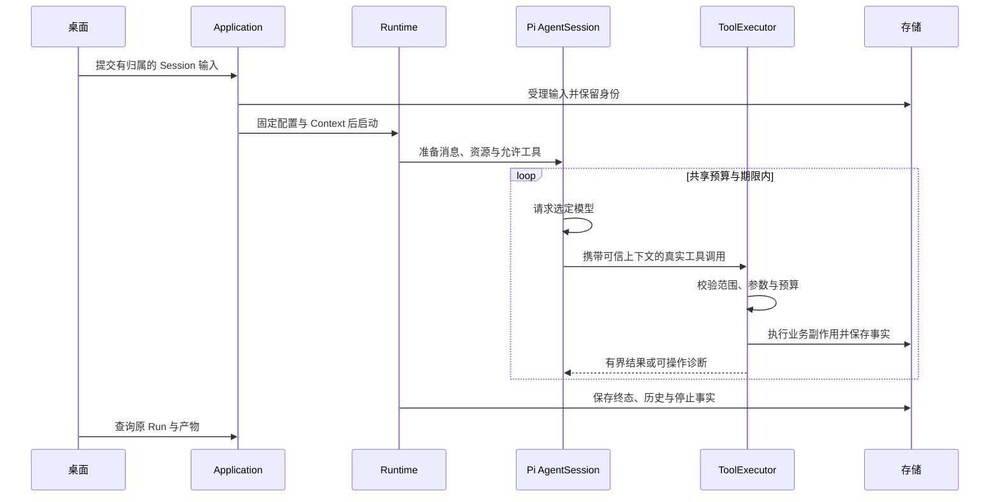

[English](agent-runtime.md) | [简体中文](agent-runtime.zh-CN.md) · [文档导航](README.zh-CN.md)

# Agent Runtime

## 会话背后的对象

Chats、Invoices、Deep Research 保留 AgentSession，[Personal Agent](personal-agent.zh-CN.md) 使用同一 Pi SDK 1.4.0 发行版的 Durable，共享产品服务、工具、Workspace 与 Context。各适配器分别负责原生历史及恢复协议。

| 对象 | 含义 |
|---|---|
| Session | 具有明确运行时归属的持久产品会话 |
| Session input | 一次受理的用户输入及其分发、消费事实 |
| Run | 具有固定配置、范围与记录结果的一次有界产品执行，沿用 `created`、`running`、`completed`、`failed`、`cancelled` 五态 |
| 原生历史 / Task | AgentSession 的 `SessionEntry`/历史归 runtime-pi；Durable SDK 原生 Task/检查点归 runtime-durable |
| InvoiceWork | 固定一组发票及持续整理目标：`open`、`completed`、`cancelled` |
| InvoiceWorkItem | 单票明确处置：`unresolved`、`accepted`、`rejected`、`excluded` |
| Context snapshot/request | 选材、工作区及实际模型请求的保存依据 |
| ToolCall | 一次真实工具请求及参数、执行、结果、交付与清理事实 |
| 业务产物 | 具有独立身份的研究来源、Claim、报告、发票候选或导出 |

一个 Session 可以包含多个 Run。模型请求工具不等于业务提交；工具可能已提交候选，但回复丢失或 Run 后续失败。重试前应查询原始身份。

驳回候选不等于处置此票，执行失败或停止不等于取消事项。停止后的 `open` 事项需要显式 `continueWork`，`completed`、`cancelled` 事项不自动复活。InvoiceWork 根据已提交业务事实协调推进，不引入通用任务系统或外层模型目标循环。

## 输入与执行路径

下图描述 AgentSession 既有入口。Personal Agent 将已受理的事项命令路由为 Durable submission 与原生 Task，同时复用产品工具准入和领域检查。

实时事件帮助 UI 刷新，持久状态与工具证据用于判断操作是否受理、执行、提交或交付。重连与历史查询不会重放输入。

## Context 与资源边界

产品将选材和工作区依据与输入、Run 关联保存，适配器将它们接入原生消息及模型请求证据。控制器读到材料，不如实际模型请求包含材料的证据充分；两者都不能证明模型语义采用。

资源刷新影响后续选择，不替换历史运行副本。资料权限撤回或原生历史不可用可能阻断继续请求模型，已保存事实仍可查看。自动原生压缩与显式 Session 压缩沿 Pi 历史路径执行，界面摘要不替代缺失的已提交历史。子 Session 不能通过根 Session 操作手动压缩。

上述 Session 历史和压缩操作仍由 AgentSession 路径负责；Durable 自行保留原生 Task、entry 与检查点记录。查看或恢复 AgentSession 历史，不会将 `SessionEntry` 变为 Durable 检查点。

## 预算与工具执行

默认值集中于 [runtime-config.ts](../../packages/contracts/src/runtime-config.ts)。新 Run 可以使用经过校验的设置覆盖，实际值以原 Run 保存配置为准。

| 默认项 | 数值 |
|---|---|
| 工作区 / 纯聊天模型请求次数 | 16 / 12 |
| 工具次数 | 24 |
| 单工具配置时限 | 10,000 ms |
| 普通 / save-candidate Run 时限 | 60,000 / 120,000 ms |
| 停止确认等待 | 5,000 ms |
| 累计工具反馈容量 | UTF-8 8 MiB |
| Provider 自动重试 | 0 |

以上是产品调用、时间与字节约束，不是另造的模型 Token 容量。模型上下文和输出能力取自实际准备的模型元数据。每次模型请求前可提示剩余次数、时间、诊断及有界工具经验，执行器独立落实限制。

工具准入校验可信 Run/Session 上下文、允许工具、资料范围、取消状态与输入 Schema；执行后检查输出结构、业务副作用、保存与交付。符合条件的自定义 PURE/READ 工具可使用有界 P95 时限策略，样本不足或不适用时回退配置。配置上限与 Run 剩余时间继续生效。

AgentSession 子任务有独立 Session/Run，Durable 子任务保留原生 Task 归属及产品 Run 来源。两者共享所属模型调用、工具次数与反馈预算。AgentSession 子任务准入为根任务保留一次继续请求；Durable 检查 Work 的剩余模型预算，但不承诺该预留。最多准入四个归属明确的子任务，禁止嵌套；Personal Agent 仅允许只读 `invoice-evidence-checker` 角色。两条路径的详细规则见 [Subagent](subagents.zh-CN.md)。

## 停止与恢复

Stop 关闭准入并请求取消，随后等待实际停止、历史和必要记录保存。取消受理、终态、`cleanup.stopped` 与确认停止时间是不同事实，停止未确认不等于名额已释放。

必要停止或保存无法确认时，对应运行时可能阻断复用，等待重启和重新核对。恢复检查原受理事项、保留证据、权限及预算；AgentSession 不重放中断的模型/工具请求，Durable 仅以原操作和收据身份恢复具备资格的原生 Task。写入回复未知时，应查询原操作或 ToolCall，而非换新身份重投。

可在 Session Details/Context、Activity 与 Processing History 查看相关 Run。停止确认、本地 SDK 执行及输出保存都不证明语义正确，[评测](EVALUATION.zh-CN.md)单独衡量质量；数据备份与恢复核验见[打包与恢复](packaging-and-recovery.zh-CN.md)。

## 源码与测试

- [RuntimeService](../../packages/core/src/runtime/service.ts)、[Session 服务](../../packages/core/src/sessions)、[Context](../../packages/core/src/context)
- [工具执行器](../../packages/core/src/tools/executor.ts)、[Pi Session 适配器](../../packages/runtime-pi/src/session.ts)、[Durable 适配器](../../packages/runtime-durable/src/index.ts)、[Personal Agent 服务](../../packages/core/src/personal-agent)
- [生命周期测试](../../tests/core/runtime)、[冷启动恢复](../../tests/core/application/cold-start-recovery.integration.test.ts)、[Context 接合](../../tests/runtime-pi/context.integration.test.ts)
