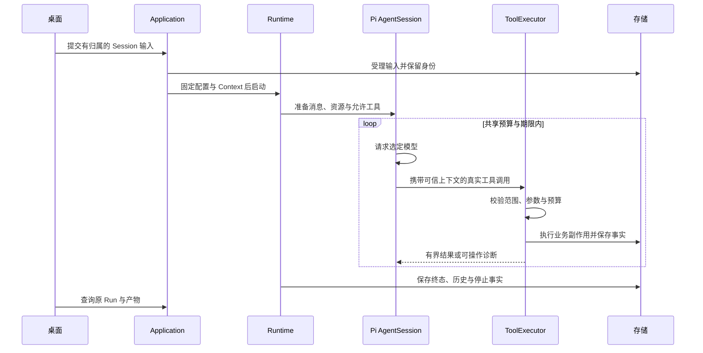

[English](agent-runtime.md) | [简体中文](agent-runtime.zh-CN.md) · [文档导航](README.zh-CN.md)

# Agent Runtime

## 会话背后的对象

Chats、Invoices、Deep Research 保留 AgentSession，[Personal Agent](personal-agent.zh-CN.md) 使用同一 Pi SDK 1.4.0 发行版的 Durable，共享产品服务、工具、Workspace 与 Context。各适配器分别负责原生历史及恢复协议。

| 对象 | 含义 |
|---|---|
| Session | 具有明确运行时归属的持久产品会话 |
| Session input | 一次受理的用户输入及其分发、消费事实 |
| Run | 具有固定配置、范围与记录结果的一次有界产品执行，沿用 `created`、`running`、`completed`、`failed`、`cancelled` 五态 |
| 原生历史 / Task | AgentSession 的 `SessionEntry`/历史归 runtime-pi；Durable SDK 原生 Task/检查点归 runtime-durable |
| InvoiceWork | 固定一组发票及持续整理目标：`open`、`completed`、`cancelled` |
| InvoiceWorkItem | 单票明确处置：`unresolved`、`accepted`、`rejected`、`excluded` |
| Context snapshot/request | 选材、工作区及实际模型请求的保存依据 |
| ToolCall | 一次真实工具请求及参数、执行、结果、交付与清理事实 |
| 业务产物 | 具有独立身份的研究来源、Claim、报告、发票候选或导出 |

一个 Session 可以包含多个 Run。模型请求工具不等于业务提交；工具可能已提交候选，但回复丢失或 Run 后续失败。重试前应查询原始身份。

驳回候选不等于处置此票，执行失败或停止不等于取消事项。停止后的 `open` 事项需要显式 `continueWork`，`completed`、`cancelled` 事项不自动复活。InvoiceWork 根据已提交业务事实协调推进，不引入通用任务系统或外层模型目标循环。

## 输入与执行路径

下图描述 AgentSession 既有入口。Personal Agent 将已受理的事项命令路由为 Durable submission 与原生 Task，同时复用产品工具准入和领域检查。

实时事件帮助 UI 刷新，持久状态与工具证据用于判断操作是否受理、执行、提交或交付。重连与历史查询不会重放输入。

## Context 与资源边界

Flowmate 将当前工作依据与已保存会话、研究事实分开管理。这些职责具有不同生命周期：

| 层次 | 内容与生命周期 |
|---|---|
| Workspace Context | 随已受理输入捕获选定业务引用、授权资料及提供时的页面焦点；切页不会改写该输入的快照。 |
| Conversation | 用户输入、助手消息、真实工具结果及 Pi 历史／压缩记录随 Session 持久保存。 |
| Runtime Session | 活跃 Agent、取消、预算和进程内执行在控制者运行期间存在；恢复使用已保存事实，而非保存一份活动进程副本。 |
| Research preferences | 在 **Settings → General → Research preferences** 明确保存的文字与设置 revision 随每次研究 Run 捕获；修改用于后续 Run，不改写正在运行的 Run。 |
| Research checkpoint | 已确认计划、步骤执行、来源身份和报告事实来自 ResearchTask 与真实记录；Checkpoint 是这些事实的投影。 |

对新的 AgentSession prompt、steer 和 follow-up 输入，产品将适用焦点与选材依据保存在 Context Snapshot。每次模型请求前，Pi 适配器根据该输入快照、Run 捕获的偏好以及适用时的当前已保存研究 Checkpoint，加入仅本次请求使用的 system section。自动捕获的页面状态不会拼进原生用户消息或作为对话文字累积；用户明确输入或展开的模板仍属于输入。可在 **Session details → Context** 中检查已保存快照和请求绑定。

历史记录不会为了清除旧页面内容而追溯改写。Pi 继续负责 AgentSession 历史与压缩，请求级投影不替代已保存的会话历史。Fill Form 保留其固定 Workspace 输入路径，Personal Agent 保留独立 Durable 阶段上下文。研究偏好和资料内容均为不可信数据，不能授予权限或扩大任务授权来源；模型请求可能将这些上下文发送至选定服务。

控制器读到材料，不如实际模型请求包含材料的证据充分；两者都不能证明模型语义采用。未配置外置记忆时，Flowmate 不从对话自动提炼长期偏好。

### AgentSession 长会话

中断后，先在 **Session details** 核对保存的输入及其 Context。输入已保存和已被运行时消费是不同状态。回复或回执丢失时，先查询原输入和 Run，再决定是否发送。资料权限撤回或原生历史不可用时，后续执行可能受阻，已保存事实仍可查看。资源刷新影响后续选择。

Pi 根据符合条件的 Run 保存的策略自动压缩。符合条件的根 Session 空闲时，可在 **Context compaction** 选择 **Compaction model** 并点击 **Compact context**，再用 **Refresh compaction** 核对摘要是否生成和保存。摘要缩短后续模型上下文，原历史继续保存。容量估计和界面摘要不能代替已保存历史。子 Session 不能通过根 Session 手动压缩。

在对话里用 **Continue from this reply**，或在符合条件的已保存历史条目上用 **Continue here**、**Fork chat**。继续是在原 Session 选择历史位置，fork 是从所选位置创建独立聊天。之后明确提交新输入才启动执行。Personal Agent 的 [Durable 历史与压缩](personal-agent.zh-CN.md#personal-long-sessions) 按 Work 阶段和原生 Task 管理。

### AgentSession 的授权与隐私

发送前选择本次使用的 Workspace 和资料。受理输入时记录授权范围，工具准入独立核对该范围。研究通过 **Confirm plan version** 授权已保存的计划。发票在 **Invoices** 中核对原件和解析证据，再选择 **Accept result**。生成候选、填表和接受分别记录。见[业务流程](workflows.zh-CN.md)。

保存记忆前确认文字和授权范围，启用自动采集需要另行确认。凭证标记和记忆写入结果未知的处理见 [OpenViking 记忆](#openviking-memory)。逐票等待与桌面或浏览器审批见 [Personal Agent](personal-agent.zh-CN.md#personal-approvals)。

## OpenViking 记忆

OpenViking 为可选功能，默认后端为 Native。改变默认值后，已有 Session 和 Work 保持原绑定，旧历史不会自动上传。本机和云端使用独立服务、账号、凭据与数据，彼此不自动同步，也不复用 WeKnora 的实例。同一位置内，AgentSession 会话和 Personal Agent Work 也分别在自己的授权范围内召回。符合授权且有可靠来源的条目作为当次请求的不可信参考。会话历史、压缩摘要和 Work 事实各自保留。服务不可用时，记忆可能不可用，原有业务仍可按授权继续。

1. 打开 **Settings → Connections → Long-term memory**，选择 **This device** 或 **Connected cloud workspace**。在本机使用 **Connect OpenViking from file**，连接文件需要回环地址、account、user、peer 和普通用户密钥。Flowmate 将密钥复制到 Windows 安全存储，原文件保留在磁盘上。普通记忆操作拒绝管理员和 Root 密钥。后台服务模式使用自己的安全凭据存储。已连接的云端工作区由 Authority 单独配置记忆服务和凭据，见[云端服务说明](../../deploy/cloud/README.zh-CN.md)。
2. 在 **Backend for new conversations** 选择 OpenViking，保存召回和采集策略。**Recall authorized memories** 控制自动召回。**Completed chats** 需要单独确认，只采集启用后成功完成的普通聊天轮次。Work 使用[自己的显式保存流程](personal-agent.zh-CN.md#personal-memory)。
3. 用 **Save a memory** 确认文字、原已完成聊天输入或 Work 阶段，以及授权范围。**Search authorized memories** 按所选原输入或阶段手动检索，不启用自动召回。**Saved memories** 可查条目、来源与授权。缺少可验证来源的条目不参与自动召回。
4. **Forget memory** 阻止未来召回该条目，并向原服务请求移除。结果未知时，在 **Memory operations** 中用 **Check original request** 核对保存，用 **Check original forget request** 核对移除，重启后仍可查。本机自动采集的同步结果未知时，使用 **Check original synchronization**。重试写入前先查原回执。禁用召回或遗忘后，已保存历史和已提交业务记录按各自的规则保留。

AgentSession 输入含可识别的凭证标记时跳过当次自动召回，例如明确标注的密码或私钥头。如果输入或最终回答含这类标记，则跳过整轮自动采集。显式保存与手动搜索仍依据用户选择的来源和范围。从历史继续或 fork 会使用新的远端记忆 Session。fork 继承原聊天当前有效的会话级记忆授权。

检索、保存和提炼依赖所选 OpenViking 服务和其模型服务。本机记忆依赖本机服务及宿主运行，服务部署在 WSL2 时也需要 WSL2 可用。

### OpenViking 管理

同页的 **OpenViking management** 使用单独的身份文件。本机文件包含回环 `endpoint`、`apiKey` 和 `role`。P 还需要 `accountId`、`userId`、`peerId`。A 需要 `accountId` 和 `userId`。S 使用系统管理员密钥。

云端文件包含 `kind: "cloud"`、`workspaceId`、`role` 和 `target`，其中 `target` 包含 `host`、`port`、`username`、`privateKeyPath` 和 `knownHostsPath`。桌面使用角色专属 SSH 身份，Authority 核对工作区、角色和 OpenViking 身份并持有服务凭据。角色设置见[云端服务说明](../../deploy/cloud/README.zh-CN.md)。

选择操作后按界面填写 JSON 参数。上传、下载、私密 Options 和导出的用户密钥使用系统文件对话框。云端文件按 256 KiB 分块传送，单文件上限 256 MiB。上传断线后在同一桌面管理连接中重试原操作，使用原文件选择并从 Authority 已确认的偏移继续。下载可在重连或重开后用 **Check original target or resume file** 从本机暂存文件继续。写入须在原生对话框确认，并为该管理身份保存加密回执。未知结果或异步任务按原操作核对。确认放弃会关闭本地回执，远端结果可能仍然未知。

## 预算与工具执行

默认值集中于 [runtime-config.ts](../../packages/contracts/src/runtime-config.ts)。新 Run 可以使用经过校验的设置覆盖，实际值以原 Run 保存配置为准。

| 默认项 | 数值 |
|---|---|
| 工作区 / 纯聊天模型请求次数 | 16 / 12 |
| 工具次数 | 24 |
| 单工具配置时限 | 10,000 ms |
| 普通 / save-candidate Run 时限 | 60,000 / 120,000 ms |
| 停止确认等待 | 5,000 ms |
| 累计工具反馈容量 | UTF-8 8 MiB |
| Provider 自动重试 | 0 |

以上是产品调用、时间与字节约束，不是另造的模型 Token 容量。模型上下文和输出能力取自实际准备的模型元数据。每次模型请求前可提示剩余次数、时间、诊断及有界工具经验，执行器独立落实限制。

工具准入校验可信 Run/Session 上下文、允许工具、资料范围、取消状态与输入 Schema；执行后检查输出结构、业务副作用、保存与交付。符合条件的自定义 PURE/READ 工具可使用有界 P95 时限策略，样本不足或不适用时回退配置。配置上限与 Run 剩余时间继续生效。

AgentSession 子任务有独立 Session/Run，Durable 子任务保留原生 Task 归属及产品 Run 来源。两者共享所属模型调用、工具次数与反馈预算。AgentSession 子任务准入为根任务保留一次继续请求；Durable 检查 Work 的剩余模型预算，但不承诺该预留。最多准入四个归属明确的子任务，禁止嵌套；Personal Agent 仅允许只读 `invoice-evidence-checker` 角色。两条路径的详细规则见 [Subagent](subagents.zh-CN.md)。

## 停止与恢复

Stop 关闭准入并请求取消，随后等待实际停止、历史和必要记录保存。取消受理、终态、`cleanup.stopped` 与确认停止时间是不同事实，停止未确认不等于名额已释放。

必要停止或保存无法确认时，对应运行时可能阻断复用，等待重启和重新核对。恢复检查原受理事项、保留证据、权限及预算；AgentSession 不重放中断的模型/工具请求，Durable 仅以原操作和收据身份恢复具备资格的原生 Task。写入回复未知时，应查询原操作或 ToolCall，而非换新身份重投。

可在 Session Details/Context、Activity 与 Processing History 查看相关 Run。停止确认、本地 SDK 执行及输出保存都不证明语义正确，[评测](EVALUATION.zh-CN.md)单独衡量质量；数据备份与恢复核验见[打包与恢复](packaging-and-recovery.zh-CN.md)。

## 源码与测试

- [RuntimeService](../../packages/core/src/runtime/service.ts)、[Session 服务](../../packages/core/src/sessions)、[Context](../../packages/core/src/context)
- [工具执行器](../../packages/core/src/tools/executor.ts)、[Pi Session 适配器](../../packages/runtime-pi/src/session.ts)、[Durable 适配器](../../packages/runtime-durable/src/index.ts)、[Personal Agent 服务](../../packages/core/src/personal-agent)
- [生命周期测试](../../tests/core/runtime)、[冷启动恢复](../../tests/core/application/cold-start-recovery.integration.test.ts)、[Context 接合](../../tests/runtime-pi/context.integration.test.ts)、[请求分层测试](../../tests/core/research/layered-context.integration.test.ts)
