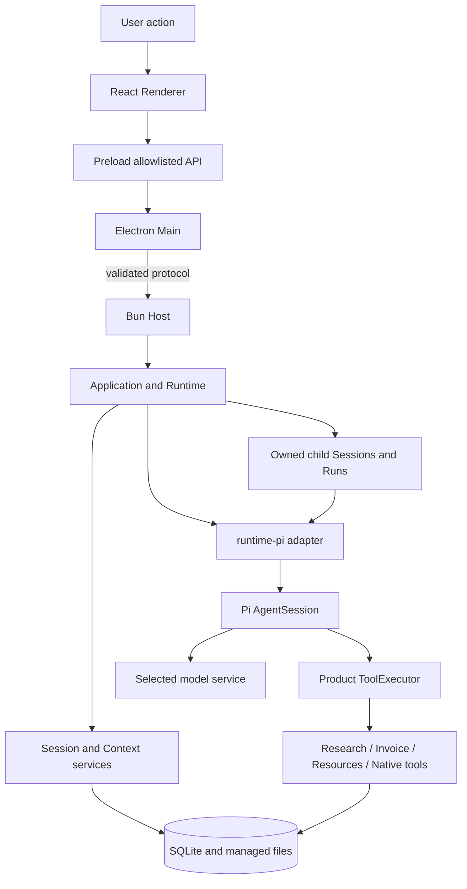

[English](architecture.md) | [简体中文](architecture.zh-CN.md) · [Documentation](README.md)

# Architecture

## Process and trust boundaries

Electron renders the workbench and owns windows and operating-system integration. A Bun Host owns the product Application and local database access. Pi AgentSession runs in that Host through the product adapter. The Renderer uses a narrow Preload API rather than reading SQLite or calling the SDK directly.

Host messages carry validated request and ownership identities. Notifications wake readers; saved queries supply authoritative state. A missing or late reply is not permission to re-execute a write. See [Agent runtime](agent-runtime.md) for lifecycle details.

## Responsibilities

| Location | Responsibility |
|---|---|
| `apps/desktop` | Main, Preload, React pages, OS credentials, file dialogs and Host lifecycle |
| `apps/host` | Protocol dispatch and product Application ownership |
| `apps/composition.ts` | Wire storage, domains, resources, tools and Pi adapters into one Application |
| `packages/contracts` | Validated inputs, results, state, events and cross-layer interfaces |
| `packages/core` | Session/Run orchestration, Context, tool recording, resources, research and storage |
| `packages/runtime-pi` | Provider/model preparation, AgentSession, native history, controlled extensions and tools |
| `packages/data` | Register and read original/parsed materials |
| `packages/employee-invoice` | Invoice rules, extraction tools, source validation and form operations |
| `packages/logging` | Bounded runtime logs and Prompt Trace |
| `packages/shared` | Paths, controller ownership, credentials and installed runtime layout |
| `agent-eval` | Separate Trial execution, evidence, scoring and optional platform export |

## From input to a saved outcome

1. Main validates a user action and routes it to the Host.
2. The Application validates Session/workspace ownership and accepts a specific input.
3. Runtime fixes model configuration, allowed materials/tools, resource versions and a Context basis for that execution.
4. The Pi adapter prepares actual native messages and tools. Model-selected tool calls return through the product executor, which enforces permissions, budgets and delivery records.
5. Domain services validate business effects. SQLite and managed files preserve execution facts and artifact identities.
6. The UI queries saved results and displays live progress without treating progress as a durable business commit.

For a child task, the `Agent` tool follows Core admission into a separately owned Pi Session/Run. Parent and child remain in the same Host and share root budgets. This is not a separate OS sandbox or an independent write-capable agent. [Subagents](subagents.md) is the authority for child permissions, context and stopping.

## Persistence and resources

The Windows user-data root is `%APPDATA%\Flowmate`. `data/app.sqlite` stores product state; `artifacts/`, `outputs/` and `runtime/` hold managed content and run resources. A controller lock prevents competing product owners of the same data root.

Author resources live under `resources/`; enabled versions are prepared into owned run bundles, with original content retained for historical use. Current author files do not silently replace an old Run's evidence. See [Skills and extensions](skills-and-extensions.md).

Installed mode uses the packaged `flowmate-runtime`, its release inventory and bundled Bun/SDK/native tools. It does not fall back to a developer source tree or a system Bun executable. Development mode resolves repository entries separately. See [Packaging and recovery](packaging-and-recovery.md).

## Source and verification entry points

- [Composition](../../apps/composition.ts), [Host dispatch](../../apps/host/main.ts), [Host protocol](../../apps/host/protocol.ts)
- [Desktop Main](../../apps/desktop/main/index.ts), [Preload](../../apps/desktop/preload), [Renderer](../../apps/desktop/renderer/src)
- [Runtime](../../packages/core/src/runtime/service.ts), [Pi adapter](../../packages/runtime-pi/src/session.ts), [runtime layout](../../packages/shared/src/runtime-layout.ts)
- [Application tests](../../tests/core/application), [desktop tests](../../tests/desktop), [packaging tests](../../tests/packaging)
