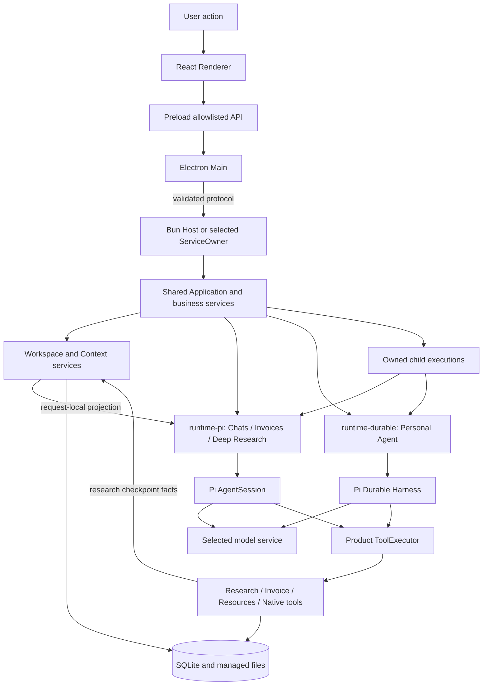

[English](architecture.md) | [简体中文](architecture.zh-CN.md) · [Documentation](README.md)

# Architecture

## Process and trust boundaries

Electron renders the workbench and owns windows and operating-system integration. In local mode, a Bun Host owns the product Application and local database access. Chats, Invoices and Deep Research use Pi AgentSession; the independent [Personal Agent](personal-agent.md) uses Pi Durable. Both adapters use SDK 1.4.0 and share Application, business services, ToolExecutor, Workspace and Context. The Renderer uses a narrow Preload API rather than reading SQLite or calling the SDK directly.

When service mode is explicitly enabled, ServiceOwner owns the Application and the desktop connects through the production Node ServiceClient. An unavailable selected service does not start a second local Host.

Host messages carry validated request and ownership identities. Notifications wake readers; saved queries supply authoritative state. A missing or late reply is not permission to re-execute a write. See [Agent runtime](agent-runtime.md) for lifecycle details.

## Responsibilities

| Location | Responsibility |
|---|---|
| `apps/desktop` | Main, Preload, React pages, OS credentials, file dialogs, Host lifecycle and ServiceClient |
| `apps/host` | Local protocol dispatch and product Application ownership |
| `apps/service` | Independent ServiceOwner, authenticated protocol and Application ownership in service mode |
| `apps/composition.ts`, `apps/personal-agent.ts` | Wire shared storage, domains, resources, tools and both runtime adapters |
| `packages/contracts` | Validated inputs, results, state, events and cross-layer interfaces |
| `packages/core` | Session/Run and invoice-work coordination, Context, tool recording, resources, research and storage |
| `packages/runtime-pi` | Provider/model preparation, AgentSession, native history, controlled extensions and tools |
| `packages/runtime-durable` | Durable Harness, SDK-native Tasks/checkpoints and the Personal Agent runtime adapter |
| `packages/data` | Register and read original/parsed materials |
| `packages/employee-invoice` | Invoice rules, extraction tools, source validation and form operations |
| `packages/logging` | Bounded runtime logs and Prompt Trace |
| `packages/shared` | Paths, controller ownership, credentials and installed runtime layout |
| `agent-eval` | Separate Trial execution, evidence, scoring and optional platform export |

## From input to a saved outcome

1. Main validates a user action and routes it to the selected Application owner.
2. The Application validates Session/workspace or invoice-work ownership and accepts a specific input or command.
3. The selected runtime fixes model configuration, allowed materials/tools, resource versions and a Context basis for that execution. A research Run also captures the saved preference text and revision.
4. For a new layered input, the AgentSession adapter prepares native history and tools, then adds its request-local Context projection and, when available, the current research checkpoint before a model request. Model-selected tool calls return through the product executor, which enforces permissions, budgets and delivery records. Durable retains its own phase context.
5. Domain services validate business effects. SQLite and managed files preserve execution facts and artifact identities.
6. The UI queries saved results and displays live progress without treating progress as a durable business commit.

Child tasks follow Core admission into runtime-owned execution in the same Application-owning process. They share their owner's budgets, admit at most four children, prohibit nesting and retain occupied capacity while stopping is unknown. Personal Agent delegates only to the read-only `invoice-evidence-checker` role through its Durable adapter; the AgentSession extension is a separate path. [Subagents](subagents.md) describes each path's permissions, context and stopping; a child is not a separate OS sandbox or an independent write-capable agent.

## Persistence and resources

The Windows user-data root is `%APPDATA%\Flowmate`. `data/app.sqlite` stores product state and Durable native records under one database owner and shared write coordination; `artifacts/`, `outputs/` and `runtime/` hold managed content and run resources. A controller lock prevents competing product owners of the same data root. AgentSession history and Durable native Tasks/checkpoints remain owned by their respective adapters.

AgentSession input snapshots, native conversation history and research step/tool/source records have distinct ownership. Research preferences are explicitly saved in product settings; the desktop's saved page/research focus is navigation state. Restoring that focus does not start a model Run. See [Context and memory layers](agent-runtime.md#context-memory-layers) and [Deep Research](workflows.md#deep-research).

ServiceOwner/Node ServiceClient, SID/DACL checks, CurrentUser DPAPI credentials, original-credential migration and maintenance remain implemented. Current engineering delivery covers execution while the Application owner is running, committed facts and eligible recovery. Real Windows SCM installation/startup, boot, upgrade/rollback and continued execution after closing the desktop remain deferred acceptance.

Author resources live under `resources/`; enabled versions are prepared into owned run bundles, with original content retained for historical use. Current author files do not silently replace an old Run's evidence. See [Skills and extensions](skills-and-extensions.md).

Installed mode uses the packaged `flowmate-runtime`, its release inventory and bundled Bun/SDK/native tools. It does not fall back to a developer source tree or a system Bun executable. Development mode resolves repository entries separately. See [Packaging and recovery](packaging-and-recovery.md).

## Source and verification entry points

- [Composition](../../apps/composition.ts), [Personal Agent composition](../../apps/personal-agent.ts), [Host dispatch](../../apps/host/main.ts), [Host protocol](../../apps/host/protocol.ts)
- [Desktop Main](../../apps/desktop/main/index.ts), [Preload](../../apps/desktop/preload), [Renderer](../../apps/desktop/renderer/src)
- [Runtime](../../packages/core/src/runtime/service.ts), [Pi adapter](../../packages/runtime-pi/src/session.ts), [Durable adapter](../../packages/runtime-durable/src/index.ts), [ServiceOwner](../../apps/service/owner.ts), [ServiceClient](../../apps/desktop/main/service-client.ts), [runtime layout](../../packages/shared/src/runtime-layout.ts)
- [Application tests](../../tests/core/application), [desktop tests](../../tests/desktop), [packaging tests](../../tests/packaging)
