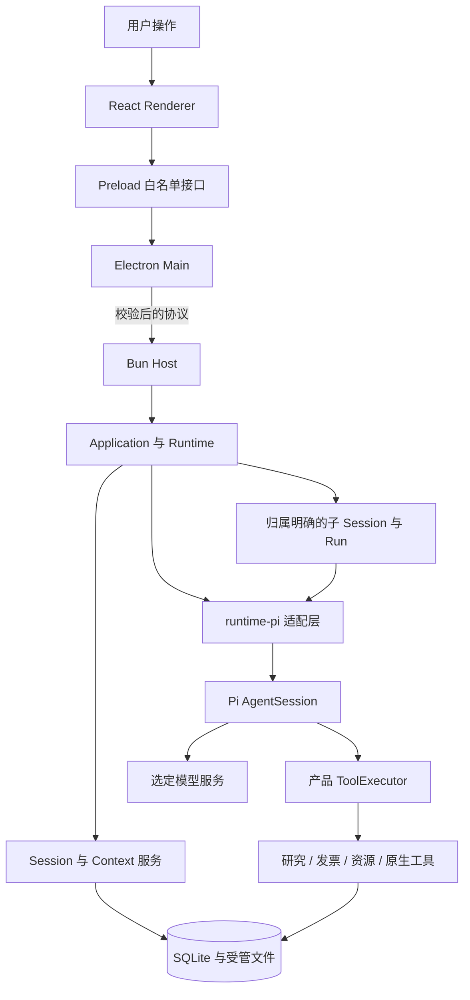

[English](architecture.md) | [简体中文](architecture.zh-CN.md) · [文档导航](README.zh-CN.md)

# 架构

## 进程与信任边界

Electron 展示工作台并管理窗口和系统集成，Bun Host 持有产品 Application 与本地数据库访问。Pi AgentSession 经产品适配层在 Host 内运行，Renderer 通过有限的 Preload 接口访问产品能力，不直接读取 SQLite 或调用 SDK。

Host 消息携带经过校验的请求与归属身份。通知负责唤醒读取，持久查询提供权威状态；回复丢失或迟到不授权重执行写入。生命周期详见 [Agent Runtime](agent-runtime.zh-CN.md)。

## 职责划分

| 位置 | 职责 |
|---|---|
| `apps/desktop` | Main、Preload、React 页面、系统凭据、文件对话框与 Host 生命周期 |
| `apps/host` | 协议分发与产品 Application 归属 |
| `apps/composition.ts` | 将存储、领域、资源、工具和 Pi 适配器组装为 Application |
| `packages/contracts` | 输入、结果、状态、事件及跨层接口的校验契约 |
| `packages/core` | Session/Run 编排、Context、工具记录、资源、研究与存储 |
| `packages/runtime-pi` | Provider/模型准备、AgentSession、原生历史、受控扩展与工具 |
| `packages/data` | 原件与解析材料登记、读取 |
| `packages/employee-invoice` | 发票规则、提取工具、来源校验和表单操作 |
| `packages/logging` | 有界运行日志与 Prompt Trace |
| `packages/shared` | 路径、控制者归属、凭据与安装版运行布局 |
| `agent-eval` | 独立 Trial 执行、采证、评分与可选平台导出 |

## 从输入到保存结果

1. Main 校验用户操作并路由到 Host。
2. Application 核对 Session/工作区归属，受理具体输入。
3. Runtime 固定当次模型配置、允许资料和工具、资源版本与 Context 依据。
4. Pi 适配器准备实际原生消息与工具，模型工具调用经过产品执行器落实权限、预算和交付记录。
5. 领域服务核对业务副作用，SQLite 与受管文件保存执行事实和产物身份。
6. UI 查询已保存结果并显示实时进度，进度本身不等于业务提交。

子任务由 `Agent` 工具经 Core 准入，进入独立归属的 Pi Session/Run。父子仍在同一 Host，共享根预算，不是独立操作系统沙箱或可写代理。权限、上下文和停止规则统一见 [Subagent](subagents.zh-CN.md)。

## 持久化与资源

Windows 用户数据根为 `%APPDATA%\Flowmate`，`data/app.sqlite` 保存产品状态，`artifacts/`、`outputs/` 和 `runtime/` 保存受管内容与运行资源。控制者锁避免同一数据根被多个产品控制者同时持有。

作者资源位于 `resources/`，启用的版本准备为当次运行的资源包，并保留历史所需原文。当前作者文件不静默替换旧 Run 的证据，详见 [Skills 与扩展](skills-and-extensions.zh-CN.md)。

安装版使用发行包内的 `flowmate-runtime`、发行清单、Bun、SDK 与原生工具，不回退到开发源码或系统 Bun。开发模式独立定位仓库入口，详见[打包与恢复](packaging-and-recovery.zh-CN.md)。

## 源码与验证入口

- [应用组装](../../apps/composition.ts)、[Host 分发](../../apps/host/main.ts)、[Host 协议](../../apps/host/protocol.ts)
- [Desktop Main](../../apps/desktop/main/index.ts)、[Preload](../../apps/desktop/preload)、[Renderer](../../apps/desktop/renderer/src)
- [Runtime](../../packages/core/src/runtime/service.ts)、[Pi 适配器](../../packages/runtime-pi/src/session.ts)、[运行布局](../../packages/shared/src/runtime-layout.ts)
- [应用测试](../../tests/core/application)、[桌面测试](../../tests/desktop)、[打包测试](../../tests/packaging)
