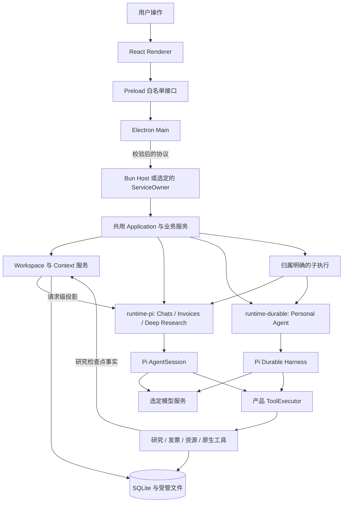

[English](architecture.md) | [简体中文](architecture.zh-CN.md) · [文档导航](README.zh-CN.md)

# 架构

## 进程与信任边界

Electron 展示工作台并管理窗口和系统集成，本地模式由 Bun Host 持有产品 Application 与本地数据库访问。Chats、Invoices、Deep Research 使用 Pi AgentSession，独立 [Personal Agent](personal-agent.zh-CN.md) 使用 Pi Durable。两套适配器统一使用 SDK 1.4.0，复用 Application、业务服务、ToolExecutor、Workspace 与 Context。Renderer 通过有限的 Preload 接口访问产品能力，不直接读取 SQLite 或调用 SDK。

明确启用服务模式后，ServiceOwner 持有 Application，桌面通过生产 Node ServiceClient 连接；选定服务不可连接时，不启动第二个本地 Host。

Host 消息携带经过校验的请求与归属身份。通知负责唤醒读取，持久查询提供权威状态；回复丢失或迟到不授权重执行写入。生命周期详见 [Agent Runtime](agent-runtime.zh-CN.md)。

## 职责划分

| 位置 | 职责 |
|---|---|
| `apps/desktop` | Main、Preload、React 页面、系统凭据、文件对话框、Host 生命周期与 ServiceClient |
| `apps/host` | 本地协议分发与产品 Application 归属 |
| `apps/service` | 独立 ServiceOwner、认证协议与服务模式的 Application 归属 |
| `apps/composition.ts`、`apps/personal-agent.ts` | 组装共用存储、领域、资源、工具与两套运行时适配器 |
| `packages/contracts` | 输入、结果、状态、事件及跨层接口的校验契约 |
| `packages/core` | Session/Run 与发票事项协调、Context、工具记录、资源、研究与存储 |
| `packages/runtime-pi` | Provider/模型准备、AgentSession、原生历史、受控扩展与工具 |
| `packages/runtime-durable` | Durable Harness、SDK 原生 Task/检查点与 Personal Agent 运行时适配 |
| `packages/data` | 原件与解析材料登记、读取 |
| `packages/employee-invoice` | 发票规则、提取工具、来源校验和表单操作 |
| `packages/logging` | 有界运行日志与 Prompt Trace |
| `packages/shared` | 路径、控制者归属、凭据与安装版运行布局 |
| `agent-eval` | 独立 Trial 执行、采证、评分与可选平台导出 |

## 从输入到保存结果

1. Main 校验用户操作并路由到选定的 Application 控制者。
2. Application 核对 Session/工作区或发票事项归属，受理具体输入或命令。
3. 选定运行时固定当次模型配置、允许资料和工具、资源版本与 Context 依据；研究 Run 还捕获已保存偏好文字与 revision。
4. 对新的分层输入，AgentSession 适配器准备原生历史和工具，在模型请求前加入该输入的请求级 Context 投影与可用的当前研究 Checkpoint。模型工具调用经过产品执行器落实权限、预算和交付记录；Durable 保留自己的阶段上下文。
5. 领域服务核对业务副作用，SQLite 与受管文件保存执行事实和产物身份。
6. UI 查询已保存结果并显示实时进度，进度本身不等于业务提交。

子任务经 Core 准入，进入同一 Application 控制进程内归属相应运行时的执行。父子共享所属预算，最多四个子任务，禁止嵌套；停止未知时继续占用名额。Personal Agent 通过 Durable 适配器仅委派给只读 `invoice-evidence-checker`，AgentSession 扩展是独立路径。两条路径的权限、上下文和停止规则见 [Subagent](subagents.zh-CN.md)；子执行不是独立操作系统沙箱或可写代理。

## 持久化与资源

Windows 用户数据根为 `%APPDATA%\Flowmate`，`data/app.sqlite` 在同一数据库 owner 和共用写入协调下保存产品状态及 Durable 原生记录，`artifacts/`、`outputs/` 和 `runtime/` 保存受管内容与运行资源。控制者锁避免同一数据根被多个产品控制者同时持有。AgentSession 历史与 Durable 原生 Task/检查点仍各由对应适配器负责。

AgentSession 输入快照、原生会话历史与研究步骤／工具／来源记录分别归属各自层次。研究偏好明确保存在产品设置中，桌面保存的页面／研究焦点属于导航状态；恢复焦点不会启动模型 Run。详见 [Context 与 Memory 分层](agent-runtime.zh-CN.md#context-memory-layers)和 [Deep Research](workflows.zh-CN.md#deep-research)。

ServiceOwner/Node ServiceClient、SID/DACL 校验、CurrentUser DPAPI 凭据、原凭据迁移与维护实现继续保留。当前工程版以 Application 控制者运行期间的执行、已提交事实和合法恢复为交付边界；真实 Windows SCM 安装/启动、开机、升级/回退及关闭桌面后持续运行统一延期验收。

作者资源位于 `resources/`，启用的版本准备为当次运行的资源包，并保留历史所需原文。当前作者文件不静默替换旧 Run 的证据，详见 [Skills 与扩展](skills-and-extensions.zh-CN.md)。

安装版使用发行包内的 `flowmate-runtime`、发行清单、Bun、SDK 与原生工具，不回退到开发源码或系统 Bun。开发模式独立定位仓库入口，详见[打包与恢复](packaging-and-recovery.zh-CN.md)。

## 源码与验证入口

- [应用组装](../../apps/composition.ts)、[Personal Agent 组装](../../apps/personal-agent.ts)、[Host 分发](../../apps/host/main.ts)、[Host 协议](../../apps/host/protocol.ts)
- [Desktop Main](../../apps/desktop/main/index.ts)、[Preload](../../apps/desktop/preload)、[Renderer](../../apps/desktop/renderer/src)
- [Runtime](../../packages/core/src/runtime/service.ts)、[Pi 适配器](../../packages/runtime-pi/src/session.ts)、[Durable 适配器](../../packages/runtime-durable/src/index.ts)、[ServiceOwner](../../apps/service/owner.ts)、[ServiceClient](../../apps/desktop/main/service-client.ts)、[运行布局](../../packages/shared/src/runtime-layout.ts)
- [应用测试](../../tests/core/application)、[桌面测试](../../tests/desktop)、[打包测试](../../tests/packaging)
