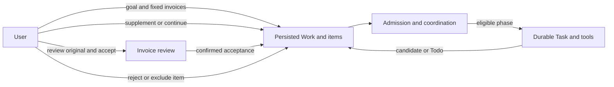

[English](personal-agent.md) | [简体中文](personal-agent.zh-CN.md) · [Documentation](README.md)

# Personal Agent

## What it does

Personal Agent is a separate workspace for continuing work on a fixed group of invoices. It records the user's goal, each invoice's Todo items and disposition, attempts, evidence and history. A missing document or a pending human decision can leave one invoice waiting while other eligible work continues. It is not a general autonomous task scheduler or an accounting submission service.

**Chats**, **Invoices** and **Deep Research** retain their Pi AgentSession paths. Personal Agent uses Pi Durable and its own native Tasks and history while sharing product services, tool admission, storage and permitted materials. **Invoices** remains the place to inspect and review one invoice; Personal Agent coordinates the continuing Work. See [Architecture](architecture.md) and [Agent runtime](agent-runtime.md).

## Prepare and create work

1. Prepare the original invoices and externally generated parsing material, then register them through **Invoices**. Flowmate does not itself provide invoice OCR or a parser. Configure a usable model in **Models**.
2. Open **Personal Agent → Assistant configuration**. Choose a saved model and thinking level; set preferences, working directory, allowed tools, and, if needed, a Prompt and Skills. Refresh resources, resolve unavailable dependencies and select **Save assistant configuration**. Settings saved later apply to new work; accepted work retains its original configuration and resource versions.
3. Select **New invoice work**, enter an **Invoice work goal**, select one or more available parsed invoices, then choose **Submit invoice work**. The submitted invoice set is fixed; a new set requires new work. The operation receipt and the Work view distinguish acceptance, queueing, waiting and blocking from actual execution.
4. Select a saved Work and an invoice in **Invoices**. Read its Todo and evidence, then use **Save supplement for Todo** to provide the requested clarification or authorized material. When eligible, a supplement can authorize continuation; after a stopped or failed attempt it is saved without restarting execution, and **Continue work** is required.
5. Use **View original invoice / review** to compare a candidate with the original and parsed evidence in **Invoices**. After **Accept result**, return to Personal Agent and use **Attach confirmed acceptance** to attach the verified original acceptance to the unresolved Work item. Alternatively, give a reason and explicitly choose **End processing as rejected** or **Exclude invoice from this work**. Rejecting a candidate alone does not end the invoice item.

Every invoice needs an explicit final disposition. Work completes only after the required business writes and execution have settled; a generated candidate or finished child is not itself an accepted invoice. The [workflow guide](workflows.md#personal-agent) summarizes the operations alongside the other invoice paths.

## Desktop window access

For KimiCU desktop tools, selecting a window authorizes reading its accessibility text for that invoice. The text may enter Work history and reach the selected model provider. Flowmate blocks observation and automated input when KimiCU reports recognizable credential labels. Handle those fields manually in the original application. Clicks and text entry each require approval.

## Controlled page reading

On Windows, local or cloud Work can read a Chrome tab selected by the user. Install the official Kimi WebBridge and enable the [Kimi Browser Extension](https://www.kimi.com/en/help/kimi-webbridge/kimi-webbridge-introduction). Entering the cloud workspace attempts to start WebBridge and reuses a healthy running service. Startup failures are shown without blocking the cloud connection. Local Work still requires WebBridge to be started manually if the cloud workspace has not been opened.

The executable path comes from `FLOWMATE_WEBBRIDGE_EXE`, then `%APPDATA%\Flowmate\data\kimi-webbridge.json`, then the official user-directory default. A custom D: drive configuration looks like:

```json
{ "version": 1, "executable": "D:\\KimiWebBridge\\bin\\kimi-webbridge.exe" }
```

The path must be absolute; WebBridge keeps its default configuration and logs. Automatic startup only permits a `127.0.0.1` listener and does not install additional Agent Skills. Before binding a page it opens two synthetic pages to check tab targeting and closes that check session; a failed check prevents user-page binding. Cloud Work also requires matching desktop, Authority, Runtime and SSH Bridge versions.

Enable **Browser page reading** in **Assistant configuration**, save it, and create new Work. Browser reading and KimiCU desktop tools are mutually exclusive within that Work; existing Work keeps its original configuration. The new Work waits initially. Select an invoice, enter an HTTP(S) address in **Page URL for this invoice**, choose **Open dedicated tab**, then select **Continue work**. Bind each invoice separately; a request for an unbound invoice fails and needs a binding and a new continuation. The user opens the page; the model cannot select a URL, tab, script or selector, or navigate, click, fill forms or take screenshots.

When the model requests a read, the interface shows the Work, invoice, dedicated tab and origin. **Approve one read and continue** allows one read; the request can also be rejected or revoked. Approval covers paths in that tab with the same scheme, host and port, including other paths on that origin. The browser can still navigate on its own, but page text from a different origin is refused. A disconnect, rebinding, cancellation or uncertain outcome requires a new confirmation. Revocation cannot recall data already read, saved or sent.

New phases retain the original tool Task while it waits for a decision. Other eligible invoices in the Work can proceed in sequence; the decided phase resumes after the active phase ends or begins waiting. Waiting still consumes the Work's original wall-clock budget, and expiry requires fresh authorization.

If the connection changes after approval but before dispatch, select the same window or same-origin tab and use **Confirm selected window for original approval** or **Confirm current tab for original approval**. The original proposal, current connection and target are checked, and the original decision is reused. Confirmation alone does not execute; choose **Resume original approved action** or **Resume original approved read** afterwards. If an operation was dispatched but its outcome is unknown, inspect the application or page; it is not automatically repeated. Older phases and approvals retain their original flow.

The result contains the page origin and path, the title and up to 22,000 UTF-8 bytes of text, with a truncation marker. The path, title and text may still contain sensitive information. The result may be retained in local or cloud Work history and sent to the selected model provider. Page text remains untrusted tool output and cannot grant authority or become a system instruction; compaction summaries are also marked as model-generated. Page content can still mislead the model or affect its answer, and later tools retain their own permission and confirmation rules.

## Work, attempts and evidence

| Object | Purpose |
|---|---|
| Work | Persistent goal and fixed invoice set; status is `open`, `completed` or `cancelled`. |
| Invoice item | One selected invoice and its `unresolved`, `accepted`, `rejected` or `excluded` disposition. |
| Attempt | A bounded execution associated with the Work; stopping or failing it does not by itself cancel the Work. |
| Durable phase and Task | The coordinator submits an accepted phase to Pi Durable, whose native Tasks, conversation and checkpoints retain execution facts. |
| Todo and supplement | A missing input or decision and the user's subsequent clarification or authorized material. Saving input, authorizing execution and starting it are distinct facts. |



The **Invoices**, **Tasks**, **History** and **Timeline** tabs expose different saved facts. Tasks can show the attempt and owned child evidence; History reads native entries; Timeline shows business events and references. Browsing these views or checking a saved receipt does not start a model call or trigger recovery. A child report, a valid source reference and confirmed parent receipt do not by themselves prove the report's meaning or approve a candidate.

New phases keep a separate native conversation for each invoice. Select an invoice and use **View invoice history** to inspect its history; the older root history remains available. Cloud input queues and result receipts are checked against the invoice owner, and reconnecting or reading results does not resubmit the original input.

## Continue, stop and recover

- **Continue work** checks the original inputs, authorization, current state and remaining budget. Depending on those facts it may continue or return an existing attempt, authorize a linked new attempt, queue it, or report a blocker. It cannot revive completed or cancelled work.
- **Stop current attempt** requests that the current execution and its owned children stop. A stop request and confirmed stopping are different; an unconfirmed stop retains ownership and can prevent reuse.
- **Cancel entire work** is a separate business action. It cancels the Work rather than merely pausing its current attempt; the interface still reports whether the execution actually stopped.
- **Create related work** is offered for a finished Work. It prepares a new goal and selection for explicit submission; earlier dispositions and permissions are not inherited.
- If a response is missing, use **Check saved receipt** to inspect the original request before retrying it. During backend startup, recovery reads the original persisted facts and native records, checks their authorization and eligibility, and resumes only eligible original work. An `open` status alone does not authorize a new execution.

Material supplied during execution is consumed at an eligible phase boundary; it does not rewrite a tool call that already started. Model operations can transmit selected information to the configured provider and may incur charges. A selected working directory is not an operating-system sandbox.

## Delegation and resource boundaries

If the **Agent** tool is enabled for Personal Agent and the parent decides to delegate, its Durable adapter may create a bounded, read-only `invoice-evidence-checker` child for an invoice evidence question. The child uses the authorized phase scope and shares the Work's model, tool, feedback and time budgets. A Work can hold at most four child executions; unconfirmed stopping keeps a slot occupied. Children cannot delegate again, run as user-selected background tasks, or make business writes. The child reports findings and gaps; the parent and user retain their respective review responsibilities.

This path does not require enabling the AgentSession **subagents** extension. The Personal Agent configuration currently has no Durable adapter for extensions, so extension-dependent Skills are unavailable there. The role, input, ownership and stopping differences between the two runtimes are detailed in [Subagents](subagents.md) and [Skills and extensions](skills-and-extensions.md).

## Process and recovery boundary

In local mode, the Bun Host owns the product Application. When service mode is explicitly activated, a separate ServiceOwner owns it and the desktop connects through ServiceClient; an unavailable selected service does not silently start a second local Host. Service preparation alone is not activation.

Continuing cloud Work depends on the existing cloud services running. Local Work can continue after the desktop closes only while the Windows background service is running. Local Work cannot execute while the computer sleeps or is off; desktop actions and page reads also require the Windows device and its connection. AgentSession still stops its foreground run when the owning desktop connection drops. Reconnection reads the original session, saved inputs and run state without resending input.

The repository implements persisted work and eligible recovery, but real Windows SCM installation/startup, boot recovery and continued execution after closing the desktop require separate system acceptance. A package, an isolated service test or a saved Work does not establish those outcomes. Data location, backup and account-dependent credential recovery are described in [Packaging and recovery](packaging-and-recovery.md).

## Implementation and verification entry points

- [Personal Agent UI](../../apps/desktop/renderer/src/personal-agent.tsx) and [configuration UI](../../apps/desktop/renderer/src/personal-configuration.tsx)
- [Composition](../../apps/personal-agent.ts), [Work service](../../packages/core/src/personal-agent/invoice-work.ts), [coordinator](../../packages/core/src/personal-agent/coordination.ts) and [Durable adapter](../../packages/runtime-durable/src/runtime.ts)
- [Personal Agent UI tests](../../tests/desktop/personal-agent.e2e.test.ts), [Work coordination tests](../../tests/core/application/invoice-work-coordination.integration.test.ts) and [Durable delegation tests](../../tests/core/application/personal-subagents.integration.test.ts)

These links locate implementation and controlled tests; a test file's presence does not prove real-model quality or system-service acceptance.
