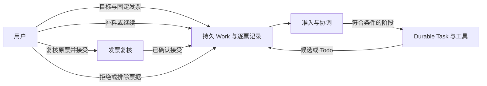

[English](personal-agent.md) | [简体中文](personal-agent.zh-CN.md) · [文档导航](README.zh-CN.md)

# Personal Agent

## 功能定位

Personal Agent 是持续处理一组固定发票的独立工作区，保存用户目标、逐票 Todo 与处置、执行尝试、证据和历史。某张票缺资料或等待人工决定时，其他符合条件的票仍可继续。它不是通用自主任务调度器，也不会自主提交记账。

**Chats**、**Invoices** 和 **Deep Research** 保留 Pi AgentSession 路径。Personal Agent 使用 Pi Durable，独立持有原生 Task 和历史，同时复用产品服务、工具准入、存储及获准资料。**Invoices** 仍用于单张发票的查看和复核，Personal Agent 协调持续事项。见[架构](architecture.zh-CN.md)与 [Agent Runtime](agent-runtime.zh-CN.md)。

## 准备与创建事项

1. 准备发票原件和外部生成的解析材料，通过 **Invoices** 登记。Flowmate 本身不提供发票 OCR 或解析器。在 **Models** 配置可用模型。
2. 打开 **Personal Agent → Assistant configuration**，选择已保存模型和思考级别，设置偏好、工作目录、允许的工具，以及需要的 Prompt 和 Skill。刷新资源、处理缺失依赖，点击 **Save assistant configuration**。后续保存的配置用于新事项；已受理事项保留原配置和资源版本。
3. 点击 **New invoice work**，填写 **Invoice work goal**，选择一张或多张可用的已解析发票，再点击 **Submit invoice work**。提交后发票集合固定，新集合需创建新事项。操作回执与事项视图区分受理、排队、等待、受阻和实际执行。
4. 选择已保存事项及其 **Invoices** 中的一张票，查看 Todo 和证据；通过 **Save supplement for Todo** 补充指定说明或获准材料。符合条件时补料可以授权继续；若尝试此前已停止或失败，补料仅保存，须点击 **Continue work** 才能继续执行。
5. 通过 **View original invoice / review** 返回 **Invoices**，对照原件及解析证据复核候选。执行 **Accept result** 后回到 Personal Agent，使用 **Attach confirmed acceptance** 将已确认的原接受操作关联到尚未处置的事项票据。也可填写原因，明确选择 **End processing as rejected** 或 **Exclude invoice from this work**。普通拒绝候选不等于结束该票处理。

每张票都需要明确最终处置；必要业务写入和执行收口后事项才能完成。产生候选或子任务结束不等于发票已经接受。[业务流程](workflows.zh-CN.md#personal-agent)将上述操作与其他发票路径放在一起说明。

## 事项、尝试与证据

| 对象 | 作用 |
|---|---|
| Work | 保存目标和固定发票集合；状态为 `open`、`completed` 或 `cancelled`。 |
| Invoice item | 一张选定发票及其 `unresolved`、`accepted`、`rejected` 或 `excluded` 处置。 |
| Attempt | 属于该事项的有界执行；尝试停止或失败本身不会取消整个事项。 |
| Durable phase 与 Task | 协调器将已受理阶段提交给 Pi Durable，由其原生 Task、会话及检查点保留执行事实。 |
| Todo 与补料 | 缺少的输入或决定，以及用户后续提供的说明或获准材料。保存输入、授权执行和实际启动是不同事实。 |

**Invoices**、**Tasks**、**History**、**Timeline** 展示不同的保存事实：Tasks 可查看尝试与归属子任务，History 读取原生记录，Timeline 展示业务事件与引用。浏览这些视图或查询已保存回执不会发起模型调用，也不会触发恢复。子报告、有效来源引用和父任务已接收均不能单独证明报告语义正确或候选已获批准。

## 继续、停止与恢复

- **Continue work** 核对原输入、授权、当前状态及剩余预算，再按事实继续或返回原尝试、授权关联新尝试、排队或报告受阻；不能复活已完成或已取消事项。
- **Stop current attempt** 请求停止当前执行及其归属子任务。请求停止与确认停止是不同事实；停止未确认时保留原归属，并可能阻断复用。
- **Cancel entire work** 是独立业务操作，取消整个事项，而不是仅暂停当前尝试；界面仍单独报告执行是否真正停止。
- 已结束事项可使用 **Create related work** 准备新目标和选择，再明确提交；原事项的处置和权限不会继承。
- 回复丢失时，先用 **Check saved receipt** 查询原请求，再决定是否重试。后端启动恢复读取原持久事实及原生记录，核对授权和资格后仅恢复符合条件的原执行；事项为 `open` 本身不构成新执行授权。

执行中补充的材料在符合条件的阶段边界使用，不改写已启动工具的参数。模型操作可能向配置的服务发送选定内容并产生费用；选择工作目录不是操作系统沙箱。

## 委派与资源边界

Personal Agent 启用 **Agent** 工具且父任务决定委派时，Durable 适配器可为限定发票取证问题创建只读 `invoice-evidence-checker` 子任务。子任务使用获准的阶段范围，共享事项的模型、工具、反馈和时间预算。一个 Work 最多保有四个子执行，停止未确认仍占名额；子任务不能再次委派、使用用户选择的后台模式或执行业务写入。子任务返回发现与缺口，父任务和用户分别承担综合与复核责任。

这条路径不需要启用 AgentSession 的 **subagents** 扩展。Personal Agent 配置目前没有扩展的 Durable 阶段适配器，因此依赖扩展的 Skill 在这里不可用。两种运行时的角色、输入、归属和停止差异见 [Subagent](subagents.zh-CN.md)及 [Skills 与扩展](skills-and-extensions.zh-CN.md)。

## 进程与恢复边界

本地模式由 Bun Host 持有产品 Application。明确启用服务模式后，独立 ServiceOwner 持有 Application，桌面通过 ServiceClient 连接；所选服务不可用时不会静默启动第二个本地 Host。准备服务不等于启用服务。

仓库实现了事项持久化和符合条件的恢复，但真实 Windows SCM 安装／启动、开机恢复以及关闭桌面后持续执行需要单独的系统验收。打包产物、隔离服务测试或保存的 Work 均不能单独证明这些结果。数据位置、备份和与账户有关的凭据恢复见[打包与恢复](packaging-and-recovery.zh-CN.md)。

## 实现与验证入口

- [Personal Agent 界面](../../apps/desktop/renderer/src/personal-agent.tsx)与[配置界面](../../apps/desktop/renderer/src/personal-configuration.tsx)
- [应用组装](../../apps/personal-agent.ts)、[事项服务](../../packages/core/src/personal-agent/invoice-work.ts)、[协调器](../../packages/core/src/personal-agent/coordination.ts)与 [Durable 适配器](../../packages/runtime-durable/src/runtime.ts)
- [Personal Agent 界面测试](../../tests/desktop/personal-agent.e2e.test.ts)、[事项协调测试](../../tests/core/application/invoice-work-coordination.integration.test.ts)与 [Durable 委派测试](../../tests/core/application/personal-subagents.integration.test.ts)

这些链接用于定位实现和受控测试；测试文件存在不代表真实模型质量或系统服务验收通过。
