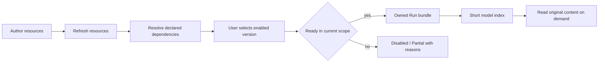

[English](skills-and-extensions.md) | [简体中文](skills-and-extensions.zh-CN.md) · [Documentation](README.md)

# Skills and extensions

## Resource types

| Resource | Purpose | Author location |
|---|---|---|
| Skill | A discoverable procedure with declared dependencies and optional supporting files | `resources/skills/<id>/resource.json`, `SKILL.md`, `references/…` |
| Prompt | A versioned product prompt | `resources/prompts/<id>/resource.json`, `prompt.md` |
| Prompt template | Expand a named user-input pattern once | `resources/prompt-templates/<name>.md` |
| Extension | Registered controlled runtime integration | `resources/` declarations and `runtime-pi` extension registry |
| Subagent role | Child system prompt and allowed tool list | `resources/subagents/<role-id>.md` |

Author resources use flat ID directories, not an extra author `v1/` directory. `ResourceRef` carries `kind`, `id` and explicit `version`; the manifest schema is version 2. Runtime bundles retain their own managed layout. See the existing [resource author guide](../../resources/README.md) for file-level conventions and [Subagents](subagents.md) for role/child rules.

## Discover, enable and prepare

Use **Skills** or **Settings → Skills** to refresh and inspect resource readiness. New resources start disabled. **Ready** means enabled with requirements met; **Partial** means enabled with missing requirements; **Disabled** means not selected. Tool, Skill and extension dependencies are resolved against actual availability and the Run's permission scope, not just the presence of files.

Run preparation preserves the selected resource versions and original file contents. A refresh does not substitute new author files into old Run evidence. Updating content requires an explicit version change and refreshed selection; same-version changed content can be rejected as `resource_version_changed`.

## Skill loading and execution

The model receives a bounded short index and guidance, with a 16 KiB preparation bound for the index/supplement/guidance path. Skill bodies and supporting files are read progressively. `list_skill_resources` and `read_skill_resource` use the original Run, selected version and permitted paths. A Skill file is instruction/data; reading a `scripts/` file as text does not execute it or grant new tool permissions.

The built-in invoice Skills split evidence discovery, field extraction, amount/source checks, ambiguity review, saving and handoff. The research Skill guides plan-confirm-investigate-synthesize-report behavior. A save-oriented Skill does not remove the actual tool's schema, permission or persistence checks. “Skill selected” and “Skill actually read/used” are different facts in evaluation.

For authoring, align SKILL frontmatter name with manifest/ID, provide an accurate description, declare real dependencies and list the files and UTF-8 byte sizes expected by the manifest. Use the current author guide and existing neighboring resources rather than inventing another loader format.

## Commands and templates

The slash menu groups Skills, extension commands, templates and roles. `/invoice-evidence-review <arguments>` and `/parallel-invoice-review <arguments>` expand Markdown templates; `$ARGUMENTS` is replaced for that input. Template expansion is not an execution receipt. The `/subagent <role-id> <task>` extension command also ultimately needs a real `Agent` call.

Selected command/template identities and content are retained with the prepared input. Editing author resources later must not change what an old input means. Detailed triggers, role overrides and parent/child permissions belong in [Subagents](subagents.md), rather than duplicate rules here.

## Controlled extensions

Extensions are enabled explicitly in **Extensions**. Product registration fixes supported capabilities and hooks; arbitrary external plugin loading is not implied. The adapter verifies actual registration and binds tool/command events to owned native Sessions. The subagents integration is backed by a pinned dependency plus managed hooks, not permission to bypass the product ToolExecutor.

If a dependency is unavailable, inspect readiness/Diagnostics, correct the dependency and refresh for a subsequent Run. Do not assume a renamed role, extra tool or newly installed package is live inside an existing execution.

## Implementation references

- [Skill Hub](../../packages/core/src/skill-hub), [input definitions](../../packages/core/src/prompt-templates.ts)
- [Controlled extension adapters](../../packages/runtime-pi/src/extensions), [author resources](../../resources)
- [Input trigger tests](../../tests/core/application/input-triggers.integration.test.ts), [Subagent tests](../../tests/core/application/parallel-subagents.integration.test.ts)
- [Runtime](agent-runtime.md), [Evaluation](EVALUATION.md) and [Development](development.md)
