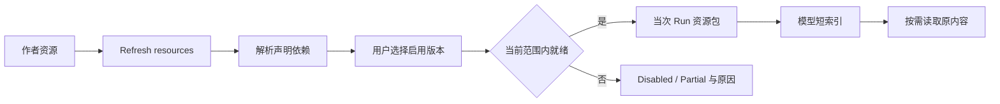

[English](skills-and-extensions.md) | [简体中文](skills-and-extensions.zh-CN.md) · [文档导航](README.zh-CN.md)

# Skills 与扩展

## 资源类型

| 资源 | 用途 | 作者位置 |
|---|---|---|
| Skill | 带依赖声明和可选附属文件的可发现流程 | `resources/skills/<id>/resource.json`、`SKILL.md`、`references/…` |
| Prompt | 有版本的产品提示 | `resources/prompts/<id>/resource.json`、`prompt.md` |
| Prompt 模板 | 将命名模式展开为一次用户输入 | `resources/prompt-templates/<name>.md` |
| Extension | 已登记的受控运行时集成 | `resources/` 声明与 `runtime-pi` 扩展注册表 |
| Subagent 角色 | 子系统提示与允许工具列表 | `resources/subagents/<role-id>.md` |

作者资源使用平铺 ID 目录，不额外增加作者 `v1/` 层。`ResourceRef` 包含 `kind`、`id` 与显式 `version`，Manifest Schema 为版本 2；运行资源包保留自己的受管布局。文件约定见既有[资源作者指南](../../resources/README.md)，角色和子任务规则见 [Subagent](subagents.zh-CN.md)。

## 发现、启用与准备

在 **Skills** 或 **Settings → Skills** 刷新并检查就绪。新资源默认禁用；**Ready** 表示启用且条件满足，**Partial** 表示启用但有缺项，**Disabled** 表示未选择。工具、Skill、扩展依赖依据实际可用性与 Run 权限范围解析，不能只看文件存在。

Run 准备保留选定资源版本及原文件内容。刷新不会将新作者文件替换进旧 Run；内容更新需显式修改版本、刷新选择，同版本内容变化可能报 `resource_version_changed`。

## Skill 读取与执行

模型先获得有界短索引和指导，索引、补充与指导准备路径总量受 16 KiB 约束，正文与附属文件按需读取。`list_skill_resources`、`read_skill_resource` 核对原 Run、选定版本与允许路径。Skill 文件是指令或资料，读取 `scripts/` 文本不等于执行脚本，也不新增工具权限。

内置发票 Skill 拆分证据发现、字段提取、金额和来源核对、歧义复核、保存与交接；研究 Skill 引导规划、确认、调查、综合、报告，包括计划步骤 ID、已保存 Checkpoint 和明确继续。它使用既有研究工具；选择 Skill 不证明计划步骤已执行。保存类 Skill 不免除实际工具 Schema、权限或持久化检查。“选中 Skill”与“实际读取、使用 Skill”是评测中的不同事实。见 [Deep Research](workflows.zh-CN.md#deep-research)。

Personal Agent 在 **Assistant configuration** 中独立选择模型、工具、Prompt 和 Skill，不沿用普通 Assistant 当前选择。Durable 路径根据可用发票与资源工具检查依赖；目前没有 Durable 扩展适配器，依赖扩展的 Skill 无法用于 Durable 阶段。已受理 Work 保留其选定配置和资源版本。详见 [Personal Agent](personal-agent.zh-CN.md)。

编写资源时，使 SKILL frontmatter 名称与 Manifest、ID 一致，提供准确描述、真实依赖，声明 Manifest 所需文件和 UTF-8 字节数。沿用当前作者指南与相邻资源，不另造加载格式。

## 命令与模板

AgentSession 斜杠菜单区分 Skill、扩展命令、模板和角色。`/invoice-evidence-review <arguments>`、`/parallel-invoice-review <arguments>` 展开 Markdown 模板，`$ARGUMENTS` 在当次输入替换。展开不是执行回执；扩展命令 `/subagent <role-id> <task>` 最终也需要真实 `Agent` 调用。这些不是 Personal Agent 的 Durable 触发接口。

选定命令、模板身份与内容随准备输入保留，后续作者编辑不能改写旧输入含义。触发、角色覆盖、父子权限统一见 [Subagent](subagents.zh-CN.md)，此处不重复详细规则。

## 受控扩展

AgentSession 扩展在 **Extensions** 显式启用，产品注册固定支持的能力和钩子，不代表任意外部插件均可加载。适配层验证实际注册，将工具、命令事件绑定到归属明确的原生 Session。Subagents 集成依赖固定版本与受管钩子，不授权绕过产品 ToolExecutor。Personal Agent 则使用自身受限的 `Agent` 工具，启用该工具不等于启用扩展。

缺依赖时先查看就绪状态、Diagnostics，补齐后为后续 Run 刷新。角色改名、增加工具或安装依赖不表示它们已进入当前执行。

## 实现定位

- [Skill Hub](../../packages/core/src/skill-hub)、[输入定义](../../packages/core/src/prompt-templates.ts)
- [受控扩展适配](../../packages/runtime-pi/src/extensions)、[作者资源](../../resources)
- [输入触发测试](../../tests/core/application/input-triggers.integration.test.ts)、[Subagent 测试](../../tests/core/application/parallel-subagents.integration.test.ts)
- [Runtime](agent-runtime.zh-CN.md)、[评测](EVALUATION.zh-CN.md)、[开发](development.zh-CN.md)
