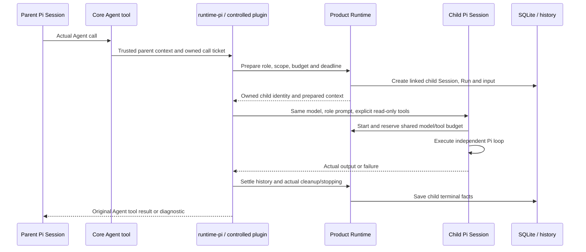

[English](subagents.md) | [简体中文](subagents.zh-CN.md) · [Documentation](README.md)

# Subagents

## What a child task is

A parent Agent can call an **`Agent`** tool to delegate a bounded task. Flowmate supports two paths: ordinary Chats, Invoices and Deep Research use the controlled AgentSession subagents extension; [Personal Agent](personal-agent.md) uses a separate Durable adapter for invoice evidence. Both create product child records linked to the original parent call, but their native execution, setup and recovery differ. Parent and child run in the Application-owning process, whether that owner is the local Host or an explicitly selected ServiceOwner.

A role is a system prompt and an allowed tool list, not another unrestricted assistant. Current children are read-only, share their owner's budgets, and cannot delegate again or use a user-selected background option. They do not gain an OS sandbox or independent model configuration.

## Personal Agent: Durable delegation

In **Personal Agent → Assistant configuration**, enable the **Agent** tool if delegation is appropriate. The parent may then call it for a bounded invoice-evidence question; a request to delegate is not proof that a child ran. The Durable path supports only the built-in `invoice-evidence-checker` role. It does not require the AgentSession extension, role management screen, slash command or Prompt templates described below. Personal Agent currently has no Durable adapter for extensions.

Core verifies the original Work, Attempt, phase and ToolCall, prepares the child from the authorized phase context, and creates linked product child Session/Run records. The Durable adapter owns the child conversation and native Task, executes the permitted read-only subset of tools, and returns a report or an evidence gap to the original parent call. The **Tasks** view exposes child status, report, parent delivery and stop facts; a report or source reference does not itself establish semantic correctness or accept an invoice.

The Work shares model requests, tool calls, feedback capacity and time across its attempts and children. At most **four** children may remain owned; when all slots are occupied, admission reports `subagent_capacity_exceeded`. A child with an unconfirmed stop continues to occupy capacity. Durable admission requires remaining model budget, but does not promise the AgentSession path's reserved parent-continuation request. Children cannot create nested children, use a user-selected background option or perform business writes.

**Stop current attempt** requests stopping of its owned children as well. Inspect actual stopping and saved child facts; cancellation or a lost reply is not confirmation of cleanup. The Personal Agent Tasks view currently provides child history and reports, not a separate child-stop button. Backend recovery reconciles original persisted identities and eligible native Tasks; it does not authorize a replacement solely because an outcome is unknown. See [Personal Agent](personal-agent.md) for Work continuation, cancellation and system-service limits.

The remaining setup, command, sequence, permission table and lifecycle sections describe the **AgentSession extension path**.

## Prepare the extension and roles

1. Open **Extensions**, enable the registered **subagents** extension and inspect its readiness. Creating a role does not enable the extension.
2. Open **subagents → Plugin details → Manage agents** to list, inspect, create or edit role definitions. Changes are used by subsequent Runs, not by an already prepared Run.
3. Choose a role whose tools are available in the parent scope. Supply the task and the information it needs; the child does not automatically inherit the whole parent transcript.

Built-in author definitions live in [resources/subagents](../../resources/subagents). User definitions/overrides live at `<runtimeRoot>/subagents/<role-id>.md`; no author `v1/` layer is required.

| Built-in role | Actual tool access | Suitable work |
|---|---|---|
| `general-analyst` | No tools | Independent analysis of information supplied in the task |
| `invoice-evidence-checker` | Declared read-only file, invoice evidence and resource readers | Check source locations, uncertainties and missing invoice evidence |
| `research-investigator` | `read_research_local`, `query_research_evidence` | Investigate assigned questions inside a confirmed local research plan |

A minimal tool-free role has this format:

```markdown
---
name: general-analyst
description: Independently analyze the supplied task without external tools or access.
tools: []
---
Analyze the supplied information. State assumptions, uncertainties and findings.
Return a concise analysis to the parent; do not invent external evidence.
```

The frontmatter identifies the role and its declared tools; the body becomes the child system prompt. Role resolution validates the current registered definition and the parent's allowed tool subset. Adding a write tool to a role cannot bypass product admission.

## Trigger a real delegation

There are three user-facing entry paths:

- **Natural language:** ask the parent to delegate an independent analysis to a registered role.
- **Command:** `/subagent <role-id> <task>`, handled by the controlled extension's registered command.
- **Prompt template:** `/invoice-evidence-review <task>` or `/parallel-invoice-review <task>`. The latter requests independent evidence and reasoning checks in the same turn.

The slash menu distinguishes Skills, commands, templates and roles. Commands/templates prepare input; a child exists only after the model actually calls `Agent` and product admission succeeds. Wording such as “I delegated this” is not execution evidence. Inspect the child card and original ToolCall.

The native call shape uses `subagent_type`, `prompt`, an optional short `description`, and `run_in_background: false`. Prompt text must be nonblank and at most 65,000 UTF-8 bytes; description is at most 512 UTF-8 bytes. The registered schema rejects unsupported fields/background mode.

```text
/subagent general-analyst Analyze the two explanations below independently. Use only the supplied text, list assumptions, and return disagreements for reconciliation: …
```

## Parent/child execution path



The trusted binding contains parent Run/Session/native Session, original ToolCall/native tool-call identity, extension instance, plugin child ID and child Run/Session. Model-supplied arguments cannot invent those identities. One originating ToolCall owns one child; re-querying it does not launch a replacement.

The product prepares the child's input/Context basis and binds original resource references. Native `inheritContext` is disabled: the child is not an automatic copy of every parent message. The adapter supplies the role prompt and explicit tools, disables independent extension/Skill discovery, and reuses only permitted original-run resources. The SDK's child session persistence is disabled; Flowmate still saves product child history and execution evidence.

## Permissions, concurrency and budget

| Constraint | Current behavior |
|---|---|
| Model | Same prepared model/runtime as the parent; no per-role provider switching |
| Tools | Role-declared subset of parent tools, effect PURE/READ; `Agent` excluded |
| Writes | No candidate/Claim/report saves, file edits, command execution or form fills from children |
| Materials | Parent-authorized scope; no new material grants from a child prompt |
| Concurrent children | At most **4** held children; a fifth is rejected with `subagent_busy`, not queued |
| Research acquisition | At most **2** active `read_research_local` acquisitions per research task, shared by the parent and children; this is separate from the child limit |
| Model calls | Shared root ledger; child admission leaves **one** root continuation request |
| Tools/feedback | Shared parent tool-call count and cumulative tool-feedback capacity |
| Time | Child deadline is no later than the parent deadline and the actual delegation deadline |
| Nested/background work | Unsupported; `run_in_background` is false |
| Isolation | Product ownership, Context and tool restrictions; not an operating-system sandbox |

Limits come from the current parent's saved configuration and remaining resources. Four children do not each get a fresh copy of the parent budget. An unconfirmed or poisoned child continues to hold capacity. Refreshing resources or editing a role does not change an active child's fixed definition.

## Stopping, failures and partial work

Open **Subagents** in Assistant or the parent Run view. Child details expose status, output/error, usage, history usability, cancellation request and stop confirmation. The lifecycle uses `created`, `running`, `completed`, `failed`, and `cancelled`.

- **Stop one child:** the parent/child identity is checked and cancellation is requested for that execution. The parent can inspect the actual result or error and reconcile remaining work; acceptance is not proof of stopping.
- **Stop the parent:** parent cancellation propagates to its owned children. Timeouts also stop admission and request actual cleanup.
- **Failure or timeout:** retain saved child output, diagnostics, usage and history facts where available. Partial text is not a successful evidence check or a saved business report.
- **Unknown stop receipt:** query the original child before retrying. Do not create a replacement merely because the response was lost.
- **Stop unconfirmed:** `stopConfirmed` requires `cleanup.stopped === true` and a non-null stop timestamp. Failure to confirm within the stop window can poison/block the Runtime and stop the parent; capacity is not silently released.

After restart, inspect the saved child/parent facts. Recovery does not automatically re-run children or their tool calls. Usage may be partial/unknown when the provider cannot supply complete evidence; do not fill in missing numbers.

## Examples and limitations

**Ordinary analysis:** use `general-analyst` to compare explanations, constraints or risks contained in the supplied text. It cannot look up facts because its tool list is empty. Ask the parent to distinguish independent reasoning from verified evidence.

**Local research:** after confirming a research plan and enabling the extension, ask the parent to assign independent subquestions to `research-investigator`. For a plan with steps, the child uses the assigned step IDs and exact planned materials; parent and children share the two acquisition slots. It returns findings, source identities, excerpts, conflicts and gaps. The parent verifies evidence and saves Claims/reports. A user can explicitly continue eligible unfinished research; this does not automatically replay an interrupted child. Online search and webpage extraction remain unavailable. See [Deep Research](workflows.md#deep-research).

**Invoice review:** once the invoice and parsed material are selected, `/parallel-invoice-review …` can request an evidence child and a tool-free reasoning child. Evidence readers stay within the fixed material scope. The parent reconciles returned results; only the authorized parent/user path can save, fill or accept the candidate. A template request is not proof that both children ran.

Delegation spends shared requests and time. Prefer a single parent pass for small tasks; use children when independent analysis or separate evidence needs justify the overhead. Completion does not establish task quality; see [Evaluation](EVALUATION.md).

## Developer map and verification

| Layer | Responsibility |
|---|---|
| [Core Agent tool](../../packages/core/src/subagents.ts) | Product tool definition, trusted executor entry and adapter invocation |
| [RuntimeService](../../packages/core/src/runtime/service.ts) | Child admission, product Session/Run, shared budgets, cancellation and final persistence |
| [Pi Session adapter](../../packages/runtime-pi/src/session.ts) | Managed child construction, model/tool binding, history and cleanup |
| [Controlled extension](../../packages/runtime-pi/src/extensions/subagents.ts) | Register actual plugin tool/command with verified ownership |
| [Personal Agent delegation](../../packages/core/src/personal-agent/subagents.ts), [Durable child adapter](../../packages/runtime-durable/src/subagents.ts) | Admit and reconcile the fixed invoice evidence role and native Durable child execution |
| [Contracts](../../packages/contracts/src/subagents.ts) | Arguments, identities, summaries, detail and cancellation responses |
| [Role/input definitions](../../packages/core/src/prompt-templates.ts) | Author/user roles, template expansion and fixed Run definitions |

The pinned `pi-subagents` dependency provides plugin orchestration; the Pi coding-agent patch and subagent patch expose the managed hooks used by the product. They are required dependencies, not optional documentation assets; see [Development](development.md#dependency-patches).

Verification entry points: [Runtime/Pi integration](../../tests/runtime-pi/subagents.integration.test.ts), [product child lifecycle](../../tests/core/application/subagents.integration.test.ts), [parallel admission/budgets](../../tests/core/application/parallel-subagents.integration.test.ts), [Durable children](../../tests/core/application/personal-subagents.integration.test.ts), [Durable adapter](../../tests/runtime-durable/subagents.integration.test.ts), [storage ownership](../../tests/core/storage/subagents.integration.test.ts), [contracts](../../tests/contracts/subagents.unit.test.ts), and [Electron UI](../../tests/desktop/subagents.e2e.test.ts). These tests use controlled conditions and do not certify real-model delegation quality.
