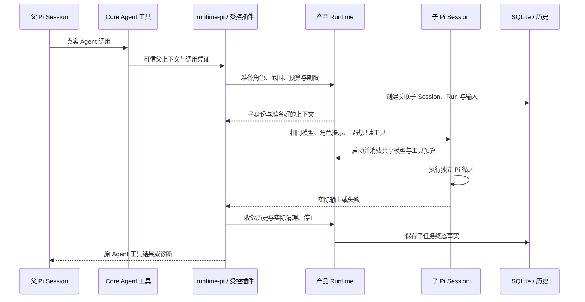

[English](subagents.md) | [简体中文](subagents.zh-CN.md) · [文档导航](README.zh-CN.md)

# Subagent

## 子任务是什么

父 Agent 通过已登记的 **`Agent`** 工具向角色委派一个有界前台任务。产品创建独立子 Session、原生 Pi AgentSession 和 Run，关联原始父 ToolCall，并将真实子任务结果返回父任务。父子在同一个 Bun Host 中运行。

角色由系统提示与允许工具列表组成，不是另一个无限制助手。当前子任务只读、共享根预算，不能创建嵌套或后台任务，也没有独立操作系统沙箱或模型配置。

## 准备扩展与角色

1. 打开 **Extensions**，启用已登记的 **subagents** 扩展并检查就绪状态。创建角色不会自动启用扩展。
2. 进入 **subagents → Plugin details → Manage agents** 列出、查看、新建或编辑角色。修改应用于后续 Run，不改变已准备的 Run。
3. 选择工具在父范围内可用的角色，提供任务和所需信息。子任务不会自动继承整个父会话记录。

内置作者定义位于 [resources/subagents](../../resources/subagents)，用户定义和覆盖位于 `<runtimeRoot>/subagents/<role-id>.md`，作者目录不需要额外的 `v1/` 层。

| 内置角色 | 实际工具权限 | 适用任务 |
|---|---|---|
| `general-analyst` | 无工具 | 独立分析任务中提供的信息 |
| `invoice-evidence-checker` | 声明的只读文件、发票证据与资源读取工具 | 核对来源定位、不确定性与缺失发票证据 |
| `research-investigator` | `read_research_local`、`query_research_evidence` | 在已确认的本地研究计划内调查指定问题 |

最小无工具角色格式如下：

```markdown
---
name: general-analyst
description: Independently analyze the supplied task without external tools or access.
tools: []
---
Analyze the supplied information. State assumptions, uncertainties and findings.
Return a concise analysis to the parent; do not invent external evidence.
```

Frontmatter 声明角色和工具，正文成为子任务系统提示。角色解析核对已登记定义及父任务允许工具子集，向角色添加写工具不能绕过产品准入。

## 触发真实委派

提供三条用户入口：

- **自然语言：** 要求父任务将独立分析委派给已登记角色。
- **命令：** `/subagent <role-id> <task>`，由受控扩展登记的真实命令处理。
- **Prompt 模板：** `/invoice-evidence-review <task>` 或 `/parallel-invoice-review <task>`，后者请求在同一轮独立检查证据和推理。

斜杠菜单区分 Skill、命令、模板和角色。命令和模板准备输入，只有模型真实调用 `Agent` 且通过产品准入后才存在子任务。“已经委派”等回答不是执行证据，应查看子卡片与原 ToolCall。

原生调用参数包括 `subagent_type`、`prompt`、可选短 `description` 和 `run_in_background: false`。Prompt 非空且最多 65,000 UTF-8 字节，description 最多 512 UTF-8 字节；已登记 Schema 拒绝不支持的字段与后台模式。

```text
/subagent general-analyst 独立分析下面两种解释。只使用所附文字，列出假设并返回分歧供父任务综合：……
```

## 父子执行路径



可信绑定包含父 Run/Session/原生 Session、原 ToolCall/原生工具调用、扩展实例、插件子 ID 及子 Run/Session。模型参数不能伪造这些身份；一个原始 ToolCall 归属一个子任务，重复查询不启动替代执行。

产品准备子输入与 Context 依据，并绑定原资源引用。原生 `inheritContext` 关闭，不自动复制父会话的全部消息。适配器提供角色提示与显式工具，禁用独立扩展、Skill 发现，只复用允许的原 Run 资源。SDK 自身的子会话持久化关闭，但 Flowmate 仍保存产品子历史及执行证据。

## 权限、并发与预算

| 约束 | 当前行为 |
|---|---|
| 模型 | 与父任务使用同一准备模型和运行环境，不按角色切换供应商 |
| 工具 | 角色声明、父任务允许工具的 PURE/READ 子集，排除 `Agent` |
| 写入 | 子任务不能保存候选、Claim、报告，不能编辑文件、执行命令或填表 |
| 资料 | 沿用父授权范围，子 Prompt 不新增资料授权 |
| 并发子任务 | 最多保有 **4** 个，第五个返回 `subagent_busy`，不排队 |
| 模型调用 | 共用根账本，子准入为父任务保留 **1** 次继续请求 |
| 工具与反馈 | 共用父工具次数及累计工具反馈容量 |
| 时间 | 不晚于父期限与实际委派期限 |
| 嵌套与后台 | 不支持，`run_in_background` 为 false |
| 隔离 | 产品归属、Context 与工具限制，不是操作系统沙箱 |

实际限制取决于父任务保存配置和剩余资源，四个子任务不会各获一份全新父预算。停止未确认或已污染的子执行继续占有名额；刷新资源或修改角色不改变在途子任务固定定义。

## 停止、失败与部分结果

在 Assistant 或父 Run 视图打开 **Subagents**。详情提供状态、输出或错误、用量、历史可用性、取消请求和停止确认。生命周期状态为 `created`、`running`、`completed`、`failed`、`cancelled`。

- **停止单个子任务：** 核对父子身份后向原执行请求取消。父任务可查看实际结果或错误并综合剩余工作；受理不证明已停止。
- **停止父任务：** 父取消传播到归属子任务，超时也关闭准入并请求实际清理。
- **失败或超时：** 尽可能保留已保存输出、诊断、用量与历史事实。部分文字不等于证据检查成功，也不是已保存业务报告。
- **停止回复未知：** 重试前查询原子任务，不因回复丢失立即创建替代任务。
- **停止未确认：** `stopConfirmed` 要求 `cleanup.stopped === true` 且停止时间非空。停止窗口内无法确认可污染、阻断 Runtime 并停止父任务，不静默释放名额。

重启后检查已保存父子事实，恢复不会自动重跑子任务或工具。供应商证据不完整时用量可能部分可知或未知，不补造数值。

## 示例与限制

**普通分析：** 使用 `general-analyst` 比较所附文字中的解释、约束或风险。该角色没有工具，无法查外部事实；要求父任务区分独立推理与已核实证据。

**本地研究：** 确认研究计划并启用扩展后，可让父任务将独立子问题交给 `research-investigator`。它返回发现、来源身份、原文、冲突与缺口，父任务核对证据并保存 Claim/报告。联网搜索和网页提取仍不可用。

**发票复核：** 选定发票与解析资料后，`/parallel-invoice-review …` 可请求一个取证子任务和一个无工具推理子任务。证据读取不越过固定资料范围，父任务综合返回结果；只有授权父任务或用户路径可以保存、填表、接受候选。模板请求不证明两个子任务均执行。

委派消耗共享次数和时间，小任务可由父任务直接完成，独立分析或分离取证确有价值时再使用子任务。执行完成不证明质量，详见[评测](EVALUATION.zh-CN.md)。

<a id="developer-map-and-verification"></a>

## 开发定位与验证

| 层级 | 职责 |
|---|---|
| [Core Agent 工具](../../packages/core/src/subagents.ts) | 产品工具定义、可信执行器入口与适配调用 |
| [RuntimeService](../../packages/core/src/runtime/service.ts) | 子准入、产品 Session/Run、共享预算、取消与终态保存 |
| [Pi Session 适配器](../../packages/runtime-pi/src/session.ts) | 受管子构造、模型工具绑定、历史与清理 |
| [受控扩展](../../packages/runtime-pi/src/extensions/subagents.ts) | 以经过核验的归属登记真实插件工具和命令 |
| [契约](../../packages/contracts/src/subagents.ts) | 参数、身份、摘要、详情与取消回复 |
| [角色与输入定义](../../packages/core/src/prompt-templates.ts) | 作者和用户角色、模板展开与 Run 固定定义 |

固定版本 `pi-subagents` 提供插件编排，Pi coding-agent 补丁与 subagents 补丁暴露产品所需的受管钩子；它们是必要依赖，不是可删的文档附件，详见[开发指南](development.zh-CN.md#dependency-patches)。

验证入口：[Runtime/Pi 接合](../../tests/runtime-pi/subagents.integration.test.ts)、[产品子生命周期](../../tests/core/application/subagents.integration.test.ts)、[并发准入和预算](../../tests/core/application/parallel-subagents.integration.test.ts)、[存储归属](../../tests/core/storage/subagents.integration.test.ts)、[契约](../../tests/contracts/subagents.unit.test.ts)、[Electron 界面](../../tests/desktop/subagents.e2e.test.ts)。这些测试使用受控条件，不认证真实模型的委派质量。
