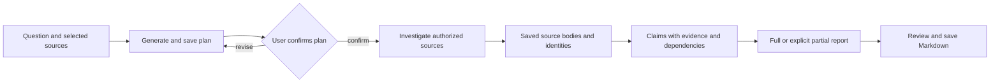

[English](workflows.md) | [简体中文](workflows.zh-CN.md) · [Documentation](README.md)

# Workflows

**Chats**, **Invoices** and **Deep Research** continue to use AgentSession. Use the independent **Personal Agent** entry for ongoing invoice work with Pi Durable.

## Ask about local information

1. Configure a model, then use **New chat** in the left navigation to open a new main conversation, or select an existing one from recent chats or **Chats**.
2. Supply text, select authorized materials or choose the intended working directory. Say what the Agent should inspect and what constitutes an answer.
3. Send once and watch the actual Run/tools. A selected directory determines execution location, not an OS sandbox; native command/write tools may be available.
4. Check the answer against source text. Open Session Details/Context and tool evidence when a citation, material version or execution claim is unclear.
5. Continue with a new input if needed. Reopening history does not resend an old request.

If evidence is missing, ask for the gap rather than a guessed fact. For independent reasoning on supplied text, enable the extension and use `general-analyst`; its no-tool definition cannot verify outside facts. See [Subagents](subagents.md).

## Deep Research

Research currently operates on selected local `.txt`/`.md` material and registered parsed documents. It does not perform online search or webpage extraction and needs no Tavily key.

1. Open **Deep Research** from the left navigation, import/select local material or existing parsed documents, enter the question and scope, and create the research task. This business page uses the linked right-side Assistant.
2. Send in the linked Assistant to generate a plan. Inspect its questions, evidence needs, budget and stop conditions. Revise as necessary; confirmation is a separate user action before investigation.
3. Investigate under the confirmed plan. Actual reads preserve source bodies and Run/ToolCall identities. If subagents is enabled, independent questions may use `research-investigator`; the parent retains responsibility for synthesis and saving.
4. Review **Evidence** and **Report**. Claims associate evidence relations and dependencies with the plan's questions. Source references must identify the actual source execution, and excerpts/locators must match saved text.
5. Save a full report only when the product's coverage/support conditions are met; otherwise retain unresolved questions in a partial report. Use **Save report** to save Markdown, which rechecks report/evidence references.

Source location validity is not semantic correctness. A Report's own coverage is a product result, not an independent quality score. A completed investigation Run without a saved report is not a delivered report. Use [Evaluation](EVALUATION.md) for independent evidence and multi-hop quality checks.

## Invoice review

Prepare the original invoice and externally generated parsing material. Development import uses `data/invoices/agent-input/`; installed imports use the product data root's `imports/invoices/`. Keep the original/parsed association intact. The Host registers and reads material; it does not parse original invoices itself.

```mermaid
flowchart LR
  Import[Import original and parsed material] --> Inspect[Original / Parsed / Results]
  Inspect --> Run[Process this invoice then Send]
  Run --> Candidate[Saved candidate]
  Candidate --> Review[Review fields and source evidence]
  Review --> Edit[Optional Fill with Agent or human Edit]
  Edit --> Save[Save reviewed version]
  Save --> Accept[Accept result]
  Accept --> Export[JSON / CSV / Markdown export]
```

1. Open **Invoices** from the left navigation, import the prepared material and inspect **Original / Parsed / Results**. The right-side Assistant accompanies the invoice workspace.
2. Click **Process this invoice**, then **Send** in Assistant. Processing and candidate saving have actual Run/ToolCall records.
3. Select the candidate. Compare header fields, line items, amounts, uncertainties and source locations with the original and parsed evidence.
4. Use **Fill with Agent** to invoke the real form operation, or **Edit** for human changes. Fill requires the original candidate/target/revision and a matching application receipt; a tool request alone does not prove the UI was filled.
5. Save reviewed edits, explicitly **Accept result**, then export JSON, CSV or Markdown. A generated candidate, human edit, saved version, accepted result and external exported copy are different facts.

Unsaved edits live in the current window and do not survive restart; follow Save/Discard prompts when leaving. Unknown write/fill receipts should be queried through the original operation before retrying. A visible form value does not replace a saved candidate or acceptance record.

An optional `invoice-evidence-checker` can inspect fixed-scope source evidence but cannot save candidates, fill forms or accept results. `/parallel-invoice-review` requests evidence and reasoning checks; inspect actual child cards before treating both checks as completed. Detailed constraints are in [Subagents](subagents.md).

## Personal Agent: ongoing invoice work

This engineering delivery covers verified capabilities while the application is running. Continued execution after desktop closure, Windows service restart recovery and Windows startup recovery remain system-service goals; real Windows SCM acceptance is deferred and those system behaviors are not yet verified.

1. Open **Personal Agent** and confirm/save its model, tool and resource configuration. Then select a fixed set of existing parsed invoices, enter the goal and explicitly submit the work. Creation is available only here; **Invoices** retains single-invoice selection and editing. New invoices require new work rather than silently enlarging the saved set.
2. Follow the persistent work overview, per-invoice records and Todo items. The Agent prepares candidates, identifies gaps and continues other eligible invoices while one waits for material or human review. A Todo explains what is missing and the next action.
3. Submit material or clarification for the relevant invoice/Todo, then inspect the saved-material and execution decisions separately. Use the continue action when required; the service checks current authorization, versions, attempts, stopping facts and remaining budget before selecting an existing attempt, a linked new attempt, queueing or a blocked response.
4. Follow the review action to the original invoice in **Invoices** and compare the candidate with its sources. Editing, **Fill with Agent**, explicit **Accept result** and export keep the existing single-invoice workflow; navigating there preserves the original Durable work and conversation.
5. Explicitly give every invoice a final disposition: `accepted`, `rejected` (end processing for this invoice) or `excluded`, with the required reason. Ordinary **Reject** only rejects a candidate. The work completes only when every invoice is finally disposed and the required business writes and execution have settled; a candidate, Run or completed child alone does not complete it.

| Trigger | What happens |
|---|---|
| Explicit continue | The service checks current facts and saved input authorization, then returns or continues the original eligible attempt, authorizes a linked new attempt, queues it when root capacity is occupied, or reports a specific Todo/blocker. Completed/cancelled work does not restart. |
| Per-invoice material | Valid material after a normally completed attempt can automatically authorize a linked new attempt while the work remains open. Material after a user stop or failure is saved and needs explicit continue. Material that is only saved without execution authorization also needs explicit continue after its blocker is resolved. Saving, authorization to execute and actual execution are separate facts. |
| Backend startup recovery | The backend loads the original persisted facts and native records, then checks saved authorization and current eligibility before resuming an eligible original attempt. An `open` work item alone creates no new intent, and stopped or failed attempts are not revived. |

Viewing pages, work history or the original operation and reconnecting the desktop are read-only. They make no model or tool calls and do not trigger backend recovery.

If material arrives during execution, it is consumed at a valid stage boundary; it is not a Steer request and cannot change an already-started tool's parameters. When a write receipt or stopping result is unknown, query the original operation before another action. **Stop** targets the current execution; cancelling the whole work is a separate business action, and neither a cancelled label nor a closed window proves stopping is confirmed.

The Master may delegate a bounded source question to the read-only `invoice-evidence-checker` when useful. At most four child executions may be owned at once, with no nesting and a shared root budget; unconfirmed stops retain their capacity. Child completion, returned results and valid source references do not establish semantic correctness. The Master remains responsible for synthesis and candidates, and human acceptance remains explicit. See [Subagents](subagents.md).

## When to stop and inspect

Stop if material permissions no longer match, execution stopping is unconfirmed, or required history/persistence is unavailable. Keep the original error, Run/ToolCall and artifact identities. Do not rerun an operation merely to replace an unclear status. [Runtime](agent-runtime.md) explains the facts; [Packaging and recovery](packaging-and-recovery.md) explains data recovery.
