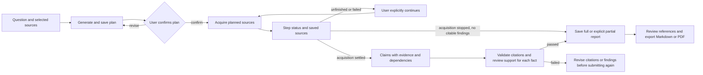

[English](workflows.md) | [简体中文](workflows.zh-CN.md) · [Documentation](README.md)

# Workflows

**Chats**, **Invoices** and **Deep Research** continue to use AgentSession. Use the independent **Personal Agent** entry for ongoing invoice work with Pi Durable.

## Ask about local information

1. Configure a model, then use **New chat** in the left navigation to open a new main conversation, or select an existing one from recent chats or **Chats**.
2. Supply text, select authorized materials or choose the intended working directory. Say what the Agent should inspect and what constitutes an answer.
3. Send once and watch the actual Run/tools. A selected directory determines execution location, not an OS sandbox; native command/write tools may be available.
4. Check the answer against source text. Open Session Details/Context and tool evidence when a citation, material version or execution claim is unclear.
5. Continue with a new input if needed. Reopening history does not resend an old request.

If evidence is missing, ask for the gap rather than a guessed fact. For independent reasoning on supplied text, enable the extension and use `general-analyst`; its no-tool definition cannot verify outside facts. See [Subagents](subagents.md).

## Deep Research

Research reads selected local `.txt` and `.md` material and registered parsed documents. **Web search** defaults to off. To turn it on, set `FLOWMATE_TAVILY_API_KEY` in the executing Host's startup environment and restart it. Desktop local mode inherits the value from the desktop launcher. Set the variable in the Windows service startup environment for WinSW. Turning web search off does not require a key.

1. Optionally open **Settings → General → Research preferences**, enter the desired evidence or report preferences, and select **Save research preferences**. The default is empty and the text is limited to 8,192 UTF-8 bytes; each research Run captures the saved text and revision. Saving does not start a model call.
2. Open **Deep Research → New research**, enter the question and optional scope, and import or select authorized local material or parsed documents as needed. Enable **Web search** if the task needs public webpages. Select **Create research**, then **Send** in the linked Assistant to generate a plan. The currently selected invoice is not added automatically.
3. Inspect the saved Plan's questions, evidence needs, source scope, budget and stop conditions. A plan with **Web search** enabled requires a public web step and, if local materials were selected, a local read step. **Web requests to Tavily** lists the search terms, time ranges, result ranks and specified public URLs. Tavily receives the terms and URLs used for search and extraction. Keep credentials, private identifiers, local paths and confidential text out of those fields, including URL query strings and fragments. Use **Revise plan** if necessary, then select **Confirm plan version** to start investigation.
4. For a plan with steps, inspect **Research steps** and the saved-source links. Local reads, web searches and page extraction share **two** active acquisition slots per task, including reads delegated to `research-investigator` children. This is separate from the limit of four owned children. The parent runs the confirmed Tavily steps and saves Claims and reports. Search tries live fetching first. If the selected rank has no candidate, Flowmate repeats discovery once with the confirmed query, date constraints and rank, then extracts the selected webpage. If a selected search result has no body, Flowmate extracts that URL directly.
5. Open **Report** and choose a version in **Saved report**. Click a marker such as `[1]` to see its source snapshot, exact quotation, UTF-16 character range, acquisition time and Run / ToolCall. **Semantic review** shows the model, policy, Run / ToolCall and per-sentence verdicts, fact spans, reasons and citations. Use **View saved passage** to open the text in **Evidence**, **Open Claim** to inspect its supporting or refuting evidence and dependencies, or **Open webpage** for a web source. Web snapshots retain the page text, URL, acquisition time and source date when available. **Open webpage** opens the saved URL in the system browser and may contact the website.
6. Choose Markdown or PDF under **Export format**, then select **Save report**. For reports with sentence citations, both exports retain the same markers and references. In a PDF, clicking a marker jumps to its entry. Format 3 reports reviewed under `research-semantic-v1` remain readable and exportable with their original review, marked as having no v2 checks. Format 2 still supports PDF and has no independent semantic review. Earlier reports with section-level citations retain Markdown export.

**Reference numbering.** Flowmate scans the answer first, then the section sentences in order. Each distinct saved Claim evidence entry receives `[1]`, `[2]`, `[3]` on first use; later uses of the same entry retain its number. The sequence can therefore be `[1]`, `[2]`, `[3]`, `[1]`. Different passages on the same webpage can have different numbers. If every sentence cites the same evidence entry, all markers are `[1]`.

The workbench, Markdown and PDF use the same numbering and References entries. A number identifies the exact saved snapshot and passage, not just a webpage title or URL. Clicking a PDF marker jumps to that entry. Reordering the body can change display numbers; it does not replace the underlying evidence. Inspect the bound quotation and the review when checking whether it supports the final wording.

Each sentence in a new report (format 3) cites a specific evidence entry on a saved Claim. The Host resolves each reference against the confirmed plan, source snapshot, exact quote at the saved UTF-16 offsets (start inclusive, end exclusive), and acquisition Run / ToolCall. For a report with findings, `research-semantic-v2` sends the final draft, research question and scope, and evidence from the relevant saved sources to the selected model provider. It includes the full saved source text when it fits. Otherwise it scans all N segments, then makes one final decision call (N+1 model calls). Review requests have no conversation history, tools or automatic retry. All calls use the same confirmed shared budget and the original Run and save tool deadlines, with one model call reserved for the Assistant response. If source coverage, time or budget is insufficient, the save is refused.

The review checks both directions: every fact and qualification must be supported by the selected evidence, and every selected quote must directly support a fact or supply a necessary premise. The full saved context can reveal definitions, exceptions, corrections or contradictions. It cannot make an unrelated quote count as support; cite the actual supporting passage. Every sentence in the body must pass both checks, including in a partial report. The model can make mistakes: a snapshot records what was captured, and a successful review does not establish truth or current validity.

| Sentence result | Meaning | Save behavior |
|---|---|---|
| `supported` | All facts have full support and the reviewer reports complete coverage | Eligible to save if every citation contributes and the remaining checks pass |
| `partially_supported` | Some support exists, but facts, conditions or review coverage remain incomplete, with no explicit contradiction | Refuse the save |
| `unsupported` | No fact receives full or partial support, and no contradiction is established | Refuse the save |
| `contradicted` | At least one fact conflicts with the evidence | Refuse the save |

After a refusal, inspect the original `save_research_report` error in Assistant. The Agent can narrow the wording, correct the citations, or obtain permitted evidence and submit again within the remaining budget. Changed wording, citations or plan require review of the final version. The Host-generated receipt binds the exact report, evidence directory, plan and writing ToolCall. Repeating the original committed ToolCall with the identical payload returns its original receipt; revisions use a new save call.

| Save issue | Next action |
|---|---|
| Missing citation, quotation mismatch or invalid acquisition record | Correct the reference using saved evidence and its original receipt |
| Partial support, no support or contradiction | Rewrite, supplement evidence or remove the unsupported statement |
| Review timeout, insufficient budget or incomplete model response | Retain the gap and check the confirmed execution limits before another attempt |
| Report or ToolCall result too large | Shorten the draft and submit again; the Host generates the review receipt |
| Execution stop unconfirmed | Check the original Run and ToolCall before continuing |

Citation, semantic review and size failures detected before commit leave the saved report and current report pointer unchanged. If a save reply is lost or its commit result is unknown, inspect the original Run and ToolCall before retrying. Opening or exporting a saved report uses its recorded review.

A full report requires successful planned acquisitions, supported Claims for every planned question, supported cited Claims and dependencies, and no unresolved questions. Once active acquisitions stop, a partial report can record failed or unfinished steps, limitations, conflicts and unresolved questions separately from the body. If there are no citable findings, a partial report can record the gaps with an empty body; this does not call the reviewer.

For a plan with steps, the checkpoint displays `pending`, `running`, `succeeded`, `failed` or `interrupted`. Success requires a successful tool receipt, confirmed cleanup and a saved source; a model's statement is not a receipt. Claim saving is blocked while a step remains pending, running or interrupted. A failed step remains visible for diagnosis and prevents a full report until it succeeds.

When a confirmed plan has pending, failed or interrupted steps, **Continue research** is shown. It can be enabled only when the selected research Session, model and runtime are ready, no Run is active, and the page is not loading or saving. It starts an explicit new investigation Run using the confirmed plan: a succeeded step reuses its original saved source if that source remains available, while remaining eligible steps can be attempted. A prior step whose stopping is unconfirmed remains blocked; inspect the original Run and ToolCall instead of starting a replacement blindly. Merely reopening the page or querying history does not run the model or replay a tool call. After restart, a valid saved research focus can be restored, but a later user selection is not replaced by a delayed restore.

To change **Web search** on an existing task, wait for the Host to confirm that its Runs and tools have stopped, then use the task's switch. Both directions retain the same task, Assistant session, local material IDs and history. The previous plan can no longer be continued. Send the question in Assistant to generate and confirm a new plan; the switch itself starts no Run. With the switch off, new investigations cannot acquire or cite web evidence, including snapshots from an earlier plan. Saved reports, sources and exports stay available under their original authorization. Changing the selected local materials requires a new research task.

Older plans without `steps` remain readable and use their original read/query flow; they do not automatically gain a step list. To use step tracking, generate and confirm a new plan. See [Agent runtime](agent-runtime.md#context-memory-layers) for the different lifetimes of focus, history, preferences and checkpoint.

Claim statuses describe the research Agent's judgment. The separate review records the model's judgment of evidence for the report's cited sentences. Read the original passages for important decisions; neither judgment guarantees truth, and neither measures real-world accuracy. See [Evaluation](EVALUATION.md) for quality checks. A completed investigation Run without a saved report has not delivered a report.

## Invoice review

Prepare the original invoice and externally generated parsing material. Development import uses `data/invoices/agent-input/`; installed imports use the product data root's `imports/invoices/`. Keep the original/parsed association intact. The Host registers and reads material; it does not parse original invoices itself.

```mermaid
flowchart LR
  Import[Import original and parsed material] --> Inspect[Original / Parsed / Results]
  Inspect --> Run[Process this invoice then Send]
  Run --> Candidate[Saved candidate]
  Candidate --> Review[Review fields and source evidence]
  Review --> Edit[Optional Fill with Agent or human Edit]
  Edit --> Save[Save reviewed version]
  Save --> Accept[Accept result]
  Accept --> Export[JSON / CSV / Markdown export]
```

1. Open **Invoices** from the left navigation, import the prepared material and inspect **Original / Parsed / Results**. The right-side Assistant accompanies the invoice workspace.
2. Click **Process this invoice**, then **Send** in Assistant. Processing and candidate saving have actual Run/ToolCall records.
3. Select the candidate. Compare header fields, line items, amounts, uncertainties and source locations with the original and parsed evidence.
4. Use **Fill with Agent** to invoke the real form operation, or **Edit** for human changes. Fill requires the original candidate/target/revision and a matching application receipt; a tool request alone does not prove the UI was filled.
5. Save reviewed edits, explicitly **Accept result**, then export JSON, CSV or Markdown. A generated candidate, human edit, saved version, accepted result and external exported copy are different facts.

Unsaved edits live in the current window and do not survive restart; follow Save/Discard prompts when leaving. Unknown write/fill receipts should be queried through the original operation before retrying. A visible form value does not replace a saved candidate or acceptance record.

An optional `invoice-evidence-checker` can inspect fixed-scope source evidence but cannot save candidates, fill forms or accept results. `/parallel-invoice-review` requests evidence and reasoning checks; inspect actual child cards before treating both checks as completed. Detailed constraints are in [Subagents](subagents.md).

## Personal Agent: ongoing invoice work

For configuration, execution objects and recovery details, see the dedicated [Personal Agent guide](personal-agent.md).

Choose the local workspace or [connect to a cloud workspace](personal-agent.md#cloud-workspace) before submitting Work. Eligible cloud execution can continue while its services are running. Local execution after desktop closure and Windows startup recovery require separate system acceptance.

1. Open **Personal Agent** and confirm/save its model, tool and resource configuration. Then select a fixed set of existing parsed invoices, enter the goal and explicitly submit the work. Creation is available only here; **Invoices** retains single-invoice selection and editing. New invoices require new work rather than silently enlarging the saved set.
2. Review the Work overview and per-invoice Todo. Provide requested clarification or authorized material and inspect whether it was saved, authorized for execution or blocked. After a stopped or failed attempt, use **Continue work** when eligible.
3. Use **View original invoice / review** to compare the candidate with its sources. Choose **Accept result** in local **Invoices** or **Accept candidate** in the cloud review panel. Return to the Work and choose **Attach confirmed acceptance**. To end an item as rejected or excluded, use its explicit disposition action and provide a reason. Rejecting a candidate alone does not end the item.
4. Inspect attempts and saved evidence. **Stop current attempt** and **Cancel entire work** are different actions; each invoice needs a final disposition and required writes and execution must settle before the Work completes. Viewing history does not start a model call.

The parent may delegate an invoice evidence question to a bounded read-only child. See [Subagents](subagents.md) for the Durable path and [Personal Agent](personal-agent.md) for stopping, recovery and related work.

If the initial attempt has closed and the original candidate and evidence are available, preview what an [independent invoice review](personal-agent.md#personal-peer-review) would share before confirming it. For interactive tools, use the [approval and reconnection flow](personal-agent.md#personal-approvals). Use **Timeline** to distinguish business receipts from model observations and [Long-term memory](agent-runtime.md#openviking-memory) to manage authorized memory for new chats or Work.

## When to stop and inspect

Stop if material permissions no longer match, execution stopping is unconfirmed, or required history/persistence is unavailable. Keep the original error, Run/ToolCall and artifact identities. Do not rerun an operation merely to replace an unclear status. [Runtime](agent-runtime.md) explains the facts; [Packaging and recovery](packaging-and-recovery.md) explains data recovery.
