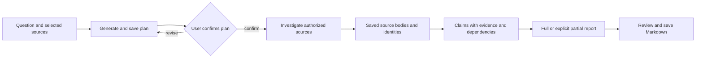

[English](workflows.md) | [简体中文](workflows.zh-CN.md) · [Documentation](README.md)

# Workflows

## Ask about local information

1. Create/select a **Chats** conversation and configure its model.
2. Supply text, select authorized materials or choose the intended working directory. Say what the Agent should inspect and what constitutes an answer.
3. Send once and watch the actual Run/tools. A selected directory determines execution location, not an OS sandbox; native command/write tools may be available.
4. Check the answer against source text. Open Session Details/Context and tool evidence when a citation, material version or execution claim is unclear.
5. Continue with a new input if needed. Reopening history does not resend an old request.

If evidence is missing, ask for the gap rather than a guessed fact. For independent reasoning on supplied text, enable the extension and use `general-analyst`; its no-tool definition cannot verify outside facts. See [Subagents](subagents.md).

## Deep Research

Research currently operates on selected local `.txt`/`.md` material and registered parsed documents. It does not perform online search or webpage extraction and needs no Tavily key.

1. Open **Deep Research**, import/select local material or existing parsed documents, enter the question and scope, and create the research task.
2. Send in the linked Assistant to generate a plan. Inspect its questions, evidence needs, budget and stop conditions. Revise as necessary; confirmation is a separate user action before investigation.
3. Investigate under the confirmed plan. Actual reads preserve source bodies and Run/ToolCall identities. If subagents is enabled, independent questions may use `research-investigator`; the parent retains responsibility for synthesis and saving.
4. Review **Evidence** and **Report**. Claims associate evidence relations and dependencies with the plan's questions. Source references must identify the actual source execution, and excerpts/locators must match saved text.
5. Save a full report only when the product's coverage/support conditions are met; otherwise retain unresolved questions in a partial report. Use **Save report** to save Markdown, which rechecks report/evidence references.

Source location validity is not semantic correctness. A Report's own coverage is a product result, not an independent quality score. A completed investigation Run without a saved report is not a delivered report. Use [Evaluation](EVALUATION.md) for independent evidence and multi-hop quality checks.

## Invoice review

Prepare the original invoice and externally generated parsing material. Development import uses `data/invoices/agent-input/`; installed imports use the product data root's `imports/invoices/`. Keep the original/parsed association intact. The Host registers and reads material; it does not parse original invoices itself.

```mermaid
flowchart LR
  Import[Import original and parsed material] --> Inspect[Original / Parsed / Results]
  Inspect --> Run[Process this invoice then Send]
  Run --> Candidate[Saved candidate]
  Candidate --> Review[Review fields and source evidence]
  Review --> Edit[Optional Fill with Agent or human Edit]
  Edit --> Save[Save reviewed version]
  Save --> Accept[Accept result]
  Accept --> Export[JSON / CSV / Markdown export]
```

1. In **Invoices**, import the prepared material and inspect **Original / Parsed / Results**.
2. Click **Process this invoice**, then **Send** in Assistant. Processing and candidate saving have actual Run/ToolCall records.
3. Select the candidate. Compare header fields, line items, amounts, uncertainties and source locations with the original and parsed evidence.
4. Use **Fill with Agent** to invoke the real form operation, or **Edit** for human changes. Fill requires the original candidate/target/revision and a matching application receipt; a tool request alone does not prove the UI was filled.
5. Save reviewed edits, explicitly **Accept result**, then export JSON, CSV or Markdown. A generated candidate, human edit, saved version, accepted result and external exported copy are different facts.

Unsaved edits live in the current window and do not survive restart; follow Save/Discard prompts when leaving. Unknown write/fill receipts should be queried through the original operation before retrying. A visible form value does not replace a saved candidate or acceptance record.

An optional `invoice-evidence-checker` can inspect fixed-scope source evidence but cannot save candidates, fill forms or accept results. `/parallel-invoice-review` requests evidence and reasoning checks; inspect actual child cards before treating both checks as completed. Detailed constraints are in [Subagents](subagents.md).

## When to stop and inspect

Stop if material permissions no longer match, execution stopping is unconfirmed, or required history/persistence is unavailable. Keep the original error, Run/ToolCall and artifact identities. Do not rerun an operation merely to replace an unclear status. [Runtime](agent-runtime.md) explains the facts; [Packaging and recovery](packaging-and-recovery.md) explains data recovery.
