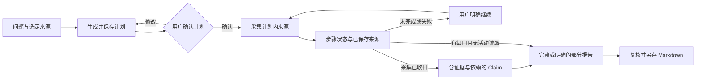

[English](workflows.md) | [简体中文](workflows.zh-CN.md) · [文档导航](README.zh-CN.md)

# 业务流程

**Chats**、**Invoices**、**Deep Research** 继续使用 AgentSession；持续发票事项从独立 **Personal Agent** 入口进入，使用 Pi Durable。

## 本地资料问答

1. 配置模型后，通过左侧导航的 **New chat** 进入新的主对话，或从最近会话、**Chats** 打开已有会话。
2. 提供文字、选定授权资料或预期工作目录，说明要检查什么以及答案要求。
3. 发送一次并观察实际 Run/工具。目录确定执行位置，不提供操作系统沙箱；原生命令、写工具可能可用。
4. 对照原文检查答案。引用、资料版本或执行声明不明确时，查看 Session Details/Context 与工具证据。
5. 需要继续时提交新输入，重新打开历史不会重发旧请求。

证据不足时要求说明缺口，不猜事实。需要对所附文字独立推理，可启用扩展并使用 `general-analyst`，无工具角色不能核实外部事实。详见 [Subagent](subagents.zh-CN.md)。

## Deep Research

当前研究仅使用选定本地 `.txt`/`.md` 资料和已登记解析文档，不联网搜索或提取网页，无需 Tavily Key。

1. 可先在 **Settings → General → Research preferences** 填写证据或报告偏好，点击 **Save research preferences**。默认文字为空，最多 8,192 UTF-8 字节；每次研究 Run 捕获当时保存的文字和 revision，保存本身不请求模型。
2. 打开 **Deep Research → New research**，输入问题与可选范围，导入或选择授权本地资料、解析文档。点击 **Create research**，再在关联 Assistant 中 **Send** 以生成计划；当前发票不会被自动加入研究。
3. 检查已保存 Plan 的问题、证据需求、来源范围、预算和停止条件。带步骤的计划将每次采集关联到问题及一个选定材料。需要时使用 **Revise plan**，再明确点击 **Confirm plan version** 启动调查。改变授权材料选择需要新建研究任务。
4. 对带步骤的计划，查看 **Research steps** 和已保存来源入口。同一研究任务的父任务与 `research-investigator` 子任务合计最多同时进行 **2 路** `read_research_local` 采集；这与最多保有四个子任务的限制分别计算。Agent 可以委派适合的独立问题，但父任务仍负责综合与保存。
5. 查看 **Evidence / Report**。Claim 将确认的问题与实际来源执行、匹配原文和依赖关联。完整报告还要求计划步骤全部成功，并满足既有覆盖与支持检查。活动采集停止后，部分报告可将失败和未完成步骤保留为明确缺口。**Save report** 将已保存报告导出为 Markdown。

带步骤计划的 Checkpoint 展示 `pending`、`running`、`succeeded`、`failed` 或 `interrupted`。成功要求工具回执成功、清理已确认且来源已保存；模型自述不等于回执。仍有 pending、running 或 interrupted 步骤时不能保存 Claim。失败步骤保留供排查，在其成功前不能保存完整报告。

已确认计划存在待执行、失败或中断步骤时，界面显示 **Continue research**；选定研究 Session、模型与运行时就绪，没有活跃 Run 且页面未在加载或保存时才能点击。该操作明确启动新一轮调查：原来源仍可用时成功步骤复用已保存来源，其他符合条件的步骤可再次尝试。原步骤停止未确认时仍会受阻，应先查询原 Run 与 ToolCall，不能盲目启动替代执行。重新打开页面或查询历史不会请求模型或重放工具；重启后可以恢复有效保存的研究焦点，但迟到的恢复不会覆盖用户后来的选择。

旧的无 `steps` 计划仍可读取并沿用原有读取／查询流程，不会自动出现步骤列表；需要步骤跟踪时，重新生成并确认新计划。焦点、历史、偏好和 Checkpoint 的生命周期见 [Agent Runtime](agent-runtime.zh-CN.md#context-memory-layers)。

来源定位合法不等于语义正确，Report 自报覆盖是产品结果，不是独立质量评分。调查 Run 完成但报告未保存，不等于报告交付；独立证据与多跳质量检查见[评测](EVALUATION.zh-CN.md)。

## 发票复核

准备原始发票与外部生成的解析资料。开发导入使用 `data/invoices/agent-input/`，安装版使用产品数据根下 `imports/invoices/`。保留原件与解析关联；Host 负责登记读取，不自行解析原票。

1. 从左侧导航打开 **Invoices**，导入准备好的资料，查看 **Original / Parsed / Results**；在右侧 Assistant 中继续关联对话。
2. 点击 **Process this invoice**，再在 Assistant 点击 **Send**。处理和候选保存留有实际 Run/ToolCall 记录。
3. 选择候选，将票头、明细、金额、不确定性和来源定位与原件、解析证据对照。
4. **Fill with Agent** 调用真实表单操作，**Edit** 用于人工修改。Fill 需要原候选、目标、revision 以及匹配的应用回执；发出工具请求不证明已填入界面。
5. 保存复核后的编辑，明确 **Accept result**，再导出 JSON、CSV 或 Markdown。生成候选、人工编辑、保存版本、接受结果与外部导出副本是不同事实。

未保存编辑仅在当前窗口，不跨重启保留；离开时按 Save/Discard 提示处理。写入或 Fill 回复未知，应先查原操作；表单可见值不能替代保存候选或接受记录。

可选 `invoice-evidence-checker` 在固定范围内核对证据，不能保存候选、填表或接受结果。`/parallel-invoice-review` 请求证据与推理检查，应查看真实子卡片后再认定两项均完成，详细约束见 [Subagent](subagents.zh-CN.md)。

## Personal Agent：持续发票事项

配置、执行对象和恢复细节见独立的 [Personal Agent 指南](personal-agent.zh-CN.md)。

本次工程版本交付覆盖应用运行期间已验证的能力。关闭桌面后持续执行、Windows 服务重启恢复与开机恢复仍属系统服务目标；真实 Windows SCM 验收延期，这些系统行为尚未验证。

1. 打开 **Personal Agent**，先确认并保存其模型、工具与资源配置，再固定选择一组已有解析的发票，填写目标并明确提交事项。创建入口仅在本模块；**Invoices** 保持单票选择与编辑。新增票据另建事项，不静默扩大已保存集合。
2. 查看事项概览和逐票 Todo，补充所需说明或获准材料，分别检查是否已保存、已授权执行或受阻。尝试停止或失败后，符合条件时使用 **Continue work**。
3. 通过 **View original invoice / review** 回到 **Invoices**，对照来源复核候选。执行 **Accept result** 后返回事项并点击 **Attach confirmed acceptance**；如需结束该票并标记为拒绝或排除，使用对应的明确处置操作并填写原因。普通拒绝候选不结束该票。
4. 查看尝试和已保存证据。**Stop current attempt** 与 **Cancel entire work** 是不同操作；每张票都需要最终处置，必要写入与执行收口后事项才能完成。查看历史不会发起模型调用。

父任务可以将发票取证问题委派给有界只读子任务。Durable 路径见 [Subagent](subagents.zh-CN.md)，停止、恢复和关联事项详见 [Personal Agent](personal-agent.zh-CN.md)。

## 何时停止并核对

资料权限不匹配、执行停止未确认或必要历史保存不可用时停止，保留原错误、Run/ToolCall 与产物身份。不为替换含糊状态而重跑操作。[Runtime](agent-runtime.zh-CN.md)解释事实，[打包与恢复](packaging-and-recovery.zh-CN.md)解释数据恢复。
