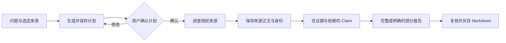

[English](workflows.md) | [简体中文](workflows.zh-CN.md) · [文档导航](README.zh-CN.md)

# 业务流程

**Chats**、**Invoices**、**Deep Research** 继续使用 AgentSession；持续发票事项从独立 **Personal Agent** 入口进入，使用 Pi Durable。

## 本地资料问答

1. 配置模型后，通过左侧导航的 **New chat** 进入新的主对话，或从最近会话、**Chats** 打开已有会话。
2. 提供文字、选定授权资料或预期工作目录，说明要检查什么以及答案要求。
3. 发送一次并观察实际 Run/工具。目录确定执行位置，不提供操作系统沙箱；原生命令、写工具可能可用。
4. 对照原文检查答案。引用、资料版本或执行声明不明确时，查看 Session Details/Context 与工具证据。
5. 需要继续时提交新输入，重新打开历史不会重发旧请求。

证据不足时要求说明缺口，不猜事实。需要对所附文字独立推理，可启用扩展并使用 `general-analyst`，无工具角色不能核实外部事实。详见 [Subagent](subagents.zh-CN.md)。

## Deep Research

当前研究仅使用选定本地 `.txt`/`.md` 资料和已登记解析文档，不联网搜索或提取网页，无需 Tavily Key。

1. 从左侧导航打开 **Deep Research**，导入或选定本地资料、已有解析文档，输入问题和范围并创建研究；此业务页面使用关联的右侧 Assistant。
2. 在关联 Assistant 发送以生成计划，检查子问题、证据需求、预算和停止条件，按需修改。确认是独立用户操作，先确认再调查。
3. 在确认计划下调查，真实读取保留来源正文及 Run/ToolCall 身份。启用 subagents 后可将独立问题交给 `research-investigator`，父任务仍负责综合与保存。
4. 查看 **Evidence / Report**。Claim 将证据关系和依赖与计划问题关联；来源必须标明实际执行身份，原文与定位需匹配保存正文。
5. 满足产品覆盖和支持条件才保存完整报告，否则在部分报告中保留未解决问题。**Save report** 另存 Markdown 时重新核对报告与证据引用。

来源定位合法不等于语义正确，Report 自报覆盖是产品结果，不是独立质量评分。调查 Run 完成但报告未保存，不等于报告交付；独立证据与多跳质量检查见[评测](EVALUATION.zh-CN.md)。

## 发票复核

准备原始发票与外部生成的解析资料。开发导入使用 `data/invoices/agent-input/`，安装版使用产品数据根下 `imports/invoices/`。保留原件与解析关联；Host 负责登记读取，不自行解析原票。

1. 从左侧导航打开 **Invoices**，导入准备好的资料，查看 **Original / Parsed / Results**；在右侧 Assistant 中继续关联对话。
2. 点击 **Process this invoice**，再在 Assistant 点击 **Send**。处理和候选保存留有实际 Run/ToolCall 记录。
3. 选择候选，将票头、明细、金额、不确定性和来源定位与原件、解析证据对照。
4. **Fill with Agent** 调用真实表单操作，**Edit** 用于人工修改。Fill 需要原候选、目标、revision 以及匹配的应用回执；发出工具请求不证明已填入界面。
5. 保存复核后的编辑，明确 **Accept result**，再导出 JSON、CSV 或 Markdown。生成候选、人工编辑、保存版本、接受结果与外部导出副本是不同事实。

未保存编辑仅在当前窗口，不跨重启保留；离开时按 Save/Discard 提示处理。写入或 Fill 回复未知，应先查原操作；表单可见值不能替代保存候选或接受记录。

可选 `invoice-evidence-checker` 在固定范围内核对证据，不能保存候选、填表或接受结果。`/parallel-invoice-review` 请求证据与推理检查，应查看真实子卡片后再认定两项均完成，详细约束见 [Subagent](subagents.zh-CN.md)。

## Personal Agent：持续发票事项

本次工程版本交付覆盖应用运行期间已验证的能力。关闭桌面后持续执行、Windows 服务重启恢复与开机恢复仍属系统服务目标；真实 Windows SCM 验收延期，这些系统行为尚未验证。

1. 打开 **Personal Agent**，先确认并保存其模型、工具与资源配置，再固定选择一组已有解析的发票，填写目标并明确提交事项。创建入口仅在本模块；**Invoices** 保持单票选择与编辑。新增票据另建事项，不静默扩大已保存集合。
2. 查看持久事项概览、逐票档案和 Todo。Agent 准备候选、定位缺口；某票等待补料或人工复核时，继续其他符合条件的票。Todo 说明缺什么以及下一步动作。
3. 对具体票/Todo 提交资料或说明，分别查看资料保存和执行决定；需要时明确继续。服务核当前授权、版本、尝试、停止事实与剩余预算，再决定原尝试、关联新尝试、排队或受阻。
4. 沿复核动作回到 **Invoices** 原票，对照候选与来源。编辑、**Fill with Agent**、明确 **Accept result** 和导出仍沿单票流程；页面跳转保留原 Durable 事项和对话。
5. 每张票明确最终处置为 `accepted`、`rejected`（结束此票处理）或 `excluded`，并提供所需原因。普通 **Reject** 只拒绝候选。全部票最终处置且必要业务写入、执行均收口后才能结项；候选、Run 或子执行完成均不能单独完成事项。

| 触发 | 实际处理 |
|---|---|
| 明确继续 | 服务核当前事实和已保存输入授权，返回或继续符合条件的原尝试、授权关联新尝试；仅根额度被占时排队，或返回具体 Todo/受阻原因。completed/cancelled 事项不重启。 |
| 逐票补料 | 原尝试正常完成、事项仍 open 时，有效补料可以自动受理关联新尝试。用户停止或失败后的补料仅保存，须明确继续；仅保存且未受理执行授权的补料，解除受阻后也须明确继续。保存、执行受理和实际执行是不同事实。 |
| 后端启动恢复 | 后端加载原持久事实和原生记录，核已保存授权及当前资格后恢复符合条件的原尝试；不因事项仍 `open` 产生新意图，不复活已停止或失败的尝试。 |

查看页面、事项历史或原操作，以及桌面重连均仅纯读，不发起模型或工具调用，也不触发后端恢复。

执行中到达的补料在合法阶段边界消费，不映射为 Steer，也不改已启动工具的参数。写回执或停止结果未知时，先查原操作再采取后续动作。**Stop** 针对当前执行，取消整个事项是另一业务动作；cancelled 标签或窗口关闭均不证明已确认停止。

Master 在有收益时，可将限定来源问题委派给只读 `invoice-evidence-checker`。最多同时拥有四个子执行，禁止嵌套，共享根预算；停止未确认仍占容量。子完成、结果返回和来源引用有效不代表语义正确；Master 仍负责综合与候选，人工接受始终须明确操作。详见 [Subagent](subagents.zh-CN.md)。

## 何时停止并核对

资料权限不匹配、执行停止未确认或必要历史保存不可用时停止，保留原错误、Run/ToolCall 与产物身份。不为替换含糊状态而重跑操作。[Runtime](agent-runtime.zh-CN.md)解释事实，[打包与恢复](packaging-and-recovery.zh-CN.md)解释数据恢复。
