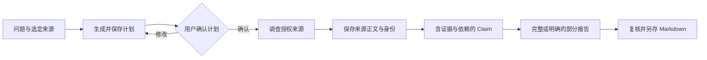

[English](workflows.md) | [简体中文](workflows.zh-CN.md) · [文档导航](README.zh-CN.md)

# 业务流程

## 本地资料问答

1. 配置模型后，通过左侧导航的 **New chat** 进入新的主对话，或从最近会话、**Chats** 打开已有会话。
2. 提供文字、选定授权资料或预期工作目录，说明要检查什么以及答案要求。
3. 发送一次并观察实际 Run/工具。目录确定执行位置，不提供操作系统沙箱；原生命令、写工具可能可用。
4. 对照原文检查答案。引用、资料版本或执行声明不明确时，查看 Session Details/Context 与工具证据。
5. 需要继续时提交新输入，重新打开历史不会重发旧请求。

证据不足时要求说明缺口，不猜事实。需要对所附文字独立推理，可启用扩展并使用 `general-analyst`，无工具角色不能核实外部事实。详见 [Subagent](subagents.zh-CN.md)。

## Deep Research

当前研究仅使用选定本地 `.txt`/`.md` 资料和已登记解析文档，不联网搜索或提取网页，无需 Tavily Key。

1. 从左侧导航打开 **Deep Research**，导入或选定本地资料、已有解析文档，输入问题和范围并创建研究；此业务页面使用关联的右侧 Assistant。
2. 在关联 Assistant 发送以生成计划，检查子问题、证据需求、预算和停止条件，按需修改。确认是独立用户操作，先确认再调查。
3. 在确认计划下调查，真实读取保留来源正文及 Run/ToolCall 身份。启用 subagents 后可将独立问题交给 `research-investigator`，父任务仍负责综合与保存。
4. 查看 **Evidence / Report**。Claim 将证据关系和依赖与计划问题关联；来源必须标明实际执行身份，原文与定位需匹配保存正文。
5. 满足产品覆盖和支持条件才保存完整报告，否则在部分报告中保留未解决问题。**Save report** 另存 Markdown 时重新核对报告与证据引用。

来源定位合法不等于语义正确，Report 自报覆盖是产品结果，不是独立质量评分。调查 Run 完成但报告未保存，不等于报告交付；独立证据与多跳质量检查见[评测](EVALUATION.zh-CN.md)。

## 发票复核

准备原始发票与外部生成的解析资料。开发导入使用 `data/invoices/agent-input/`，安装版使用产品数据根下 `imports/invoices/`。保留原件与解析关联；Host 负责登记读取，不自行解析原票。

1. 从左侧导航打开 **Invoices**，导入准备好的资料，查看 **Original / Parsed / Results**；在右侧 Assistant 中继续关联对话。
2. 点击 **Process this invoice**，再在 Assistant 点击 **Send**。处理和候选保存留有实际 Run/ToolCall 记录。
3. 选择候选，将票头、明细、金额、不确定性和来源定位与原件、解析证据对照。
4. **Fill with Agent** 调用真实表单操作，**Edit** 用于人工修改。Fill 需要原候选、目标、revision 以及匹配的应用回执；发出工具请求不证明已填入界面。
5. 保存复核后的编辑，明确 **Accept result**，再导出 JSON、CSV 或 Markdown。生成候选、人工编辑、保存版本、接受结果与外部导出副本是不同事实。

未保存编辑仅在当前窗口，不跨重启保留；离开时按 Save/Discard 提示处理。写入或 Fill 回复未知，应先查原操作；表单可见值不能替代保存候选或接受记录。

可选 `invoice-evidence-checker` 在固定范围内核对证据，不能保存候选、填表或接受结果。`/parallel-invoice-review` 请求证据与推理检查，应查看真实子卡片后再认定两项均完成，详细约束见 [Subagent](subagents.zh-CN.md)。

## 何时停止并核对

资料权限不匹配、执行停止未确认或必要历史保存不可用时停止，保留原错误、Run/ToolCall 与产物身份。不为替换含糊状态而重跑操作。[Runtime](agent-runtime.zh-CN.md)解释事实，[打包与恢复](packaging-and-recovery.zh-CN.md)解释数据恢复。
