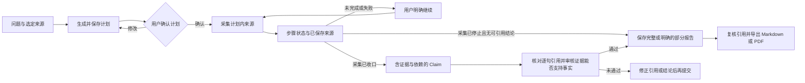

[English](workflows.md) | [简体中文](workflows.zh-CN.md) · [文档导航](README.zh-CN.md)

# 业务流程

**Chats**、**Invoices**、**Deep Research** 继续使用 AgentSession；持续发票事项从独立 **Personal Agent** 入口进入，使用 Pi Durable。

## 本地资料问答

1. 配置模型后，通过左侧导航的 **New chat** 进入新的主对话，或从最近会话、**Chats** 打开已有会话。
2. 提供文字、选定授权资料或预期工作目录，说明要检查什么以及答案要求。
3. 发送一次并观察实际 Run/工具。目录确定执行位置，不提供操作系统沙箱；原生命令、写工具可能可用。
4. 对照原文检查答案。引用、资料版本或执行声明不明确时，查看 Session Details/Context 与工具证据。
5. 需要继续时提交新输入，重新打开历史不会重发旧请求。

证据不足时要求说明缺口，不猜事实。需要对所附文字独立推理，可启用扩展并使用 `general-analyst`，无工具角色不能核实外部事实。详见 [Subagent](subagents.zh-CN.md)。

## Deep Research

研究可读取选定的本地 `.txt`、`.md` 与已登记的解析文档。新任务默认关闭 **Web search**。要开启联网，在实际执行的 Host 启动环境设置 `FLOWMATE_TAVILY_API_KEY` 并重启 Host。桌面本地模式从启动桌面的进程环境传递该变量，WinSW 模式从 Windows 服务启动环境读取。关闭联网不需要密钥。

1. 可先在 **Settings → General → Research preferences** 填写证据或报告偏好，点击 **Save research preferences**。默认文字为空，最多 8,192 UTF-8 字节；每次研究 Run 捕获当时保存的文字和 revision，保存本身不请求模型。
2. 打开 **Deep Research → New research**，输入问题与可选范围，按需导入或选择授权本地资料与解析文档。如果需要公开网页，打开 **Web search**。点击 **Create research**，再在关联 Assistant 中 **Send** 生成计划。当前发票不会被自动加入研究。
3. 检查已保存 Plan 的问题、证据需求、来源范围、预算和停止条件。开启 **Web search** 的计划必须包含网页步骤；已选本地资料时还须包含本地读取步骤。**Web requests to Tavily** 会列出搜索词、时间范围、排名和指定的公开网址。Tavily 会收到用于搜索和提取的词语与网址。请检查这些字段及 URL 的查询参数和片段，避免发送凭据、私有标识、本地路径或保密文字。需要时使用 **Revise plan**，再点击 **Confirm plan version** 启动调查。
4. 对带步骤的计划，查看 **Research steps** 和已保存来源入口。同一研究任务的父任务与 `research-investigator` 子任务合计最多同时进行 **2 路**来源采集，包括本地读取和 Tavily 搜索或正文提取。两路采集并发与四个子任务的上限分别计算。网页来源保存正文、链接、取证时间和已知的来源日期。父 Agent 执行已确认的 Tavily 步骤。搜索优先实时抓取。指定排名缺少候选时，保留查询、日期条件和排名补查一次，再提取选中网页的正文。当已选搜索结果缺少正文时，直接提取该网址。可将适合的独立问题委派给只读调查子代理，综合与保存由父 Agent 负责。
5. 打开 **Report**，在 **Saved report** 选择要查看的版本。点击正文中的 `[1]` 等标记，查看来源快照、引用原文、UTF-16 字符区间、采集时间和 Run／ToolCall。**Semantic review** 显示审核模型、策略、Run／ToolCall，以及逐句判定、事实片段、理由和引用。点击 **View saved passage** 可在 **Evidence** 中查看对应原文，点击 **Open Claim** 可检查支持或反驳该 Claim 的证据和依赖。网页来源还可用 **Open webpage** 在系统浏览器打开已保存的地址，这可能访问原网站。
6. 在 **Export format** 选择 Markdown 或 PDF，再点击 **Save report**。对于含逐句引用的报告，两种导出格式沿用同一套标记和引用，PDF 内的编号可跳到对应条目。带逐句引用的旧报告（格式 2）仍支持 PDF，并显示无独立语义审核记录；更早的章节级引用报告仍可查看和导出 Markdown。

新报告（格式 3）的正文每句话必须引用已保存 Claim 中的具体证据。保存时，Flowmate 核对 Claim 和计划归属、UTF-16 原文区间（含起点、不含终点）和采集 Run／ToolCall 回执。有结论时，系统会向所选模型服务发送报告草稿、研究问题和范围、来源元数据以及相关引文。每次符合条件的保存仅发出一次隔离请求，不带会话历史或工具，也不自动重试。审核占用 Run 的共享模型预算，并为 Assistant 回应留一次调用，因此保存时至少需要剩余两次调用及足够时间。核对或审核未通过则不保存报告。

审核者将每句话拆成可核验事实，对照引文检查主体、指标、数值、单位、时间、条件、否定和必要推理。Host 将各事实的判断汇总为下表中的句子结果。部分报告的正文同样要求每句通过。

| 句子结果 | 含义 | 保存行为 |
|---|---|---|
| `supported`，充分支持 | 全部事实充分支持，且审核覆盖完整 | 其余检查通过后可保存 |
| `partially_supported`，部分支持 | 存在充分或部分支持，但事实、条件或审核覆盖仍不完整，且未判定明确矛盾 | 拒绝保存 |
| `unsupported`，不支持 | 没有事实获得充分或部分支持，且未判定明确矛盾 | 拒绝保存 |
| `contradicted`，矛盾 | 至少一项事实与证据冲突 | 拒绝保存 |

保存被拒绝时，在 Assistant 查看原 `save_research_report` 的错误。Agent 可在剩余预算内缩小表述、修正引用或补充获准证据后再次提交。句子、引用或计划改变后须重新审核。已保存回执绑定具体报告、计划和写入 ToolCall。仅重复原已提交 ToolCall 且参数完全一致时返回原回执，修改报告须使用新的保存调用。

| 保存问题 | 处理方式 |
|---|---|
| 引用缺失、原文不匹配或采集记录无效 | 使用已保存证据及原采集回执修正引用 |
| 部分支持、不支持或矛盾 | 改写、补证或删除没有依据的表述 |
| 审核超时、预算不足或模型响应不完整 | 保留缺口，核对已确认的执行限制后再决定下一次尝试 |
| 报告或 ToolCall 结果过大 | 精简报告后重新提交，审核回执由 Host 生成 |
| 执行停止未确认 | 先核对原 Run 和 ToolCall，再继续 |

提交前的引用、语义和大小校验失败时，不写入新报告，也不更新当前报告指针。保存回复丢失或提交结果未知时，应先查询原 Run 和 ToolCall，再决定是否重试。打开或导出已保存报告使用其原审核记录。

完整报告要求计划内采集步骤全部成功，每个计划问题均有受支持的 Claim，所有引用的 Claim 及其依赖均为受支持状态，且没有未解决问题。活动采集停止后，部分报告可在正文之外记录失败或未完成的步骤、局限、冲突和未解决问题。没有可引用的结论时，部分报告可留空正文并记录证据缺口；此时不会调用审核模型。

带步骤计划的 Checkpoint 展示 `pending`、`running`、`succeeded`、`failed` 或 `interrupted`。成功要求工具回执成功、清理已确认且来源已保存；模型自述不等于回执。仍有 pending、running 或 interrupted 步骤时不能保存 Claim。失败步骤保留供排查，在其成功前不能保存完整报告。

已确认计划存在待执行、失败或中断步骤时，界面显示 **Continue research**；选定研究 Session、模型与运行时就绪，没有活跃 Run 且页面未在加载或保存时才能点击。该操作明确启动新一轮调查：原来源仍可用时成功步骤复用已保存来源，其他符合条件的步骤可再次尝试。原步骤停止未确认时仍会受阻，应先查询原 Run 与 ToolCall，不能盲目启动替代执行。重新打开页面或查询历史不会请求模型或重放工具；重启后可以恢复有效保存的研究焦点，但迟到的恢复不会覆盖用户后来的选择。

要在已有任务上切换 **Web search**，请等待任务的 Run 和工具确认停止，再使用任务开关。开启和关闭均保留同一研究任务、Assistant 会话、本地资料 ID 与历史。旧计划不能再继续；请在 Assistant 发送问题生成新计划并确认，切换本身不会启动 Run。关闭后，新调查不能采集或引用网页证据，包括旧计划保存的快照。历史报告、来源和导出仍按原授权可用。改变选定的本地资料需要新建研究任务。

旧的无 `steps` 计划仍可读取并沿用原有读取／查询流程，不会自动出现步骤列表；需要步骤跟踪时，重新生成并确认新计划。焦点、历史、偏好和 Checkpoint 的生命周期见 [Agent Runtime](agent-runtime.zh-CN.md#context-memory-layers)。

Claim 状态记录研究 Agent 的判断；单独审核记录模型对报告逐句引文支持程度的判断。涉及重要决定时，应直接核对原文。这两种判断均不保证结论为真，也不衡量真实场景的准确度。质量检查见[评测](EVALUATION.zh-CN.md)。调查 Run 完成但报告未保存时，仍未交付报告。

## 发票复核

准备原始发票与外部生成的解析资料。开发导入使用 `data/invoices/agent-input/`，安装版使用产品数据根下 `imports/invoices/`。保留原件与解析关联；Host 负责登记读取，不自行解析原票。

1. 从左侧导航打开 **Invoices**，导入准备好的资料，查看 **Original / Parsed / Results**；在右侧 Assistant 中继续关联对话。
2. 点击 **Process this invoice**，再在 Assistant 点击 **Send**。处理和候选保存留有实际 Run/ToolCall 记录。
3. 选择候选，将票头、明细、金额、不确定性和来源定位与原件、解析证据对照。
4. **Fill with Agent** 调用真实表单操作，**Edit** 用于人工修改。Fill 需要原候选、目标、revision 以及匹配的应用回执；发出工具请求不证明已填入界面。
5. 保存复核后的编辑，明确 **Accept result**，再导出 JSON、CSV 或 Markdown。生成候选、人工编辑、保存版本、接受结果与外部导出副本是不同事实。

未保存编辑仅在当前窗口，不跨重启保留；离开时按 Save/Discard 提示处理。写入或 Fill 回复未知，应先查原操作；表单可见值不能替代保存候选或接受记录。

可选 `invoice-evidence-checker` 在固定范围内核对证据，不能保存候选、填表或接受结果。`/parallel-invoice-review` 请求证据与推理检查，应查看真实子卡片后再认定两项均完成，详细约束见 [Subagent](subagents.zh-CN.md)。

## Personal Agent：持续发票事项

配置、执行对象和恢复细节见独立的 [Personal Agent 指南](personal-agent.zh-CN.md)。

提交前选择本地工作区，或先[连接云端工作区](personal-agent.zh-CN.md#cloud-workspace)。云端服务运行时，符合条件的云端执行可以继续。本地关闭桌面后执行和 Windows 开机恢复需要单独验收。

1. 打开 **Personal Agent**，先确认并保存其模型、工具与资源配置，再固定选择一组已有解析的发票，填写目标并明确提交事项。创建入口仅在本模块；**Invoices** 保持单票选择与编辑。新增票据另建事项，不静默扩大已保存集合。
2. 查看事项概览和逐票 Todo，补充所需说明或获准材料，分别检查是否已保存、已授权执行或受阻。尝试停止或失败后，符合条件时使用 **Continue work**。
3. 通过 **View original invoice / review** 对照来源复核候选。本地在 **Invoices** 选择 **Accept result**，云端在复核面板选择 **Accept candidate**。返回事项后点击 **Attach confirmed acceptance**。如需结束该票并标记为拒绝或排除，使用对应处置操作并填写原因。普通拒绝候选不结束该票。
4. 查看尝试和已保存证据。**Stop current attempt** 与 **Cancel entire work** 是不同操作；每张票都需要最终处置，必要写入与执行收口后事项才能完成。查看历史不会发起模型调用。

父任务可以将发票取证问题委派给有界只读子任务。Durable 路径见 [Subagent](subagents.zh-CN.md)，停止、恢复和关联事项详见 [Personal Agent](personal-agent.zh-CN.md)。

初次尝试结束且原候选和证据可用时，可先预览将共享的内容，再确认[独立发票复核](personal-agent.zh-CN.md#personal-peer-review)。交互工具按[审批与重连流程](personal-agent.zh-CN.md#personal-approvals)处理。在 **Timeline** 分别查看业务回执与模型观测。新聊天或 Work 的记忆授权从[长期记忆](agent-runtime.zh-CN.md#openviking-memory)管理。

## 何时停止并核对

资料权限不匹配、执行停止未确认或必要历史保存不可用时停止，保留原错误、Run/ToolCall 与产物身份。不为替换含糊状态而重跑操作。[Runtime](agent-runtime.zh-CN.md)解释事实，[打包与恢复](packaging-and-recovery.zh-CN.md)解释数据恢复。
